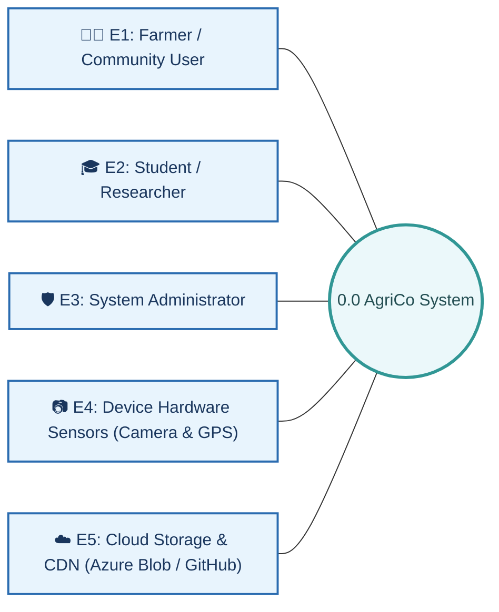
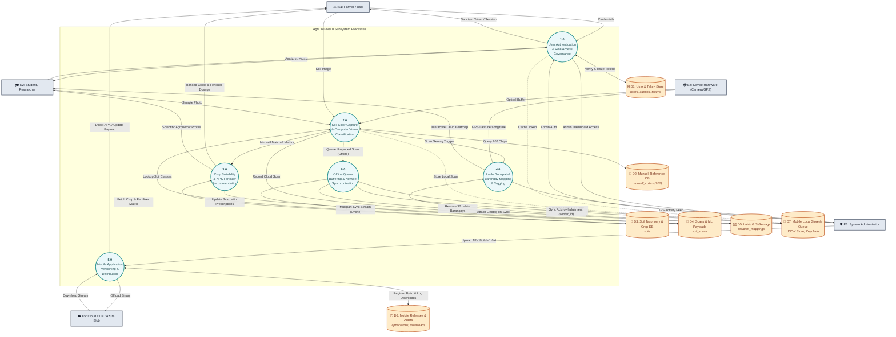
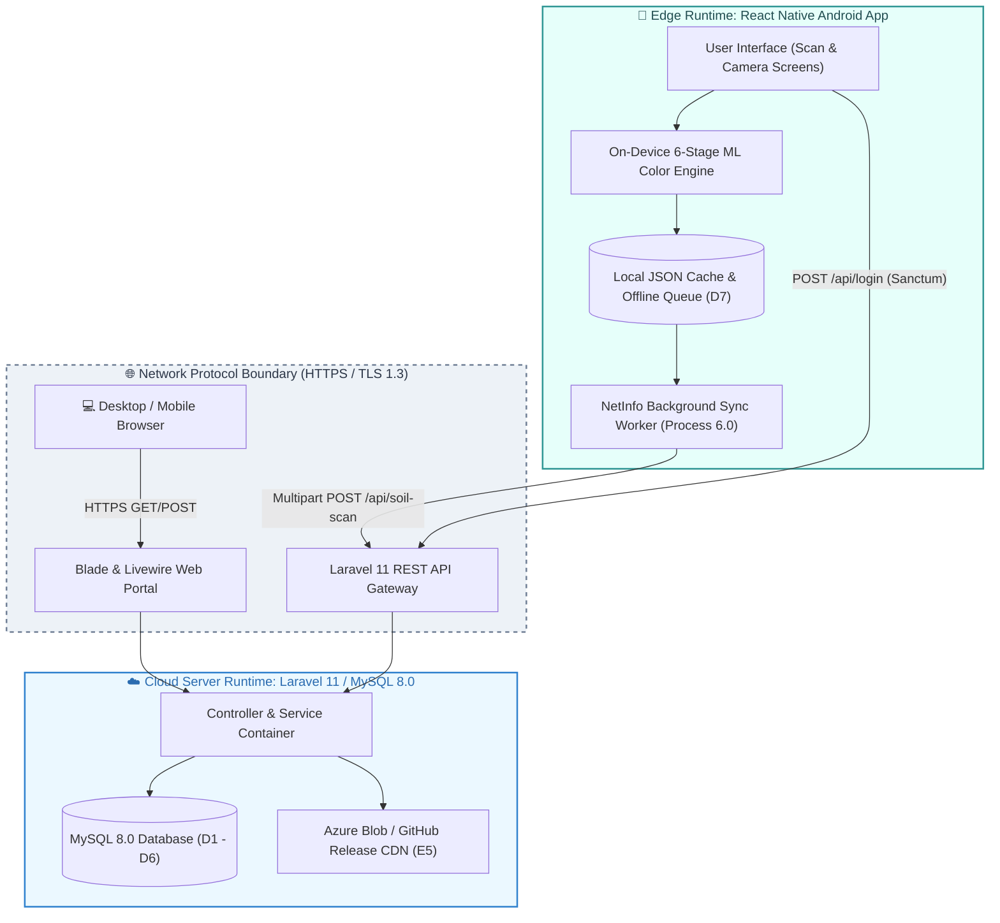

# 🌾 AgriCo Data Flow Diagram (DFD Level 0): Website & Mobile Application

Comprehensive Data Flow Diagram (Level 0 Context Diagram and Decomposed Level 0 Subsystem Processes), Data Flow Dictionary, External Entity Specifications, Data Store Definitions, and Platform Boundary Analysis for the **AgriCo Soil Analysis and Crop Recommendation System**.

---

## 📑 Table of Contents
1. [DFD Methodology & Notation Standards](#1-dfd-methodology--notation-standards)
2. [External Entities Catalog (E1 – E5)](#2-external-entities-catalog-e1--e5)
3. [Data Stores Specification (D1 – D7)](#3-data-stores-specification-d1--d7)
4. [Level 0 System Context Diagram (Context-Level DFD)](#4-level-0-system-context-diagram-context-level-dfd)
   - [4.1 Context Diagram Architecture (Mermaid)](#41-context-diagram-architecture-mermaid)
   - [4.2 External Entity Inflow & Outflow Packet Matrix](#42-external-entity-inflow--outflow-packet-matrix)
5. [Decomposed Level 0 DFD (Subsystem Processes 1.0 – 6.0)](#5-decomposed-level-0-dfd-subsystem-processes-10--60)
   - [5.1 Decomposed DFD Level 0 Architecture (Mermaid)](#51-decomposed-dfd-level-0-architecture-mermaid)
   - [5.2 Subsystem Process Profiles](#52-subsystem-process-profiles)
6. [Data Flow Dictionary & Packet Schema](#6-data-flow-dictionary--packet-schema)
7. [Process-to-Data Store CRUD Matrix](#7-process-to-data-store-crud-matrix)
8. [Platform Execution Boundaries: Web Portal vs. Mobile Client](#8-platform-execution-boundaries-web-portal-vs-mobile-client)
9. [Verification & Codebase Grounding](#9-verification--codebase-grounding)

---

## 1. DFD Methodology & Notation Standards

This documentation adheres to standard structured systems analysis (Gane & Sarson and Yourdon & Coad conventions):

| Symbol / Element | Notation | Visual Standard | Description |
| :--- | :--- | :--- | :--- |
| **External Entity** | `E[Number]` | `[Rectangle]` | An external actor, hardware component, or third-party service that produces data into or consumes data from the system. |
| **Process** | `[Number.0]` | `((Circle / Rounded))` | A transformative business function that processes, calculates, or validates data flows. |
| **Data Store** | `D[Number]` | `[(Cylinder / Open End)]` | A repository of data at rest (MySQL relational tables or on-device persistent cache). |
| **Data Flow** | `DF-[Number]` | `-->|packet|` | A directed vector carrying a specified data packet between entities, processes, and stores. |

---

## 2. External Entities Catalog (E1 – E5)



### Detailed External Entity Profiles:

1. **`E1: Farmer & Community User` (Primary Consumer - Web & Mobile Client)**
   - **Role:** Performs in-field soil photography, views Munsell color matching, receives crop recommendations, calculates fertilizer requirements, and submits suspension appeals.
   - **Inflows to System:** Account credentials, raw soil imagery, manual GPS coordinates, soil notes, appeal tickets (`user_requests`).
   - **Outflows from System:** Soil classification cards, crop ranking lists, NPK fertilizer dosage formulas, historical scan logs, mobile APK downloads.

2. **`E2: Agriculture Student & Researcher` (Academic Consumer - Web & Mobile Client)**
   - **Role:** Conducts scientific soil sampling, verifies student status (`student_id`, `section`), conducts multi-region crop feasibility studies, and inspects Lal-lo GIS soil heatmaps.
   - **Inflows to System:** Academic credentials, student verification forms, research scan notes, GIS query filters.
   - **Outflows from System:** Munsell standard scientific metrics (Hue, Value, Chroma, Delta E), Lal-lo barangay distribution data, agronomic research exports.

3. **`E3: System Administrator` (Platform Controller - Web Portal)**
   - **Role:** Governs system users, monitors suspensions, edits Munsell reference standards (207 chips), creates soil classes, uploads APK release packages (`v1.0.4`), and audits system actor logs.
   - **Inflows to System:** Admin credentials (`ADM-XXXX`), Munsell catalog updates, APK binaries & changelogs, user moderation commands, FAQ articles.
   - **Outflows from System:** Admin dashboard analytics, audit telemetry (`system_actors`), pending appeal queues, download telemetry metrics.

4. **`E4: Mobile Device Hardware Sensors` (Android On-Device I/O)**
   - **Role:** Physical hardware sensors on the user's mobile device providing real-time data inputs.
   - **Inflows to System:** Optical camera stream (raw RGB matrices), hardware GPS location coordinates (Latitude, Longitude), network state telemetry (`NetInfo`).
   - **Outflows from System:** Camera focus/shutter commands, GPS permission queries, haptic vibration alerts.

5. **`E5: Cloud Storage & CDN` (Azure Blob Storage & GitHub Releases)**
   - **Role:** External distribution networks and object stores hosting large static binaries and assets.
   - **Inflows to System:** Binary upload confirmations, release download URLs, static asset CDN links.
   - **Outflows from System:** Packaged mobile APK artifacts (e.g. `agrico-app-v1.0.4.apk`), compressed image backups.

---

## 3. Data Stores Specification (D1 – D7)

| Store ID | Data Store Name | Physical Storage Technology | Schema / Entities Represented | Description |
| :--- | :--- | :--- | :--- | :--- |
| **`D1`** | **User Accounts & Token Store** | MySQL 8.0 Cloud Database | `users`, `admins`, `personal_access_tokens`, `password_reset_tokens` | User identities, hashed credentials, roles, 1-day suspension states, and Sanctum tokens. |
| **`D2`** | **Munsell Standards Database** | MySQL 8.0 Cloud Database | `munsell_colors` (207 Reference Chips) | Standardized Munsell color grid (Hue, Value, Chroma, Hex, Organic index) used for classification. |
| **`D3`** | **Soil Taxonomy & Crop Agronomy Store** | MySQL 8.0 Cloud Database | `soils` | Soil varieties, soil types, organic matter percentages, and associated suitable crops. |
| **`D4`** | **Soil Scans & ML Payloads Store** | MySQL 8.0 Cloud Database | `soil_scans` | Historical cloud scan records, image file paths, 6-stage ML JSON payloads (`regions_data`), and timestamps. |
| **`D5`** | **Lal-lo Barangay GIS Geolocation Store** | MySQL 8.0 Cloud Database | `location_mappings` | Field-captured GPS latitude/longitude coordinates mapped to the 37 barangays of Lal-lo, Cagayan. |
| **`D6`** | **Mobile Releases & Download Audit Store** | MySQL 8.0 Cloud Database | `applications`, `downloads`, `application_actors` | Published APK versions (`v1.0.4`), release notes, file sizes, and download telemetry records. |
| **`D7`** | **Mobile Client Local Storage & Sync Queue** | Android Local File System (`AsyncStorage` / Encrypted `Keychain`) | `local_scan_history.json`, `agrico_offline_scans_queue`, `Keychain` | Offline persistent scan history, unsynced multipart upload queue, and encrypted mobile bearer tokens. |

---

## 4. Level 0 System Context Diagram (Context-Level DFD)

The **Context Diagram (Level 0 Context DFD)** establishes the highest level of abstraction, depicting the entire AgriCo platform as a single operational bubble interacting with external actors and services.

### 4.1 Context Diagram Architecture (Mermaid)

```mermaid
flowchart TD
    subgraph ExternalEntities ["External Entities (Sources & Sinks)"]
        E1["🧑‍🌾 E1: Farmer / Community User"]
        E2["🎓 E2: Student / Researcher"]
        E3["🛡️ E3: System Administrator"]
        E4["📷 E4: Device Hardware Sensors (Camera & GPS)"]
        E5["☁️ E5: Cloud Storage & CDN (Azure Blob / GitHub)"]
    end

    subgraph CentralSystem ["Central System Boundary"]
        P0(("<b>0.0</b><br/><b>AgriCo Soil Analysis</b><br/><b>& Crop Recommendation</b><br/><b>System</b><br/><i>(Web Portal & Mobile App)</i>"))
    end

    %% Inflows from E1
    E1 -->|"DF-01: Credentials & Registration"| P0
    E1 -->|"DF-02: Soil Sample Photo & Geotag"| P0
    E1 -->|"DF-03: Crop & Fertilizer Parameters"| P0
    E1 -->|"DF-04: Account Appeal Request"| P0

    %% Outflows to E1
    P0 -->|"DF-05: Auth Session & Profile Status"| P0_O1[" "]
    P0_O1 -->|Delivery| E1
    P0 -->|"DF-06: Soil Classification & Munsell Match"| P0_O2[" "]
    P0_O2 -->|Delivery| E1
    P0 -->|"DF-07: Crop Recommendations & Fertilizer Plan"| P0_O3[" "]
    P0_O3 -->|Delivery| E1
    P0 -->|"DF-08: Mobile APK Binary (v1.0.4)"| P0_O4[" "]
    P0_O4 -->|Delivery| E1

    %% Inflows from E2
    E2 -->|"DF-09: Student Academic Credentials"| P0
    E2 -->|"DF-10: Research Soil Photo & Metadata"| P0
    E2 -->|"DF-11: Lal-lo Barangay GIS Queries"| P0

    %% Outflows to E2
    P0 -->|"DF-12: Scientific Soil Metrics (Hue/Val/Chroma)"| P0_O5[" "]
    P0_O5 -->|Delivery| E2
    P0 -->|"DF-13: Interactive Lal-lo GIS Heatmap"| P0_O6[" "]
    P0_O6 -->|Delivery| E2

    %% Inflows from E3
    E3 -->|"DF-14: Admin Credentials (ADM-XXXX)"| P0
    E3 -->|"DF-15: Soil & Munsell Catalog Updates"| P0
    E3 -->|"DF-16: Application Release Package (APK)"| P0
    E3 -->|"DF-17: User Moderation & Appeal Decisions"| P0

    %% Outflows to E3
    P0 -->|"DF-18: Admin Telemetry & Analytics Dashboard"| P0_O7[" "]
    P0_O7 -->|Delivery| E3
    P0 -->|"DF-19: Audit Trail Logs & Download Metrics"| P0_O8[" "]
    P0_O8 -->|Delivery| E3

    %% Inflows from E4
    E4 -->|"DF-20: Camera Raw Optical Stream"| P0
    E4 -->|"DF-21: Hardware GPS Coordinates"| P0

    %% Outflows to E5
    P0 -->|"DF-22: APK Binary & Media Offload"| E5

    %% Inflows from E5
    E5 -->|"DF-23: CDN Direct Download Stream"| P0

    style P0 fill:#2d3748,stroke:#48bb78,stroke-width:4px,color:#ffffff
    style E1 fill:#ebf8ff,stroke:#3182ce,stroke-width:2px,color:#2b6cb0
    style E2 fill:#f0fff4,stroke:#38a169,stroke-width:2px,color:#276749
    style E3 fill:#fffaf0,stroke:#dd6b20,stroke-width:2px,color:#9c4221
    style E4 fill:#faf5ff,stroke:#805ad5,stroke-width:2px,color:#553c9e
    style E5 fill:#f7fafc,stroke:#718096,stroke-width:2px,color:#4a5568
    style P0_O1 display:none;
    style P0_O2 display:none;
    style P0_O3 display:none;
    style P0_O4 display:none;
    style P0_O5 display:none;
    style P0_O6 display:none;
    style P0_O7 display:none;
    style P0_O8 display:none;
```

---

### 4.2 External Entity Inflow & Outflow Packet Matrix

| Flow ID | Flow Direction | External Entity | Flow Name | Data Packet Content |
| :--- | :--- | :--- | :--- | :--- |
| **`DF-01`** | Inflow | `E1: Farmer` | User Registration & Login | `{email, password, role='farmer', full_name}` |
| **`DF-02`** | Inflow | `E1: Farmer` | Soil Capture Packet | `{image_file, latitude, longitude, scan_note}` |
| **`DF-03`** | Inflow | `E1: Farmer` | Recommendation Filter Request | `{soil_id, farm_area_hectares, target_crop}` |
| **`DF-04`** | Inflow | `E1: Farmer` | Account Suspension Appeal | `{request_code, user_name, user_email, description}` |
| **`DF-05`** | Outflow | `E1: Farmer` | Authentication & Status Packet | `{sanctum_token, user_id, status, role, suspension_expiry}` |
| **`DF-06`** | Outflow | `E1: Farmer` | Soil Classification Result | `{munsell_code, color_name, soil_type, organic_matter, delta_e}` |
| **`DF-07`** | Outflow | `E1: Farmer` | Agronomic Prescription Plan | `{ranked_crops[], fertilizer_recommendation{urea, npk, bags_50kg}}` |
| **`DF-08`** | Outflow | `E1: Farmer` | Mobile Application Installer | `{version='v1.0.4', apk_binary_stream, sha256_hash}` |
| **`DF-09`** | Inflow | `E2: Student` | Academic Verification Login | `{email, password, student_id, section, role='student'}` |
| **`DF-10`** | Inflow | `E2: Student` | Scientific Soil Sampling | `{sample_image, scientific_notes, gps_coords}` |
| **`DF-11`** | Inflow | `E2: Student` | GIS Heatmap Query Request | `{barangay_name, soil_type_filter, date_range}` |
| **`DF-12`** | Outflow | `E2: Student` | Scientific Color Metrics | `{hue, value, chroma, hex_code, delta_e_tolerance}` |
| **`DF-13`** | Outflow | `E2: Student` | Lal-lo Geospatial Distribution | `{barangays[37], pins[{lat, lng, soil_type, scan_count}]}` |
| **`DF-14`** | Inflow | `E3: Admin` | Administrator Authentication | `{email, password, admin_id='ADM-XXXX'}` |
| **`DF-15`** | Inflow | `E3: Admin` | Soil Catalog Administration | `{soil_name, description, hex_color, munsell_code, admin_id}` |
| **`DF-16`** | Inflow | `E3: Admin` | New Mobile Release Deployment | `{version, apk_file, release_notes, is_maintenance}` |
| **`DF-17`** | Inflow | `E3: Admin` | Moderation & Suspension Action | `{target_user_id, action, suspend_reason, duration_days=1}` |
| **`DF-18`** | Outflow | `E3: Admin` | Admin Intelligence Dashboard | `{total_scans, active_users, lal_lo_coverage, server_metrics}` |
| **`DF-19`** | Outflow | `E3: Admin` | Audit Trail & Download Reports | `{audit_logs[], download_telemetry[], appeal_queue[]}` |
| **`DF-20`** | Inflow | `E4: Hardware` | Camera Optical Buffer | `{raw_rgb_pixel_buffer, image_dimensions}` |
| **`DF-21`** | Inflow | `E4: Hardware` | Device Geolocation Telemetry | `{hardware_latitude, hardware_longitude, accuracy_meters}` |
| **`DF-22`** | Outflow | `E5: CDN/Cloud`| Static Binary Upload Request | `{apk_binary_payload, release_tag='v1.0.4'}` |
| **`DF-23`** | Inflow | `E5: CDN/Cloud`| CDN Asset Delivery Stream | `{cdn_download_url, content_range_bytes}` |

---

## 5. Decomposed Level 0 DFD (Subsystem Processes 1.0 – 6.0)

In this decomposition, Process `0.0` is expanded into **six major operational subsystem processes**, exposing the interaction between the **Central Laravel 11 Cloud Architecture**, the **React Native On-Device Engine**, and the **seven data stores (`D1` – `D7`)**.

### 5.1 Decomposed DFD Level 0 Architecture (Mermaid)



---

### 5.2 Subsystem Process Profiles

#### `1.0 User Authentication & Role Access Governance`
* **Objective:** Authenticate user accounts, manage role-based permissions (Farmer, Student, Researcher, Admin, Super Admin), handle 1-day suspensions with automated expiration, and issue Laravel Sanctum bearer tokens for the mobile client.
* **Inputs:** Credentials from `E1`, `E2`, `E3`; token validation queries from `D1`.
* **Outputs:** Sanctum tokens (`Personal_Access_Token`), session cookies, account status notifications, and token storage in `D7`.
* **Stores Touched:** Read/Write `D1: User Accounts & Token Store`.

#### `2.0 Soil Color Capture & Computer Vision Classification`
* **Objective:** Ingest optical camera frames or uploaded images, crop center 300x300 ROIs, extract dominant color statistics, compare against the 207 Munsell reference chips using the CIE Delta E algorithm, and classify soil types.
* **Inputs:** Optical frames from `E4`, uploads from `E1`/`E2`, reference color vectors from `D2`.
* **Outputs:** Munsell classification (`Full_Code`, `Hue`, `Value`, `Chroma`, `Color_Name`, `Organic_Index`), scan record in `D4`, and local scan in `D7`.
* **Stores Touched:** Read `D2: Munsell Reference DB`, Read `D3: Soil Taxonomy DB`, Write `D4: Scans Store`, Write `D7: Mobile Local Store`.

#### `3.0 Crop Suitability & NPK Fertilizer Recommendation Engine`
* **Objective:** Take the identified soil profile, organic matter index, and Lal-lo geographic parameters to rank agricultural crops (Rice, Corn, Tobacco, Peanut, Cassava, Eggplant) and calculate precise NPK fertilizer requirements in 50kg bags.
* **Inputs:** Munsell matching output from `2.0`, crop agronomic tables from `D3`.
* **Outputs:** Crop recommendation lists with suitability ratings, fertilizer dosage cards, and updated scan records in `D4` and `D7`.
* **Stores Touched:** Read `D3: Soil Taxonomy & Crop DB`, Update `D4: Scans Store`, Update `D7: Mobile Local Store`.

#### `4.0 Lal-lo Geospatial Barangay Mapping & Telemetry Tagging`
* **Objective:** Bind field GPS coordinates to one of the 37 barangays of Lal-lo, Cagayan, generate GIS pins, and feed geospatial heatmaps indicating soil distribution and crop productivity.
* **Inputs:** Geolocation coordinates from `E4`, scan references from `2.0`.
* **Outputs:** Spatial coordinate records in `D5`, interactive GIS heatmap views for `E2` and `E3`.
* **Stores Touched:** Write `D5: Lal-lo GIS Geotags`.

#### `5.0 Mobile Application Versioning & Distribution Manager`
* **Objective:** Manage mobile application release life cycles, host production APK builds (e.g. `v1.0.4`), track download telemetry across direct APK and QR code channels, and enforce maintenance gates.
* **Inputs:** APK packages from `E3`, download queries from `E1`.
* **Outputs:** Binary streams to `E1`, upload offloads to `E5`, download logs in `D6`.
* **Stores Touched:** Read/Write `D6: Mobile Releases & Audits`.

#### `6.0 Offline Queue Buffering & Network Synchronization`
* **Objective:** Enable 100% autonomous mobile operation without cellular connectivity by caching scans locally and executing background synchronization when internet connectivity resumes.
* **Inputs:** Local scan records and queued payloads in `D7`, connectivity state from `E4`.
* **Outputs:** Multipart HTTP POST requests to `D4` and `D5`, server scan ID confirmation back to `D7`.
* **Stores Touched:** Read/Write `D7: Mobile Client Local Store & Queue`, Write `D4: Scans Store`, Write `D5: Lal-lo GIS Geotags`.

---

## 6. Data Flow Dictionary & Packet Schema

This dictionary defines every data flow packet crossing subsystem boundaries:

| Flow ID | Flow Name | Source | Destination | Packet Structure & Data Types | Protocol / Medium |
| :--- | :--- | :--- | :--- | :--- | :--- |
| **`DF-P1-IN`** | Login Request | `E1, E2, E3` | `1.0 Auth` | `{email: String, password: String, role?: String}` | HTTPS POST |
| **`DF-P1-OUT`** | Token & Claims | `1.0 Auth` | `E1, E2, E3` | `{token: String(64), user_id: String, role: String, expires_at: Datetime}` | JSON Response |
| **`DF-P1-D1`** | Account Query | `1.0 Auth` | `D1 Store` | `SELECT * FROM users WHERE email = ?` | SQL Query / TCP |
| **`DF-P2-IN`** | Image Input | `E1, E4` | `2.0 Vision` | `{image_file: Binary, camera_meta: JSON}` | Local IPC / HTTP |
| **`DF-P2-D2`** | Munsell Query | `2.0 Vision` | `D2 Store` | `SELECT * FROM munsell_colors WHERE status = 'ACTIVE'` | In-Memory / SQL |
| **`DF-P2-ML`** | 6-Stage ML Output | `2.0 Vision` | `3.0 Crop` | `{munsell_code: String, hex: String, delta_e: Float, organic_pct: Float}` | Internal Pipeline |
| **`DF-P2-D4`** | Cloud Scan Record | `2.0 Vision` | `D4 Store` | `{scan_image: Path, regions_data: JSON, user_id: String, soil_id: Int}` | SQL INSERT |
| **`DF-P2-D7`** | Local Scan Cache | `2.0 Vision` | `D7 Store` | `{scanId: UUID, munsellCode: String, imageUri: String, syncState: 'queued'}` | JSON File I/O |
| **`DF-P3-D3`** | Crop Profile Query | `3.0 Crop` | `D3 Store` | `SELECT * FROM soils WHERE soil_id = ?` | SQL Query |
| **`DF-P3-OUT`** | Prescription Packet | `3.0 Crop` | `E1, E2` | `{crops: [{name: String, score: Float}], fertilizer: {urea_bags: Int, npk_bags: Int}}`| View / JSON |
| **`DF-P4-IN`** | GPS Capture | `E4 Sensors` | `4.0 GIS` | `{latitude: Decimal(10,8), longitude: Decimal(11,8)}` | Device Driver |
| **`DF-P4-D5`** | GIS Pin Insert | `4.0 GIS` | `D5 Store` | `{latitude: Decimal, longitude: Decimal, barangay: String, soil_scan_id: Int}` | SQL INSERT |
| **`DF-P4-OUT`** | Heatmap Payload | `4.0 GIS` | `E2, E3` | `{barangays: [{name: String, scan_count: Int, dominant_soil: String}]}` | GeoJSON / Blade |
| **`DF-P5-IN`** | Release Deploy | `E3 Admin` | `5.0 Version` | `{version: 'v1.0.4', apk_binary: File, release_notes: Text}` | Multipart POST |
| **`DF-P5-D6`** | Release Record | `5.0 Version` | `D6 Store` | `{application_name: String, version: String, file_path: URL, is_maintenance: Bool}`| SQL INSERT |
| **`DF-P5-OUT`** | APK Download | `5.0 Version` | `E1 Farmer` | `Binary octet-stream (agrico-app-v1.0.4.apk)` | HTTP 200 Stream |
| **`DF-P6-BUF`** | Offline Buffer | `6.0 Sync` | `D7 Store` | `{queueId: UUID, imageUri: Path, attempts: 0, queuedAt: ISO8601}` | Local Storage |
| **`DF-P6-NET`** | Multipart Sync | `6.0 Sync` | `D4 Store` | `POST /api/soil-scan {image: File, latitude: Float, longitude: Float}` | HTTPS Multipart |
| **`DF-P6-ACK`** | Sync Complete ACK | `D4 Store` | `6.0 Sync` | `{success: true, soil_scan_id: Int}` | JSON Response |

---

## 7. Process-to-Data Store CRUD Matrix

The matrix below maps data access controls between each subsystem process and the seven data stores:

| Subsystem Process | D1: Users & Tokens | D2: Munsell 207 | D3: Soil & Crops | D4: Scans & ML | D5: Lal-lo GIS | D6: App Releases | D7: Mobile Cache |
| :--- | :---: | :---: | :---: | :---: | :---: | :---: | :---: |
| **`1.0` User Auth & Governance** | **C, R, U** | — | — | — | — | — | **C, R (Token)** |
| **`2.0` Soil Color & Vision** | — | **R** | **R** | **C, R** | — | — | **C, R** |
| **`3.0` Crop & Fertilizer Engine** | — | — | **R** | **U** | — | — | **U** |
| **`4.0` Lal-lo GIS Mapping** | — | — | **R** | **R** | **C, R** | — | — |
| **`5.0` App Versioning & Release** | — | — | — | — | — | **C, R, U** | — |
| **`6.0` Offline Queue & Sync** | **R (Bearer)** | — | — | **C (Cloud)** | **C (Cloud)** | — | **C, R, U, D** |

*Legend: **C** = Create (Insert), **R** = Read (Select), **U** = Update, **D** = Delete (or Purge from Queue).*

---

## 8. Platform Execution Boundaries: Web Portal vs. Mobile Client

The AgriCo platform divides operational execution across two major execution runtimes:



### Execution Boundary Breakdown:
1. **Edge On-Device Execution (Autonomous):**
   - Camera frame capture and hardware crop.
   - CIE Delta E color distance computation against pre-cached 207 Munsell profiles.
   - Local storage in `local_scan_history.json` and queue buffering in `agrico_offline_scans_queue`.
   - Guaranteed full operational scanning functionality without mobile data or Wi-Fi.

2. **Network Boundary Crossing:**
   - Network connectivity checked via `@react-native-community/netinfo`.
   - Bearer token authentication via `Personal_Access_Token` stored securely in the Android Keystore.
   - Resilient multipart sync uploads with retry limit (`attemptCount <= 5`).

3. **Cloud Web Execution:**
   - Administration dashboard, user moderation, and 1-day suspension toggles.
   - Munsell standard database edits and Lal-lo GIS barangay pin heatmaps.
   - Mobile APK package hosting (`v1.0.4`) and automated GitHub Release syncing.

---

## 9. Verification & Codebase Grounding

Every process, data packet, and store in this Level 0 DFD specification corresponds directly to functional files in the AgriCo codebase:

| DFD Element | Codebase Implementation Reference | Verification Evidence |
| :--- | :--- | :--- |
| **`Process 1.0`** | `app/Http/Controllers/AuthController.php`<br/>`app/Models/User.php` | Sanctum tokens, Bcrypt auth, role policies (`farmer`, `student`, `admin`), 1-day suspensions. |
| **`Process 2.0`** | `app/Http/Controllers/SoilScanController.php`<br/>`rn-cli-app/src/screens/ScanResultScreen.js` | 6-stage ML pipeline (`regions_data`), 300x300 ROI cropping, Delta E calculation. |
| **`Process 3.0`** | `app/Models/Soil.php`<br/>`database/migrations/2026_01_01_000003_create_soils_table.php` | Soil profile matching, organic matter classification, fertilizer dosage formulas. |
| **`Process 4.0`** | `app/Models/LocationMapping.php`<br/>`app/Http/Controllers/GISController.php` | 37 Lal-lo barangay polygon/centroid matching, latitude/longitude bounds. |
| **`Process 5.0`** | `app/Http/Controllers/ApplicationController.php`<br/>`app/Models/Application.php` | `v1.0.4` APK downloads, sha256 checksums, maintenance toggle, download counts. |
| **`Process 6.0`** | `rn-cli-app/src/services/scanSyncService.js`<br/>`rn-cli-app/src/services/localScanStore.js` | Offline queue buffer, NetInfo sync triggers, multipart background transmission. |
| **`Store D1`** | `database/migrations/2026_01_01_000001_create_users_table.php` | User accounts and token authentication tables. |
| **`Store D2`** | `database/migrations/2026_01_01_000004_create_munsell_colors_table.php`| 207 Munsell soil color reference rows. |
| **`Store D3`** | `database/migrations/2026_01_01_000003_create_soils_table.php` | Soil catalog and crop recommendation tables. |
| **`Store D4`** | `database/migrations/2026_01_01_000005_create_soil_scans_table.php` | Multi-region ML JSON payloads and image storage paths. |
| **`Store D5`** | `database/migrations/2026_01_01_000006_create_location_mappings_table.php` | GPS coordinates and Lal-lo barangay geotags. |
| **`Store D6`** | `database/migrations/2026_01_01_000007_create_applications_table.php`| APK release management and download logging. |
| **`Store D7`** | `rn-cli-app/src/services/localScanStore.js` | On-device persistent JSON file and offline sync queue. |
