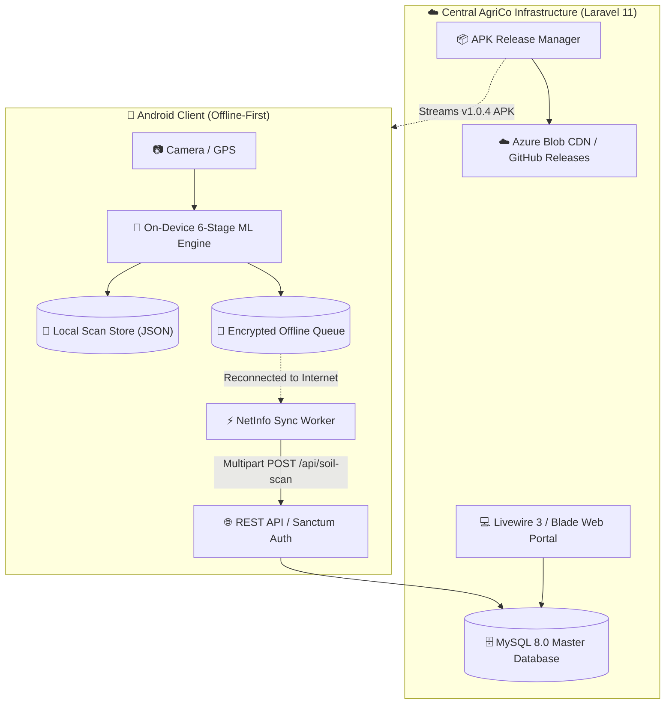
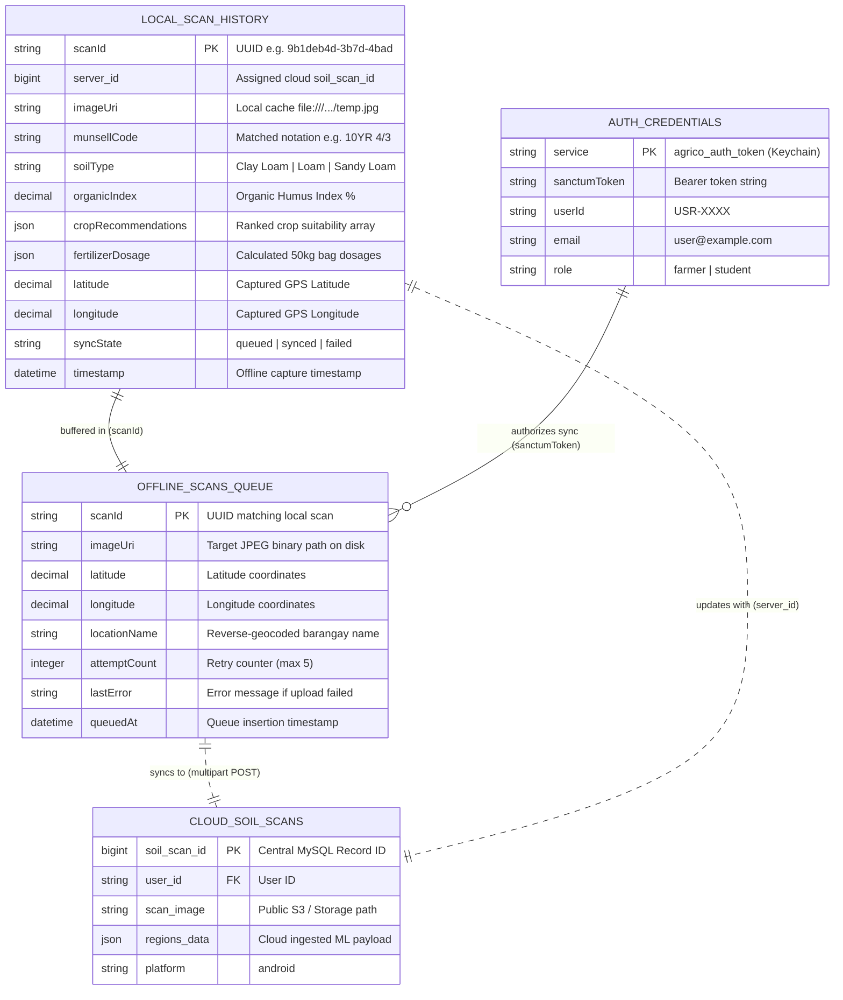

# 🌾 AgriCo Entity Relationship & Database Data Dictionary: Website & Mobile Application

Comprehensive Entity Relationship Diagrams (ERD), table attributes, data dictionaries, constraints, and relational schemas for the **AgriCo Soil Analysis and Crop Recommendation System**, covering both the **Central Cloud Database (Laravel 11 / MySQL 8.0)** and the **Mobile Client Local Storage (React Native / Offline Cache & Keychains)**.

---

## 📑 Table of Contents
1. [Architecture & Conceptual Domain Model](#1-architecture--conceptual-domain-model)
2. [Master Entity Relationship Diagram (ERD)](#2-master-entity-relationship-diagram-erd)
3. [Mobile Offline Storage & Sync ERD](#3-mobile-offline-storage--sync-erd)
4. [Entity, Attributes & Domain Reference Tables](#4-entity-attributes--domain-reference-tables)
   - [4.1 Central Database Entities](#41-central-database-entities)
   - [4.2 Mobile On-Device Local Entities](#42-mobile-on-device-local-entities)
5. [Data Dictionary & Technical Column Specifications](#5-data-dictionary--technical-column-specifications)
   - [5.1 Users & Authentication (`users`, `admins`, `personal_access_tokens`, `password_reset_tokens`)](#51-users--authentication)
   - [5.2 Soil Analysis & On-Device ML (`soils`, `munsell_colors`, `soil_scans`)](#52-soil-analysis--on-device-ml)
   - [5.3 GIS Geospatial Mapping (`location_mappings`)](#53-gis-geospatial-mapping)
   - [5.4 Mobile Application Distribution & Updates (`applications`, `downloads`, `application_actors`)](#54-mobile-application-distribution--updates)
   - [5.5 System Telemetry, Appeals & Knowledge Base (`user_requests`, `system_actors`, `faqs`, `faq_interactions`)](#55-system-telemetry-appeals--knowledge-base)
6. [Mobile Client On-Device Schemas](#6-mobile-client-on-device-schemas)
   - [6.1 Persistent Local Scan History (`local_scan_history.json`)](#61-persistent-local-scan-history)
   - [6.2 Offline Sync Queue Store (`agrico_offline_scans_queue`)](#62-offline-sync-queue-store)
   - [6.3 Client Authenticated Session (`Keychain`)](#63-client-authenticated-session)
7. [Relational Cardinality & Multiplicity Matrix](#7-relational-cardinality--multiplicity-matrix)
8. [Referential Integrity, Cascades & Indexing Strategy](#8-referential-integrity-cascades--indexing-strategy)

---

## 1. Architecture & Conceptual Domain Model

The AgriCo platform operates an **Offline-First Hybrid Architecture** bridging an enterprise Laravel 11 / MySQL backend with an autonomous React Native Android client:



### Domain Clusters:
1. **Identity & Governance Cluster:** User accounts (`users`), administrative personnel (`admins`), token credentials (`personal_access_tokens`), and password recovery (`password_reset_tokens`). Supports multi-tier roles (Farmer, Student, Researcher, Admin, Super Admin) and 1-day suspension penalties with appeal tickets (`user_requests`).
2. **Soil Analysis & Computer Vision Cluster:** Soil catalog (`soils`), the 207-standard Munsell reference grid (`munsell_colors`), and multi-platform scan records (`soil_scans`). Accommodates raw field photos, normalized 300x300 ROI patches, and structured 6-stage ML JSON outputs.
3. **Spatial Geotagging Cluster:** Location markers (`location_mappings`) binding field GPS coordinates with soil classification and 37 Lal-lo barangay polygon/point centroids.
4. **Binary Release Management Cluster:** Mobile client builds (`applications`), download telemetry (`downloads`), and publishing administrative associations (`application_actors`).
5. **Knowledge & Support Cluster:** Educational FAQs (`faqs`), engagement logging (`faq_interactions`), and system actor audit logs (`system_actors`).

---

## 2. Master Entity Relationship Diagram (ERD)

The following Mermaid ER diagram models the relational schema of the AgriCo central database, showing all entities, foreign keys, and cardinalities:

```mermaid
erDiagram
    %% Entities & Relationships

    USERS ||--o{ SOIL_SCANS : "conducts (user_id)"
    USERS ||--o{ DOWNLOADS : "downloads (user_id)"
    USERS ||--o{ FAQ_INTERACTIONS : "interacts (user_id)"
    USERS ||--o{ SYSTEM_ACTORS : "audits (user_id)"
    USERS ||--o{ PERSONAL_ACCESS_TOKENS : "authenticates via (tokenable_id)"

    ADMINS ||--o{ SOILS : "creates/manages (admin_id)"
    ADMINS ||--o{ MUNSELL_COLORS : "maintains (admin_id)"
    ADMINS ||--o{ APPLICATIONS : "uploads (uploaded_by)"
    ADMINS ||--o{ APPLICATION_ACTORS : "assigned to (admin_id)"
    ADMINS ||--o{ USER_REQUESTS : "resolves (admin_id)"
    ADMINS ||--o{ FAQS : "authors (admin_id)"
    ADMINS ||--o{ FAQ_INTERACTIONS : "moderates (admin_id)"
    ADMINS ||--o{ SYSTEM_ACTORS : "operates as (admin_id)"

    MUNSELL_COLORS ||--o{ SOILS : "standardizes (color_id -> munsell_color_id)"

    SOILS ||--o{ SOIL_SCANS : "classified under (soil_id)"
    SOILS ||--o{ LOCATION_MAPPINGS : "referenced by (soil_id)"
    SOILS ||--o{ SYSTEM_ACTORS : "tagged in (soil_id)"

    SOIL_SCANS ||--o| LOCATION_MAPPINGS : "geotagged at (soil_scan_id)"

    APPLICATIONS ||--o{ DOWNLOADS : "tracks downloads of (application_id)"
    APPLICATIONS ||--o{ APPLICATION_ACTORS : "managed via (application_id)"

    FAQS ||--o{ FAQ_INTERACTIONS : "logged in (faq_id)"

    %% Entity Attribute Definitions

    USERS {
        string user_id PK "Format: USR-XXXX or ADM-XXXX"
        string name "User full name"
        string email UK "Unique email address"
        string password "Bcrypt password hash"
        string role "farmer | student | researcher | admin | superadmin"
        string student_id "Optional Student ID number"
        string section "Academic section / class"
        string student_record_status "active | pending | graduated"
        string status "ACTIVE | SUSPENDED"
        string suspend_reason "Reason for suspension"
        datetime suspended_until "Expiration timestamp of penalty"
        string suspended_by_admin_id FK "Admin who suspended user"
        string profile_photo_path "Relative avatar storage path"
        boolean is_online "Real-time presence indicator"
        string theme "light | dark"
        datetime created_at "Account creation timestamp"
        datetime updated_at "Account modification timestamp"
    }

    ADMINS {
        string admin_id PK "Format: ADM-001, ADM-002"
        string full_name "Administrator legal name"
        string email UK "Official administrative email"
        string password "Bcrypt password hash"
        string profile_photo_path "Avatar path"
        string remember_token "Persistent login cookie token"
    }

    MUNSELL_COLORS {
        bigint munsell_color_id PK "Auto-incrementing ID"
        string hue "e.g. 10YR, 7.5YR, 5Y"
        decimal value "Lightness level 2.0 to 8.0"
        decimal chroma "Color saturation 1.0 to 8.0"
        string full_code "Computed notation e.g. 10YR 4/4"
        string soil_organic_index "Low | Medium | High Humus"
        string soil_type "Clay | Loam | Sandy Loam"
        string color_name "Descriptive soil color name"
        string hex_code "Calibrated sRGB Hex color #RRGGBB"
        string image_path "Munsell swatch chip image"
        text description "Soil drainage & agricultural note"
        string status "ACTIVE | INACTIVE"
        string admin_id FK "Authoring admin ID"
        string last_admin_id FK "Last editing admin ID"
        datetime created_at "Creation timestamp"
        datetime updated_at "Modification timestamp"
    }

    SOILS {
        bigint soil_id PK "Auto-incrementing ID"
        string soil_name "Agricultural soil classification"
        text description "Agronomic characteristics"
        string hue "Base Munsell Hue page"
        string full_code "Full notation e.g. 10YR 3/2"
        string soil_type "Physical texture category"
        string organic_matter "Humus content rating"
        string hex_color "Color hex representation"
        string status "ACTIVE | ARCHIVED"
        integer scan_count "Historical detection counter"
        bigint color_id FK "Linked Munsell color standard"
        string admin_id FK "Managing admin ID"
        string last_admin_id FK "Last editing admin ID"
        datetime created_at "Creation timestamp"
        datetime updated_at "Modification timestamp"
    }

    SOIL_SCANS {
        bigint soil_scan_id PK "Auto-incrementing scan ID"
        text scan_note "User remarks or parcel name"
        json regions_data "6-stage ML results & NPK metrics"
        string scan_image "Raw/processed photo storage path"
        string platform "web | android"
        datetime scan_date "Timestamp sample was captured"
        string user_id FK "Scanning user ID"
        bigint soil_id FK "Determined soil entity"
        datetime created_at "Server ingestion timestamp"
        datetime updated_at "Record update timestamp"
    }

    LOCATION_MAPPINGS {
        bigint location_mapping_id PK "Auto-incrementing ID"
        decimal latitude "GPS Latitude (4.5 to 21.5 N)"
        decimal longitude "GPS Longitude (116.0 to 127.0 E)"
        string barangay "Resolved Lal-lo barangay name"
        datetime timestamp "Field geotagging timestamp"
        string status "ACTIVE | PENDING | FLAGGED | HIDDEN"
        bigint soil_scan_id FK "Linked scan analysis"
        bigint soil_id FK "Associated soil category"
        datetime created_at "Creation timestamp"
        datetime updated_at "Modification timestamp"
    }

    APPLICATIONS {
        bigint application_id PK "Auto-incrementing ID"
        string application_name "AgriCo Mobile Application"
        string version "Release tag e.g. v1.0.4"
        string file_path "Local or CDN binary URL"
        string filename "e.g. agrico-app-v1.0.4.apk"
        string file_size "Binary size e.g. 59.5 MB"
        text release_notes "Bulleted changelog text"
        string status "ACTIVE | ARCHIVED"
        boolean is_maintenance "System-wide maintenance gate"
        string uploaded_by FK "Super Admin ID"
        datetime created_at "Publishing timestamp"
        datetime updated_at "Modification timestamp"
    }

    DOWNLOADS {
        bigint download_id PK "Auto-incrementing ID"
        string user_id FK "Downloading user ID (or null)"
        bigint application_id FK "Downloaded release entity"
        string download_type "direct_apk | cdn_redirect | qr_code"
        datetime download_date "Download timestamp"
        datetime created_at "Creation timestamp"
        datetime updated_at "Modification timestamp"
    }

    APPLICATION_ACTORS {
        bigint application_actor_id PK "Auto-incrementing ID"
        string admin_id FK "Admin managing release"
        bigint application_id FK "Target application release"
        string role "release_manager | publisher | auditor"
        datetime created_at "Creation timestamp"
        datetime updated_at "Modification timestamp"
    }

    USER_REQUESTS {
        bigint user_request_id PK "Auto-incrementing ID"
        string request_code UK "Unique ticket code e.g. REQ-94812"
        string user_name "Applicant name"
        string user_email "Applicant email"
        string type "suspension_appeal | student_verification"
        text description "User justification message"
        string status "Pending | Approved | Rejected"
        string admin_id FK "Reviewing admin ID"
        datetime submitted_at "Submission timestamp"
        datetime created_at "Creation timestamp"
        datetime updated_at "Modification timestamp"
    }

    FAQS {
        bigint faq_id PK "Auto-incrementing ID"
        string question "FAQ headline question"
        string category "scanning | munsell | sync | updates"
        text answer "Markdown formatted explanation"
        string status "ACTIVE | DRAFT | ARCHIVED"
        string admin_id FK "Authoring admin ID"
        string last_admin_id FK "Editing admin ID"
        datetime created_at "Creation timestamp"
        datetime updated_at "Modification timestamp"
    }

    FAQ_INTERACTIONS {
        bigint faq_interaction_id PK "Auto-incrementing ID"
        string action_type "view | helpful | unhelpful | search"
        string user_id FK "Engaging user ID"
        string admin_id FK "Optional admin reviewer"
        bigint faq_id FK "Target FAQ record"
        datetime timestamp "Interaction timestamp"
        datetime created_at "Creation timestamp"
        datetime updated_at "Modification timestamp"
    }

    SYSTEM_ACTORS {
        bigint system_actor_id PK "Auto-incrementing ID"
        string actor_name "Actor identifier"
        string actor_type "USER | ADMIN | SYSTEM_SERVICE"
        text description "Audit action description"
        string status "LOGGED | AUDITED"
        bigint soil_id FK "Optional soil context"
        string user_id FK "Optional user context"
        bigint map_id "Optional location mapping context"
        string admin_id FK "Optional admin context"
        string role "Role at execution time"
        string action "Action identifier verb"
        datetime created_at "Creation timestamp"
        datetime updated_at "Modification timestamp"
    }

    PERSONAL_ACCESS_TOKENS {
        bigint id PK "Auto-incrementing ID"
        string tokenable_type "App\\Models\\User"
        string tokenable_id FK "User string ID (user_id)"
        string name "Device name or client tag"
        string token UK "SHA-256 hashed bearer token"
        text abilities "JSON token abilities array"
        datetime last_used_at "Last API request timestamp"
        datetime expires_at "Token expiration date"
        datetime created_at "Token creation timestamp"
        datetime updated_at "Token update timestamp"
    }
```



---

## 3. Mobile Offline Storage & Sync ERD

The React Native mobile client stores entities locally on Android to guarantee 100% offline functionality. When online connectivity is re-established, the records map directly into the central cloud schema:



---

## 4. Entity, Attributes & Domain Reference Tables

The following tables provide the academic standard **Entity, Attributes, and Domain Specification** matching relational data modeling criteria. 

* **Primary Key (PK):** Formatted with underline `<u>Attribute_Name</u>`.
* **Foreign Key (FK):** Formatted with italics `*Attribute_Name*`.
* **Domain:** Specifies the permitted alphabet, numerical range, or enumerated set allowed for valid instances of the attribute.

### 4.1 Central Database Entities

| ENTITY | ATTRIBUTES | DOMAIN |
| :--- | :--- | :--- |
| **User** | <u>User_ID</u> | `0-9` *(or formatted `USR-XXXX`, `ADM-XXXX`)* |
| | Full_Name | `a-z, A-Z, spaces` |
| | Email | `a-z, A-Z, 0-9, @, ., _, -` |
| | Password | `a-z, A-Z, 0-9, Symbols` *(Bcrypt hash string)* |
| | Role | `'farmer', 'student', 'researcher', 'admin', 'superadmin'` |
| | Student_ID | `a-z, A-Z, 0-9, -` *(Optional)* |
| | Section | `a-z, A-Z, 0-9, spaces` *(Optional)* |
| | Student_Record_Status | `'active', 'pending', 'graduated'` |
| | Status | `'ACTIVE', 'SUSPENDED'` |
| | Suspend_Reason | `a-z, A-Z, 0-9, Symbols, spaces` *(Text)* |
| | Suspended_Until | `YYYY-MM-DD HH:MM:SS` *(Datetime)* |
| | *Suspended_By_Admin_ID* | `a-z, A-Z, 0-9, -` *(FK -> Admin.Admin_ID)* |
| | *Last_Admin_ID* | `a-z, A-Z, 0-9, -` *(FK -> Admin.Admin_ID)* |
| | Profile_Photo_Path | `a-z, A-Z, 0-9, /, ., _, -` *(File path)* |
| | Is_Online | `0, 1` *(Boolean)* |
| | Theme | `'light', 'dark'` |
| | Created_At | `YYYY-MM-DD HH:MM:SS` *(Datetime)* |
| | Updated_At | `YYYY-MM-DD HH:MM:SS` *(Datetime)* |
| | Scheduled_Deletion_At | `YYYY-MM-DD HH:MM:SS` *(Datetime)* |

<br>

| ENTITY | ATTRIBUTES | DOMAIN |
| :--- | :--- | :--- |
| **Admin** | <u>Admin_ID</u> | `0-9, a-z, A-Z, -` *(e.g. ADM-001, ADM-002)* |
| | Full_Name | `a-z, A-Z, spaces` |
| | Email | `a-z, A-Z, 0-9, @, ., _, -` |
| | Password | `a-z, A-Z, 0-9, Symbols` *(Bcrypt hash)* |
| | Profile_Photo_Path | `a-z, A-Z, 0-9, /, ., _, -` *(File path)* |
| | Remember_Token | `a-z, A-Z, 0-9` *(60-100 characters string)* |

<br>

| ENTITY | ATTRIBUTES | DOMAIN |
| :--- | :--- | :--- |
| **Personal_Access_Token** | <u>ID</u> | `0-9` *(Positive Integer)* |
| | Tokenable_Type | `a-z, A-Z, \` *(e.g. 'App\Models\User')* |
| | *Tokenable_ID* | `0-9, a-z, A-Z, -` *(FK -> User.User_ID)* |
| | Name | `a-z, A-Z, 0-9, spaces, -` *(Device client tag)* |
| | Token | `0-9, a-f` *(64-character SHA-256 hash)* |
| | Abilities | `a-z, A-Z, 0-9, *, [, ], ", ,` *(JSON array)* |
| | Last_Used_At | `YYYY-MM-DD HH:MM:SS` *(Datetime)* |
| | Expires_At | `YYYY-MM-DD HH:MM:SS` *(Datetime)* |
| | Created_At | `YYYY-MM-DD HH:MM:SS` *(Datetime)* |
| | Updated_At | `YYYY-MM-DD HH:MM:SS` *(Datetime)* |

<br>

| ENTITY | ATTRIBUTES | DOMAIN |
| :--- | :--- | :--- |
| **Password_Reset_Token** | <u>Email</u> | `a-z, A-Z, 0-9, @, ., _, -` |
| | Token | `0-9` *(6-digit numeric OTP e.g. 849201)* |
| | Created_At | `YYYY-MM-DD HH:MM:SS` *(Datetime)* |

<br>

| ENTITY | ATTRIBUTES | DOMAIN |
| :--- | :--- | :--- |
| **Soil** | <u>Soil_ID</u> | `0-9` *(Positive Integer)* |
| | Soil_Name | `a-z, A-Z, 0-9, spaces` *(e.g. 'Lal-lo Clay Loam')* |
| | Description | `a-z, A-Z, 0-9, Symbols, spaces` *(Text)* |
| | Hue | `0-9, ., a-z, A-Z` *(e.g. '10YR', '7.5YR', '5Y')* |
| | Full_Code | `0-9, ., /, a-z, A-Z, spaces` *(e.g. '10YR 4/4')* |
| | Soil_Type | `a-z, A-Z, spaces` *(e.g. 'Clay Loam', 'Sandy Loam')* |
| | Organic_Matter | `a-z, A-Z, 0-9, %, spaces` *(e.g. 'Medium Humus (2.5%)')* |
| | Hex_Color | `#, 0-9, a-f, A-F` *(7 characters e.g. '#9A7B4F')* |
| | Status | `'ACTIVE', 'ARCHIVED'` |
| | Scan_Count | `0-9` *(Integer >= 0)* |
| | *Color_ID* | `0-9` *(FK -> Munsell_Color.Munsell_Color_ID)* |
| | *Admin_ID* | `0-9, a-z, A-Z, -` *(FK -> Admin.Admin_ID)* |
| | *Last_Admin_ID* | `0-9, a-z, A-Z, -` *(FK -> Admin.Admin_ID)* |
| | Created_At | `YYYY-MM-DD HH:MM:SS` *(Datetime)* |
| | Updated_At | `YYYY-MM-DD HH:MM:SS` *(Datetime)* |

<br>

| ENTITY | ATTRIBUTES | DOMAIN |
| :--- | :--- | :--- |
| **Soil_Scan** | <u>Soil_Scan_ID</u> | `0-9` *(Positive Integer)* |
| | Scan_Image | `a-z, A-Z, 0-9, /, ., _, -` *(Storage file path)* |
| | Scan_Date | `YYYY-MM-DD HH:MM:SS` *(Datetime)* |
| | Platform | `'web', 'android'` |
| | Scan_Note | `a-z, A-Z, 0-9, Symbols, spaces` *(Text)* |
| | Regions_Data | `a-z, A-Z, 0-9, Symbols` *(Valid JSON structure)* |
| | *User_ID* | `0-9, a-z, A-Z, -` *(FK -> User.User_ID or NULL)* |
| | *Soil_ID* | `0-9` *(FK -> Soil.Soil_ID)* |
| | Created_At | `YYYY-MM-DD HH:MM:SS` *(Datetime)* |
| | Updated_At | `YYYY-MM-DD HH:MM:SS` *(Datetime)* |

<br>

| ENTITY | ATTRIBUTES | DOMAIN |
| :--- | :--- | :--- |
| **Munsell_Color** | <u>Munsell_Color_ID</u>| `0-9` *(Positive Integer, 1 to 207)* |
| | Hue | `'10R', '2.5YR', '5YR', '7.5YR', '10YR', '2.5Y', '5Y', 'GLEY'` |
| | Value | `2.00 to 8.00` *(Decimal 4,2)* |
| | Chroma | `1.00 to 8.00` *(Decimal 4,2)* |
| | Full_Code | `0-9, ., /, a-z, A-Z, spaces` *(e.g. '10YR 5/6')* |
| | Soil_Organic_Index | `'Low Humus', 'Medium Humus', 'High Humus'` |
| | Soil_Type | `'Clay', 'Loam', 'Sandy Loam', 'Silt Loam', 'Heavy Clay'` |
| | Color_Name | `a-z, A-Z, spaces` *(e.g. 'Yellowish Brown')* |
| | Hex_Code | `#, 0-9, a-f, A-F` *(7 characters e.g. '#A87948')* |
| | Image_Path | `a-z, A-Z, 0-9, /, ., _, -` *(File path)* |
| | Description | `a-z, A-Z, 0-9, Symbols, spaces` *(Text)* |
| | Status | `'ACTIVE', 'INACTIVE'` |
| | *Admin_ID* | `0-9, a-z, A-Z, -` *(FK -> Admin.Admin_ID)* |
| | *Last_Admin_ID* | `0-9, a-z, A-Z, -` *(FK -> Admin.Admin_ID)* |
| | Created_At | `YYYY-MM-DD HH:MM:SS` *(Datetime)* |
| | Updated_At | `YYYY-MM-DD HH:MM:SS` *(Datetime)* |

<br>

| ENTITY | ATTRIBUTES | DOMAIN |
| :--- | :--- | :--- |
| **Location_Mapping** | <u>Location_Mapping_ID</u>| `0-9` *(Positive Integer)* |
| | Latitude | `4.50000000 to 21.50000000` *(Decimal 10,8 N)* |
| | Longitude | `116.00000000 to 127.00000000` *(Decimal 11,8 E)* |
| | Barangay | `a-z, A-Z, spaces, (), -` *(Lal-lo Barangay Name)* |
| | Timestamp | `YYYY-MM-DD HH:MM:SS` *(Datetime)* |
| | Status | `'ACTIVE', 'PENDING', 'FLAGGED', 'HIDDEN'` |
| | *Soil_Scan_ID* | `0-9` *(FK -> Soil_Scan.Soil_Scan_ID)* |
| | *Soil_ID* | `0-9` *(FK -> Soil.Soil_ID)* |
| | Created_At | `YYYY-MM-DD HH:MM:SS` *(Datetime)* |
| | Updated_At | `YYYY-MM-DD HH:MM:SS` *(Datetime)* |

<br>

| ENTITY | ATTRIBUTES | DOMAIN |
| :--- | :--- | :--- |
| **Application** | <u>Application_ID</u> | `0-9` *(Positive Integer)* |
| | Application_Name | `a-z, A-Z, 0-9, spaces` *(e.g. 'AgriCo Mobile App')* |
| | Version | `v0.0.0 to v99.99.99` *(e.g. 'v1.0.4')* |
| | File_Path | `a-z, A-Z, 0-9, :, /, ., _, -, ?` *(URL / Path)* |
| | Filename | `a-z, A-Z, 0-9, ., -, _` *(e.g. 'agrico-app-v1.0.4.apk')* |
| | File_Size | `0-9, ., a-z, A-Z, spaces` *(e.g. '59.5 MB')* |
| | Release_Notes | `a-z, A-Z, 0-9, Symbols, spaces` *(Markdown Text)* |
| | Status | `'ACTIVE', 'ARCHIVED'` |
| | Is_Maintenance | `0, 1` *(Boolean)* |
| | *Uploaded_By* | `0-9, a-z, A-Z, -` *(FK -> Admin.Admin_ID)* |
| | Created_At | `YYYY-MM-DD HH:MM:SS` *(Datetime)* |
| | Updated_At | `YYYY-MM-DD HH:MM:SS` *(Datetime)* |

<br>

| ENTITY | ATTRIBUTES | DOMAIN |
| :--- | :--- | :--- |
| **Download** | <u>Download_ID</u> | `0-9` *(Positive Integer)* |
| | *User_ID* | `0-9, a-z, A-Z, -` *(FK -> User.User_ID or NULL)* |
| | *Application_ID* | `0-9` *(FK -> Application.Application_ID)* |
| | Download_Type | `'direct_apk', 'in_app_update', 'cdn_redirect', 'qr_code'` |
| | Download_Date | `YYYY-MM-DD HH:MM:SS` *(Datetime)* |
| | Created_At | `YYYY-MM-DD HH:MM:SS` *(Datetime)* |
| | Updated_At | `YYYY-MM-DD HH:MM:SS` *(Datetime)* |

<br>

| ENTITY | ATTRIBUTES | DOMAIN |
| :--- | :--- | :--- |
| **Application_Actor** | <u>Application_Actor_ID</u>| `0-9` *(Positive Integer)* |
| | *Admin_ID* | `0-9, a-z, A-Z, -` *(FK -> Admin.Admin_ID)* |
| | *Application_ID* | `0-9` *(FK -> Application.Application_ID)* |
| | Role | `'publisher', 'release_manager', 'auditor'` |
| | Created_At | `YYYY-MM-DD HH:MM:SS` *(Datetime)* |
| | Updated_At | `YYYY-MM-DD HH:MM:SS` *(Datetime)* |

<br>

| ENTITY | ATTRIBUTES | DOMAIN |
| :--- | :--- | :--- |
| **User_Request** | <u>User_Request_ID</u> | `0-9` *(Positive Integer)* |
| | Request_Code | `REQ-00000 to REQ-99999` *(Unique string)* |
| | User_Name | `a-z, A-Z, spaces` |
| | User_Email | `a-z, A-Z, 0-9, @, ., _, -` |
| | Type | `'suspension_appeal', 'student_verification'` |
| | Description | `a-z, A-Z, 0-9, Symbols, spaces` *(Text)* |
| | Status | `'Pending', 'Approved', 'Rejected'` |
| | *Admin_ID* | `0-9, a-z, A-Z, -` *(FK -> Admin.Admin_ID or NULL)* |
| | Submitted_At | `YYYY-MM-DD HH:MM:SS` *(Datetime)* |
| | Created_At | `YYYY-MM-DD HH:MM:SS` *(Datetime)* |
| | Updated_At | `YYYY-MM-DD HH:MM:SS` *(Datetime)* |

<br>

| ENTITY | ATTRIBUTES | DOMAIN |
| :--- | :--- | :--- |
| **FAQ** | <u>FAQ_ID</u> | `0-9` *(Positive Integer)* |
| | Question | `a-z, A-Z, 0-9, ?, spaces` *(Text)* |
| | Category | `'scanning', 'munsell', 'sync', 'updates', 'fertilizer'` |
| | Answer | `a-z, A-Z, 0-9, Symbols, spaces` *(Markdown Text)* |
| | Status | `'ACTIVE', 'DRAFT', 'ARCHIVED'` |
| | *Admin_ID* | `0-9, a-z, A-Z, -` *(FK -> Admin.Admin_ID)* |
| | *Last_Admin_ID* | `0-9, a-z, A-Z, -` *(FK -> Admin.Admin_ID)* |
| | Created_At | `YYYY-MM-DD HH:MM:SS` *(Datetime)* |
| | Updated_At | `YYYY-MM-DD HH:MM:SS` *(Datetime)* |

<br>

| ENTITY | ATTRIBUTES | DOMAIN |
| :--- | :--- | :--- |
| **FAQ_Interaction** | <u>FAQ_Interaction_ID</u> | `0-9` *(Positive Integer)* |
| | Action_Type | `'view', 'helpful', 'unhelpful', 'search'` |
| | *User_ID* | `0-9, a-z, A-Z, -` *(FK -> User.User_ID or NULL)* |
| | *Admin_ID* | `0-9, a-z, A-Z, -` *(FK -> Admin.Admin_ID or NULL)* |
| | *FAQ_ID* | `0-9` *(FK -> FAQ.FAQ_ID)* |
| | Timestamp | `YYYY-MM-DD HH:MM:SS` *(Datetime)* |
| | Created_At | `YYYY-MM-DD HH:MM:SS` *(Datetime)* |
| | Updated_At | `YYYY-MM-DD HH:MM:SS` *(Datetime)* |

<br>

| ENTITY | ATTRIBUTES | DOMAIN |
| :--- | :--- | :--- |
| **System_Actor** | <u>System_Actor_ID</u> | `0-9` *(Positive Integer)* |
| | Actor_Name | `a-z, A-Z, 0-9, _, spaces` |
| | Actor_Type | `'USER', 'ADMIN', 'SYSTEM_SERVICE'` |
| | Description | `a-z, A-Z, 0-9, Symbols, spaces` *(Text)* |
| | Status | `'LOGGED', 'AUDITED'` |
| | *Soil_ID* | `0-9` *(FK -> Soil.Soil_ID or NULL)* |
| | *User_ID* | `0-9, a-z, A-Z, -` *(FK -> User.User_ID or NULL)* |
| | Map_ID | `0-9` *(Integer or NULL)* |
| | *Admin_ID* | `0-9, a-z, A-Z, -` *(FK -> Admin.Admin_ID or NULL)* |
| | Role | `a-z, A-Z, _` *(Role at action execution)* |
| | Action | `a-z, A-Z, _` *(e.g. 'APPROVE_SCAN', 'SUSPEND_USER')* |
| | Created_At | `YYYY-MM-DD HH:MM:SS` *(Datetime)* |
| | Updated_At | `YYYY-MM-DD HH:MM:SS` *(Datetime)* |

---

### 4.2 Mobile On-Device Local Entities

| ENTITY | ATTRIBUTES | DOMAIN |
| :--- | :--- | :--- |
| **Local_Scan_Record** | <u>Scan_ID</u> | `0-9, a-f, -` *(UUIDv4 36-characters string)* |
| *(local_scan_history.json)* | *Server_ID* | `0-9` *(Integer or NULL if un-synced)* |
| | Image_URI | `file://, a-z, A-Z, 0-9, /, ., _` *(Device file path)* |
| | Munsell_Code | `0-9, ., /, a-z, A-Z, spaces` *(e.g. '10YR 4/3')* |
| | Color_Name | `a-z, A-Z, spaces` *(e.g. 'Dark Brown')* |
| | Hex_Color | `#, 0-9, a-f, A-F` *(e.g. '#594331')* |
| | Soil_Type | `a-z, A-Z, spaces` *(e.g. 'Clay Loam')* |
| | Organic_Index | `0.00 to 100.00` *(Decimal %)* |
| | Delta_E | `0.00 to 99.99` *(Color difference metric)* |
| | Crop_Recommendations | `a-z, A-Z, 0-9, %, Symbols` *(JSON array of crops & scores)* |
| | Fertilizer_Dosage | `0-9, a-z, A-Z, Symbols` *(JSON of bags & kg)* |
| | Latitude | `-90.000000 to +90.000000` *(Decimal)* |
| | Longitude | `-180.000000 to +180.000000` *(Decimal)* |
| | Barangay | `a-z, A-Z, spaces, (), -` |
| | Sync_State | `'queued', 'synced', 'failed'` |
| | Timestamp | `YYYY-MM-DDTHH:MM:SSZ` *(ISO 8601 String)* |

<br>

| ENTITY | ATTRIBUTES | DOMAIN |
| :--- | :--- | :--- |
| **Offline_Sync_Queue** | <u>Queue_Item_ID</u> | `0-9, a-f, -` *(UUIDv4 string)* |
| *(agrico_offline_scans_queue)* | Image_Path | `file://, a-z, A-Z, 0-9, /, ., _` *(Detached JPEG path)* |
| | Latitude | `-90.000000 to +90.000000` *(Decimal)* |
| | Longitude | `-180.000000 to +180.000000` *(Decimal)* |
| | Location_Name | `a-z, A-Z, spaces, (), -` |
| | Attempt_Count | `0 to 5` *(Integer counter)* |
| | Last_Error | `a-z, A-Z, 0-9, Symbols, spaces` *(Error text or NULL)* |
| | Queued_At | `YYYY-MM-DDTHH:MM:SSZ` *(ISO 8601 String)* |

<br>

| ENTITY | ATTRIBUTES | DOMAIN |
| :--- | :--- | :--- |
| **Auth_Credential_Session** | <u>Service</u> | `'agrico_auth_session'` *(Constant identifier)* |
| *(Android Keystore / Keychain)*| Sanctum_Token | `0-9, a-zA-Z, \|` *(e.g. '14\|N28e3b...')* |
| | User_ID | `0-9, a-z, A-Z, -` *(e.g. 'USR-0482')* |
| | Email | `a-z, A-Z, 0-9, @, ., _, -` |
| | Role | `'farmer', 'student'` |

---

## 5. Data Dictionary & Technical Column Specifications

### 5.1 Users & Authentication

#### Entity: `users`
* **Description:** Represents all registered user accounts (Farmers, Students, Academic Researchers, and Administrators).
* **Storage Engine:** MySQL InnoDB | Character Set: `utf8mb4_unicode_ci`.
* **Primary Key:** `user_id` (`VARCHAR(255)`). Custom string identifier pattern: `USR-XXXX` for regular users, `ADM-XXXX` for administrators.

| Column Name | SQL Type | Nullable | Default | Keys & Constraints | Description & Validation Rules |
| :--- | :--- | :---: | :---: | :---: | :--- |
| `user_id` | `VARCHAR(255)` | NO | None | **PK** | Formatted string ID. Superadmin = `ADM-001`. Regular users = `USR-XXXX`. |
| `name` | `VARCHAR(255)` | NO | None | — | User's full display name. |
| `email` | `VARCHAR(255)` | NO | None | **UNIQUE** | Valid email address used for sign-in and OTP verification. |
| `password` | `VARCHAR(255)` | NO | None | — | Bcrypt hashed password string ($2y$12$...). |
| `role` | `VARCHAR(50)` | NO | `'user'` | Index | Role enumeration: `'farmer'`, `'student'`, `'researcher'`, `'admin'`, `'superadmin'`. |
| `student_id` | `VARCHAR(100)` | YES | `NULL` | — | University student ID number (for student/academic accounts). |
| `section` | `VARCHAR(100)` | YES | `NULL` | — | Academic class or agricultural course section. |
| `student_record_status` | `VARCHAR(50)` | YES | `'active'` | — | Status of student verification (`active`, `pending`, `graduated`). |
| `status` | `VARCHAR(50)` | NO | `'ACTIVE'` | Index | Account state: `'ACTIVE'` or `'SUSPENDED'`. |
| `suspend_reason` | `TEXT` | YES | `NULL` | — | Justification recorded when a user is placed under suspension. |
| `suspended_until` | `DATETIME` | YES | `NULL` | — | Expiration timestamp for 24-hour account suspension penalties. |
| `suspended_by_admin_id`| `VARCHAR(255)` | YES | `NULL` | **FK** | Admin who initiated the suspension penalty (`admins.admin_id`). |
| `last_admin_id` | `VARCHAR(255)` | YES | `NULL` | **FK** | Admin who performed the most recent moderation action on this user. |
| `profile_photo_path` | `VARCHAR(2048)`| YES | `NULL` | — | Storage path relative to `storage/app/public/` for user avatar. |
| `is_online` | `TINYINT(1)` | NO | `0` | — | Boolean flag indicating active WebSocket / session connection. |
| `theme` | `VARCHAR(50)` | YES | `'light'`| — | UI theme preference: `'light'` (Light Forest) or `'dark'` (Dark Emerald). |
| `scheduled_deletion_at`| `DATETIME` | YES | `NULL` | — | Grace period timestamp for user-initiated account deletion requests. |
| `created_at` | `TIMESTAMP` | YES | `NULL` | — | Account creation timestamp. |
| `updated_at` | `TIMESTAMP` | YES | `NULL` | — | Record modification timestamp. |

---

#### Entity: `admins`
* **Description:** Dedicated administrative table for high-privilege staff, moderators, and Super Administrators.
* **Primary Key:** `admin_id` (`VARCHAR(255)`).

| Column Name | SQL Type | Nullable | Default | Keys & Constraints | Description |
| :--- | :--- | :---: | :---: | :---: | :--- |
| `admin_id` | `VARCHAR(255)` | NO | None | **PK** | Administrative code (`ADM-001`, `ADM-002`, etc.). |
| `full_name` | `VARCHAR(255)` | NO | None | — | Legal full name of administrator. |
| `email` | `VARCHAR(255)` | NO | None | **UNIQUE** | Administrative login email. |
| `password` | `VARCHAR(255)` | NO | None | — | Bcrypt password hash. |
| `profile_photo_path` | `VARCHAR(2048)`| YES | `NULL` | — | Admin profile avatar file path. |
| `remember_token` | `VARCHAR(100)` | YES | `NULL` | — | Authentication session persistence token. |

---

#### Entity: `personal_access_tokens`
* **Description:** Laravel Sanctum bearer tokens used for mobile app API authentication.
* **Primary Key:** `id` (`BIGINT UNSIGNED AUTO_INCREMENT`).

| Column Name | SQL Type | Nullable | Default | Keys & Constraints | Description |
| :--- | :--- | :---: | :---: | :---: | :--- |
| `id` | `BIGINT UNSIGNED`| NO | Auto | **PK** | Token record primary key. |
| `tokenable_type` | `VARCHAR(255)` | NO | None | Index | Morph class name (`App\Models\User`). |
| `tokenable_id` | `VARCHAR(255)` | NO | None | Index, **FK** | String foreign key pointing to `users.user_id`. |
| `name` | `VARCHAR(255)` | NO | None | — | Device client description e.g. `'agrico-mobile-android'`. |
| `token` | `VARCHAR(64)` | NO | None | **UNIQUE** | SHA-256 hash of the plain-text Bearer token. |
| `abilities` | `TEXT` | YES | `NULL` | — | JSON array of token permissions (defaults to `["*"]`). |
| `last_used_at` | `DATETIME` | YES | `NULL` | — | Timestamp of most recent authorized API request. |
| `expires_at` | `DATETIME` | YES | `NULL` | — | Token expiration datetime. |
| `created_at` / `updated_at`| `TIMESTAMP` | YES | `NULL` | — | Standard timestamps. |

---

#### Entity: `password_reset_tokens`
* **Description:** Stores 6-digit numeric OTP tokens for password recovery.
* **Primary Key:** `email` (`VARCHAR(255)`).

| Column Name | SQL Type | Nullable | Default | Keys & Constraints | Description |
| :--- | :--- | :---: | :---: | :---: | :--- |
| `email` | `VARCHAR(255)` | NO | None | **PK** | Target user's registered email address. |
| `token` | `VARCHAR(255)` | NO | None | — | Encrypted 6-digit OTP code string (e.g. `849201`). |
| `created_at` | `TIMESTAMP` | YES | `NULL` | — | Timestamp generated (valid for 15 minutes). |

---

### 4.2 Soil Analysis & On-Device ML

#### Entity: `munsell_colors`
* **Description:** The scientific master catalog of all 207 Munsell soil standards used for CIELAB Delta-E colorimetric matching.
* **Primary Key:** `munsell_color_id` (`BIGINT UNSIGNED AUTO_INCREMENT`).

| Column Name | SQL Type | Nullable | Default | Keys & Constraints | Description |
| :--- | :--- | :---: | :---: | :---: | :--- |
| `munsell_color_id` | `BIGINT UNSIGNED`| NO | Auto | **PK** | Master chip primary key. |
| `hue` | `VARCHAR(20)` | NO | None | Index | Munsell Hue page notation: `10R`, `2.5YR`, `5YR`, `7.5YR`, `10YR`, `2.5Y`, `5Y`, `GLEY`. |
| `value` | `DECIMAL(4,2)` | NO | None | — | Lightness scale (typically `2.0` to `8.0`). |
| `chroma` | `DECIMAL(4,2)` | NO | None | — | Color saturation purity (typically `1.0` to `8.0`). |
| `full_code` | `VARCHAR(50)` | YES | `NULL` | Index | Composite standard notation e.g. `'10YR 4/4'`, `'5YR 3/2'`. |
| `soil_organic_index`| `VARCHAR(100)`| YES | `NULL` | — | Humus classification: `'Low'`, `'Medium'`, or `'High Humus'`. |
| `soil_type` | `VARCHAR(100)` | YES | `NULL` | — | Agricultural texture category (e.g. `'Clay Loam'`, `'Sandy Loam'`). |
| `image_path` | `VARCHAR(2048)`| YES | `NULL` | — | Standard color chip raster image file path. |
| `color_name` | `VARCHAR(150)` | NO | None | — | Common English soil color designation (e.g. `'Dark Yellowish Brown'`). |
| `hex_code` | `VARCHAR(7)` | NO | None | — | Calibrated sRGB Hexadecimal representation (e.g. `'#9A7B4F'`). |
| `description` | `TEXT` | YES | `NULL` | — | Agronomic drainage, permeability, and soil aeration description. |
| `status` | `VARCHAR(50)` | NO | `'ACTIVE'` | — | Record state: `'ACTIVE'` or `'ARCHIVED'`. |
| `admin_id` | `VARCHAR(255)` | YES | `NULL` | **FK** | Administrator who created the entry (`admins.admin_id`). |
| `last_admin_id` | `VARCHAR(255)` | YES | `NULL` | **FK** | Administrator who last modified the entry. |
| `created_at` / `updated_at`| `TIMESTAMP` | YES | `NULL` | — | Standard timestamps. |

---

#### Entity: `soils`
* **Description:** Represents generalized soil classifications and aggregation records.
* **Primary Key:** `soil_id` (`BIGINT UNSIGNED AUTO_INCREMENT`).

| Column Name | SQL Type | Nullable | Default | Keys & Constraints | Description |
| :--- | :--- | :---: | :---: | :---: | :--- |
| `soil_id` | `BIGINT UNSIGNED`| NO | Auto | **PK** | Soil primary key. |
| `soil_name` | `VARCHAR(255)` | NO | None | — | Soil name designation e.g. `'Lal-lo Clay Loam'`. |
| `description` | `TEXT` | YES | `NULL` | — | Agronomic description and cropping suitability notes. |
| `hue` | `VARCHAR(20)` | YES | `NULL` | — | Base Munsell Hue code. |
| `full_code` | `VARCHAR(50)` | YES | `NULL` | Index | Munsell notation linking to `munsell_colors.full_code`. |
| `soil_type` | `VARCHAR(100)` | YES | `NULL` | — | Physical USDA texture class. |
| `organic_matter` | `VARCHAR(100)` | YES | `NULL` | — | Qualitative organic matter content rating. |
| `hex_color` | `VARCHAR(7)` | YES | `NULL` | — | Default hex representation. |
| `status` | `VARCHAR(50)` | NO | `'ACTIVE'` | — | Record status. |
| `scan_count` | `INT UNSIGNED` | NO | `0` | — | Aggregate counter of how many times this soil was detected. |
| `color_id` | `BIGINT UNSIGNED`| YES | `NULL` | **FK** | Foreign key pointing to `munsell_colors.munsell_color_id`. |
| `admin_id` | `VARCHAR(255)` | YES | `NULL` | **FK** | Managing admin ID (`admins.admin_id`). |
| `last_admin_id` | `VARCHAR(255)` | YES | `NULL` | **FK** | Last modifying admin ID. |
| `created_at` / `updated_at`| `TIMESTAMP` | YES | `NULL` | — | Standard timestamps. |

---

#### Entity: `soil_scans`
* **Description:** Individual soil analysis records generated via Web Browser Camera / Upload or React Native Mobile App.
* **Primary Key:** `soil_scan_id` (`BIGINT UNSIGNED AUTO_INCREMENT`).

| Column Name | SQL Type | Nullable | Default | Keys & Constraints | Description |
| :--- | :--- | :---: | :---: | :---: | :--- |
| `soil_scan_id` | `BIGINT UNSIGNED`| NO | Auto | **PK** | Unique soil scan record ID. |
| `scan_note` | `TEXT` | YES | `NULL` | — | User field notes, parcel identifiers, or crop history. |
| `regions_data` | `JSON` | YES | `NULL` | — | **Structured 6-Stage ML Output JSON Payload** (schema detailed below). |
| `scan_image` | `VARCHAR(2048)`| YES | `NULL` | — | Storage path to raw captured image or stitched Before/After file. |
| `platform` | `VARCHAR(50)` | NO | `'web'` | Index | Client origin: `'web'` (Browser) or `'android'` (Mobile App). |
| `scan_date` | `DATETIME` | NO | `now()` | Index | Field capture timestamp. |
| `user_id` | `VARCHAR(255)` | YES | `NULL` | **FK**, Index | Foreign key to `users.user_id` (NULL for unregistered guest scans). |
| `soil_id` | `BIGINT UNSIGNED`| YES | `NULL` | **FK**, Index | Foreign key to `soils.soil_id`. |
| `created_at` / `updated_at`| `TIMESTAMP` | YES | `NULL` | — | Standard timestamps. |

##### JSON Schema: `soil_scans.regions_data`
```json
{
  "stage1_organic_index": {
    "luminance_y": 42.8,
    "cielab_l": 38.2,
    "organic_matter_pct": 2.85,
    "humus_tier": "Medium Humus"
  },
  "stage2_munsell_match": {
    "matched_code": "10YR 4/3",
    "color_name": "Dark Brown",
    "hex_code": "#594331",
    "delta_e": 1.84,
    "cielab": { "l": 38.2, "a": 5.4, "b": 14.1 }
  },
  "stage3_texture": {
    "usda_class": "Clay Loam",
    "drainage_index": "Moderately Well Drained"
  },
  "stage4_nutrient_estimate": {
    "estimated_ph": "6.2 - 6.8",
    "nitrogen_status": "Medium",
    "phosphorus_status": "Low",
    "potassium_status": "Sufficient"
  },
  "stage5_crop_suitability": [
    { "crop": "Rice (Lowland)", "score_pct": 94, "rating": "Highly Suitable" },
    { "crop": "Yellow Corn", "score_pct": 88, "rating": "Suitable" },
    { "crop": "Tomato / Solanaceous", "score_pct": 82, "rating": "Moderately Suitable" }
  ],
  "stage6_fertilizer_dosage": {
    "complete_14_14_14_bags_ha": 6,
    "urea_46_0_0_bags_ha": 4,
    "potash_0_0_60_bags_ha": 2,
    "organic_compost_bags_ha": 10
  }
}
```

---

### 4.3 GIS Geospatial Mapping

#### Entity: `location_mappings`
* **Description:** Geotagged coordinates linking soil scans to physical field parcels on the GIS interactive map.
* **Primary Key:** `location_mapping_id` (`BIGINT UNSIGNED AUTO_INCREMENT`).

| Column Name | SQL Type | Nullable | Default | Keys & Constraints | Description |
| :--- | :--- | :---: | :---: | :---: | :--- |
| `location_mapping_id`| `BIGINT UNSIGNED`| NO | Auto | **PK** | Unique location pin primary key. |
| `latitude` | `DECIMAL(10,8)`| NO | None | Index | GPS Latitude coordinate ($4.5^\circ N$ to $21.5^\circ N$). |
| `longitude` | `DECIMAL(11,8)`| NO | None | Index | GPS Longitude coordinate ($116.0^\circ E$ to $127.0^\circ E$). |
| `barangay` | `VARCHAR(100)` | NO | `'Centro (Poblacion)'`| Index | Nearest resolved Lal-lo municipality barangay name. |
| `timestamp` | `DATETIME` | NO | `now()` | — | Field pin creation timestamp. |
| `status` | `VARCHAR(50)` | NO | `'ACTIVE'` | Index | Moderation state: `'ACTIVE'`, `'PENDING'`, `'FLAGGED'`, `'HIDDEN'`. |
| `soil_scan_id` | `BIGINT UNSIGNED`| YES | `NULL` | **FK**, Index | Foreign key pointing to `soil_scans.soil_scan_id`. |
| `soil_id` | `BIGINT UNSIGNED`| YES | `NULL` | **FK**, Index | Foreign key pointing to `soils.soil_id`. |
| `created_at` / `updated_at`| `TIMESTAMP` | YES | `NULL` | — | Standard timestamps. |

---

### 4.4 Mobile Application Distribution & Updates

#### Entity: `applications`
* **Description:** Tracks release builds of the AgriCo Android Mobile APK for in-app updates and public downloads.
* **Primary Key:** `application_id` (`BIGINT UNSIGNED AUTO_INCREMENT`).

| Column Name | SQL Type | Nullable | Default | Keys & Constraints | Description |
| :--- | :--- | :---: | :---: | :---: | :--- |
| `application_id` | `BIGINT UNSIGNED`| NO | Auto | **PK** | Release primary key. |
| `application_name` | `VARCHAR(255)` | NO | `'AgriCo Mobile Application'` | — | Official application application title. |
| `version` | `VARCHAR(50)` | NO | None | Index | Release version tag e.g. `'v1.0.4'`. |
| `file_path` | `VARCHAR(2048)`| NO | None | — | Local storage path or direct Azure Blob / CDN URL. |
| `filename` | `VARCHAR(255)` | NO | None | — | Physical file name e.g. `'agrico-app-v1.0.4.apk'`. |
| `file_size` | `VARCHAR(50)` | YES | `NULL` | — | Formatted binary size string e.g. `'59.5 MB'`. |
| `release_notes` | `TEXT` | YES | `NULL` | — | Markdown changelog notes displayed in the update dialog. |
| `status` | `VARCHAR(50)` | NO | `'ACTIVE'` | Index | Publication state: `'ACTIVE'` (current release) or `'ARCHIVED'`. |
| `is_maintenance` | `TINYINT(1)` | NO | `0` | Index | System-wide maintenance switch: `1` blocks app with maintenance screen. |
| `uploaded_by` | `VARCHAR(255)` | YES | `NULL` | **FK** | Super Admin ID who deployed the release (`admins.admin_id`). |
| `created_at` / `updated_at`| `TIMESTAMP` | YES | `NULL` | — | Standard timestamps. |

---

#### Entity: `downloads`
* **Description:** Telemetry logging every client download event for the mobile APK.
* **Primary Key:** `download_id` (`BIGINT UNSIGNED AUTO_INCREMENT`).

| Column Name | SQL Type | Nullable | Default | Keys & Constraints | Description |
| :--- | :--- | :---: | :---: | :---: | :--- |
| `download_id` | `BIGINT UNSIGNED`| NO | Auto | **PK** | Telemetry record ID. |
| `user_id` | `VARCHAR(255)` | YES | `NULL` | **FK**, Index | Downloading user ID (NULL for anonymous public web visitors). |
| `application_id` | `BIGINT UNSIGNED`| NO | None | **FK**, Index | Foreign key pointing to `applications.application_id`. |
| `download_type` | `VARCHAR(50)` | NO | `'direct_apk'` | — | Channel: `'direct_apk'`, `'in_app_update'`, `'cdn_redirect'`, or `'qr_code'`. |
| `download_date` | `DATETIME` | NO | `now()` | Index | Event timestamp. |
| `created_at` / `updated_at`| `TIMESTAMP` | YES | `NULL` | — | Standard timestamps. |

---

#### Entity: `application_actors`
* **Description:** Many-to-many relationship tracking administrative rights and deployment roles per release.
* **Primary Key:** `application_actor_id` (`BIGINT UNSIGNED AUTO_INCREMENT`).

| Column Name | SQL Type | Nullable | Default | Keys & Constraints | Description |
| :--- | :--- | :---: | :---: | :---: | :--- |
| `application_actor_id`| `BIGINT UNSIGNED`| NO | Auto | **PK** | Record ID. |
| `admin_id` | `VARCHAR(255)` | NO | None | **FK** | Admin ID from `admins.admin_id`. |
| `application_id` | `BIGINT UNSIGNED`| NO | None | **FK** | Target release ID from `applications.application_id`. |
| `role` | `VARCHAR(50)` | NO | `'publisher'` | — | Administrative role: `'publisher'`, `'auditor'`, `'release_manager'`. |
| `created_at` / `updated_at`| `TIMESTAMP` | YES | `NULL` | — | Standard timestamps. |

---

### 4.5 System Telemetry, Appeals & Knowledge Base

#### Entity: `user_requests`
* **Description:** Manages user suspension appeals, account inquiries, and student credential verification requests.
* **Primary Key:** `user_request_id` (`BIGINT UNSIGNED AUTO_INCREMENT`).

| Column Name | SQL Type | Nullable | Default | Keys & Constraints | Description |
| :--- | :--- | :---: | :---: | :---: | :--- |
| `user_request_id`| `BIGINT UNSIGNED`| NO | Auto | **PK** | Request ticket ID. |
| `request_code` | `VARCHAR(50)` | NO | None | **UNIQUE** | Unique human-readable ticket code e.g. `'REQ-49102'`. |
| `user_name` | `VARCHAR(255)` | NO | None | — | Applicant's full name. |
| `user_email` | `VARCHAR(255)` | NO | None | Index | Applicant's email address. |
| `type` | `VARCHAR(100)` | NO | None | Index | Ticket category: `'suspension_appeal'`, `'student_verification'`. |
| `description` | `TEXT` | NO | None | — | Applicant's detailed justification or appeal explanation. |
| `status` | `VARCHAR(50)` | NO | `'Pending'` | Index | Workflow state: `'Pending'`, `'Approved'`, or `'Rejected'`. |
| `admin_id` | `VARCHAR(255)` | YES | `NULL` | **FK** | Admin who reviewed and resolved the request (`admins.admin_id`). |
| `submitted_at` | `DATETIME` | NO | `now()` | — | Submission timestamp. |
| `created_at` / `updated_at`| `TIMESTAMP` | YES | `NULL` | — | Standard timestamps. |

---

#### Entity: `faqs`
* **Description:** Knowledge base and educational guides for soil scanning, Munsell science, and app updates.
* **Primary Key:** `faq_id` (`BIGINT UNSIGNED AUTO_INCREMENT`).

| Column Name | SQL Type | Nullable | Default | Keys & Constraints | Description |
| :--- | :--- | :---: | :---: | :---: | :--- |
| `faq_id` | `BIGINT UNSIGNED`| NO | Auto | **PK** | Article primary key. |
| `question` | `VARCHAR(500)` | NO | None | — | FAQ headline question text. |
| `category` | `VARCHAR(100)` | NO | `'scanning'` | Index | Category: `'scanning'`, `'munsell'`, `'sync'`, `'updates'`, `'fertilizer'`. |
| `answer` | `TEXT` | NO | None | — | Comprehensive Markdown answer text with agronomic advice. |
| `status` | `VARCHAR(50)` | NO | `'ACTIVE'` | — | Visibility state: `'ACTIVE'`, `'DRAFT'`, or `'ARCHIVED'`. |
| `admin_id` | `VARCHAR(255)` | YES | `NULL` | **FK** | Authoring admin ID. |
| `last_admin_id` | `VARCHAR(255)` | YES | `NULL` | **FK** | Last editing admin ID. |
| `created_at` / `updated_at`| `TIMESTAMP` | YES | `NULL` | — | Standard timestamps. |

---

#### Entity: `faq_interactions`
* **Description:** Telemetry logging user interactions with FAQs for UX analytics and search relevance.
* **Primary Key:** `faq_interaction_id` (`BIGINT UNSIGNED AUTO_INCREMENT`).

| Column Name | SQL Type | Nullable | Default | Keys & Constraints | Description |
| :--- | :--- | :---: | :---: | :---: | :--- |
| `faq_interaction_id`| `BIGINT UNSIGNED`| NO | Auto | **PK** | Interaction event ID. |
| `action_type` | `VARCHAR(50)` | NO | `'view'` | — | Action verb: `'view'`, `'helpful'`, `'unhelpful'`, `'search'`. |
| `user_id` | `VARCHAR(255)` | YES | `NULL` | **FK**, Index | Interacting user ID (NULL for guests). |
| `admin_id` | `VARCHAR(255)` | YES | `NULL` | **FK** | Administrative reviewer ID. |
| `faq_id` | `BIGINT UNSIGNED`| NO | None | **FK**, Index | Foreign key pointing to `faqs.faq_id`. |
| `timestamp` | `DATETIME` | NO | `now()` | — | Event timestamp. |
| `created_at` / `updated_at`| `TIMESTAMP` | YES | `NULL` | — | Standard timestamps. |

---

#### Entity: `system_actors`
* **Description:** System-wide audit logging recording high-level actions across user, admin, and background services.
* **Primary Key:** `system_actor_id` (`BIGINT UNSIGNED AUTO_INCREMENT`).

| Column Name | SQL Type | Nullable | Default | Keys & Constraints | Description |
| :--- | :--- | :---: | :---: | :---: | :--- |
| `system_actor_id`| `BIGINT UNSIGNED`| NO | Auto | **PK** | Audit entry ID. |
| `actor_name` | `VARCHAR(255)` | NO | None | — | Name or identifier of executing actor. |
| `actor_type` | `VARCHAR(50)` | NO | None | — | Actor tier: `'USER'`, `'ADMIN'`, or `'SYSTEM_SERVICE'`. |
| `description` | `TEXT` | YES | `NULL` | — | Detailed description of the executed domain operation. |
| `status` | `VARCHAR(50)` | NO | `'LOGGED'` | — | Audit status. |
| `soil_id` | `BIGINT UNSIGNED`| YES | `NULL` | **FK** | Associated soil record ID if applicable. |
| `user_id` | `VARCHAR(255)` | YES | `NULL` | **FK** | Associated user record ID if applicable. |
| `map_id` | `BIGINT UNSIGNED`| YES | `NULL` | — | Associated location mapping ID if applicable. |
| `admin_id` | `VARCHAR(255)` | YES | `NULL` | **FK** | Associated admin record ID if applicable. |
| `role` | `VARCHAR(50)` | YES | `NULL` | — | Role claimed by actor at time of event. |
| `action` | `VARCHAR(100)` | NO | None | — | Domain action code e.g. `'APPROVE_SCAN'`, `'SUSPEND_USER'`. |
| `created_at` / `updated_at`| `TIMESTAMP` | YES | `NULL` | — | Standard timestamps. |

---

## 5. Mobile Client On-Device Schemas

To ensure resilient operation in remote farming environments without Wi-Fi or cellular signal, the React Native Android application stores data locally using two distinct persistent mechanisms:

### 5.1 Persistent Local Scan History (`local_scan_history.json`)
* **Path:** `${RNFS.DocumentDirectoryPath}/local_scan_history.json`
* **Description:** Stores complete diagnostic scan histories locally on the device file system so farmers can browse past analyses offline.

```json
[
  {
    "scanId": "7d9b4f2a-8219-4bc2-81e3-3b169a5312dc",
    "soil_scan_id": 142,
    "imageUri": "file:///data/user/0/com.agrico.mobile/files/scans/scan_17918520.jpg",
    "munsellCode": "10YR 4/3",
    "colorName": "Dark Brown",
    "hexColor": "#594331",
    "soilType": "Clay Loam",
    "organicIndex": 2.85,
    "deltaE": 1.84,
    "cropRecommendations": [
      { "crop": "Rice (Lowland)", "score": 94 },
      { "crop": "Yellow Corn", "score": 88 }
    ],
    "fertilizerDosage": {
      "completeBags": 6,
      "ureaBags": 4,
      "potashBags": 2
    },
    "latitude": 18.2045,
    "longitude": 121.6580,
    "barangay": "Bagumbayan",
    "syncState": "synced",
    "timestamp": "2026-10-13T14:32:00Z"
  }
]
```

### 5.2 Offline Sync Queue Store (`agrico_offline_scans_queue`)
* **Mechanism:** Android Keystore / Keychain Service (`agrico_offline_scans_queue`) & Document Storage (`scan_queue/`).
* **Description:** Lightweight FIFO queue metadata. Images are detached to disk cache to prevent Keychain memory buffer overflows.

```json
[
  {
    "scanId": "a1f8c4e2-9b51-4682-ba61-823e4125b0cd",
    "imageUri": "file:///data/user/0/com.agrico.mobile/files/scan_queue/queued_a1f8c4e2.jpg",
    "latitude": 18.1983,
    "longitude": 121.6625,
    "locationName": "Centro (Poblacion)",
    "attemptCount": 1,
    "lastError": "Network request timed out",
    "queuedAt": "2026-10-13T14:45:10Z"
  }
]
```

### 5.3 Client Authenticated Session (`Keychain`)
* **Service:** `agrico_auth_session`
* **Description:** Hardware-backed encrypted store for bearer token authorization.
* **Fields:**
  - `username`: Current user's registered email.
  - `password`: Laravel Sanctum plain-text Bearer Token (`14|N28e...`).
  - `role`: `'farmer'` or `'student'`.
  - `userId`: String user identifier (`USR-0482`).

---

## 6. Relational Cardinality & Multiplicity Matrix

| Primary Entity (Parent) | Related Entity (Child) | Cardinality | Foreign Key Column | Business Rule & Relationship Rationale |
| :--- | :--- | :---: | :--- | :--- |
| **`users`** | `soil_scans` | **1 : N** | `soil_scans.user_id` | One user can conduct many soil scans. A scan can be associated with one user, or NULL for anonymous guest scans. |
| **`users`** | `downloads` | **1 : N** | `downloads.user_id` | One user can download multiple mobile APK releases. Anonymous downloads have `user_id = NULL`. |
| **`users`** | `personal_access_tokens` | **1 : N** | `tokens.tokenable_id` | One user can authenticate from multiple mobile devices simultaneously, each possessing an active token. |
| **`users`** | `faq_interactions` | **1 : N** | `faq_interactions.user_id` | One user can interact with many FAQ items (views, helpful/unhelpful votes). |
| **`munsell_colors`** | `soils` | **1 : N** | `soils.color_id` | A Munsell standard color chip can standardize multiple regional soil profile records. |
| **`soils`** | `soil_scans` | **1 : N** | `soil_scans.soil_id` | One soil category can be classified across hundreds of field scan samples. |
| **`soil_scans`** | `location_mappings` | **1 : 1** (or 1:0) | `location_mappings.soil_scan_id`| Each soil scan can optionally have at most one physical geotagged field pin on the GIS map. |
| **`soils`** | `location_mappings` | **1 : N** | `location_mappings.soil_id` | One soil classification can appear across multiple geographical field markers. |
| **`admins`** | `soils` | **1 : N** | `soils.admin_id` | Administrators manage and author soil master records. |
| **`admins`** | `munsell_colors` | **1 : N** | `munsell_colors.admin_id` | Administrators maintain and calibrate the 207 Munsell soil standards. |
| **`admins`** | `applications` | **1 : N** | `applications.uploaded_by` | A Super Administrator deploys and publishes application releases. |
| **`applications`** | `downloads` | **1 : N** | `downloads.application_id` | One APK release (e.g. `v1.0.4`) tracks hundreds of client download events. |
| **`applications`** | `application_actors` | **1 : N** | `app_actors.application_id` | An application release can have multiple administrative managers and auditors. |
| **`admins`** | `user_requests` | **1 : N** | `user_requests.admin_id` | An administrator reviews and adjudicates multiple user suspension appeals. |
| **`faqs`** | `faq_interactions` | **1 : N** | `faq_interactions.faq_id` | An individual FAQ article aggregates multiple user reads, helpful votes, and queries. |

---

## 7. Referential Integrity, Cascades & Indexing Strategy

### 7.1 Foreign Key Cascade & Retention Policies
1. **Soft Retention on Scans (`soil_scans`):**
   - If a user account is deleted, associated `soil_scans.user_id` is set to `SET NULL`. Soil diagnostic records are valuable agronomic research data and must never be deleted when a user departs.
2. **Scan Record Limit Auto-Purging:**
   - To maintain high database performance on small server instances, `SoilScan::enforceLimit(300)` automatically purges the oldest records when the table exceeds 300 scans, ensuring lean disk utilization.
3. **Location Marker Retention:**
   - Deleting a soil scan triggers `ON DELETE SET NULL` on `location_mappings.soil_scan_id`, preserving the geographical presence on public agricultural maps.
4. **Token Revocation on Suspension:**
   - When a user account status is set to `'SUSPENDED'`, system business logic (`UC-28`) invokes `personal_access_tokens::where('tokenable_id', $user_id)->delete()`, instantly revoking all active client sessions across all mobile hardware.

### 7.2 Database Performance Indexing Strategy
To guarantee sub-50ms query response times across high-traffic web pages and mobile API endpoints, the following database indexes are applied:

| Table Name | Indexed Column(s) | Index Type | Optimization Target |
| :--- | :--- | :---: | :--- |
| `users` | `email` | **UNIQUE** | Instant login lookups and real-time registration check (`UC-01`, `UC-02`). |
| `users` | `role`, `status` | Composite B-Tree | Fast Livewire admin filtering (`ManageUser.php`). |
| `munsell_colors` | `full_code` | B-Tree | High-speed lookup matching on composite notation (e.g. `'10YR 4/4'`). |
| `munsell_colors` | `hue` | B-Tree | Filtering by Hue page in the 207-color Munsell Grid (`UC-15`). |
| `soil_scans` | `user_id`, `scan_date` | Composite B-Tree | User scan history pagination (`UC-06`, `SoilScanHistory.php`). |
| `soil_scans` | `platform` | B-Tree | Filtering metrics between Web and Android Mobile app scans. |
| `location_mappings` | `latitude`, `longitude` | Composite B-Tree | Fast spatial bounding box queries within Philippine coordinates. |
| `location_mappings` | `status` | B-Tree | Filtering public active pins vs. pending administrative pins on Leaflet GIS (`UC-13`). |
| `location_mappings` | `barangay` | B-Tree | Barangay-level clustering and aggregation queries. |
| `applications` | `status`, `version` | Composite B-Tree | Version check API endpoint `GET /api/app-version` (`UC-23`). |
| `personal_access_tokens`| `tokenable_type`, `tokenable_id` | Composite B-Tree | Sanctum Bearer token validation on every authenticated mobile API call. |

---
