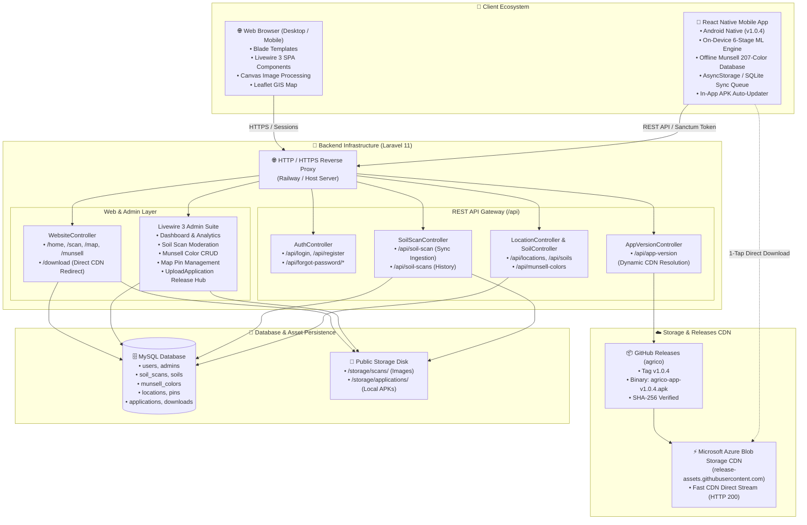
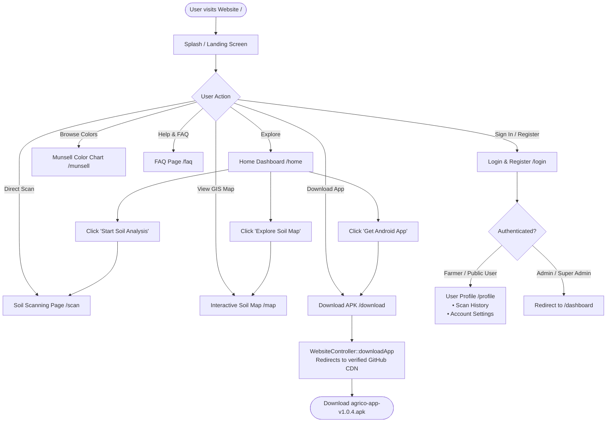
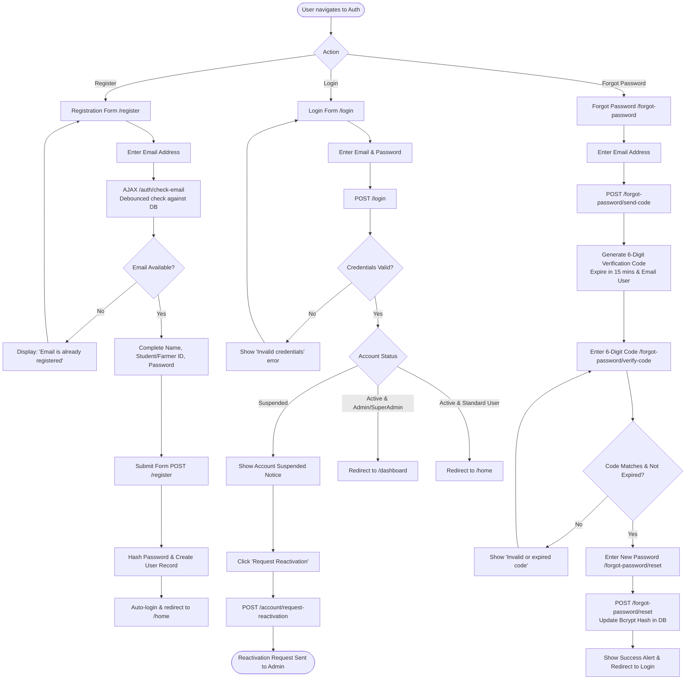
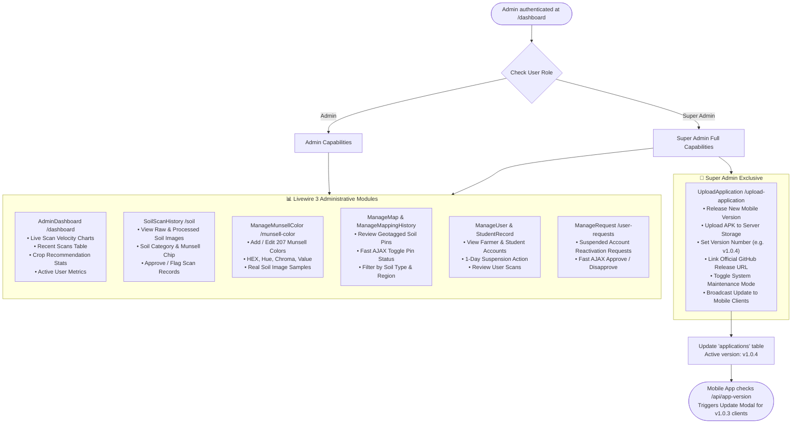
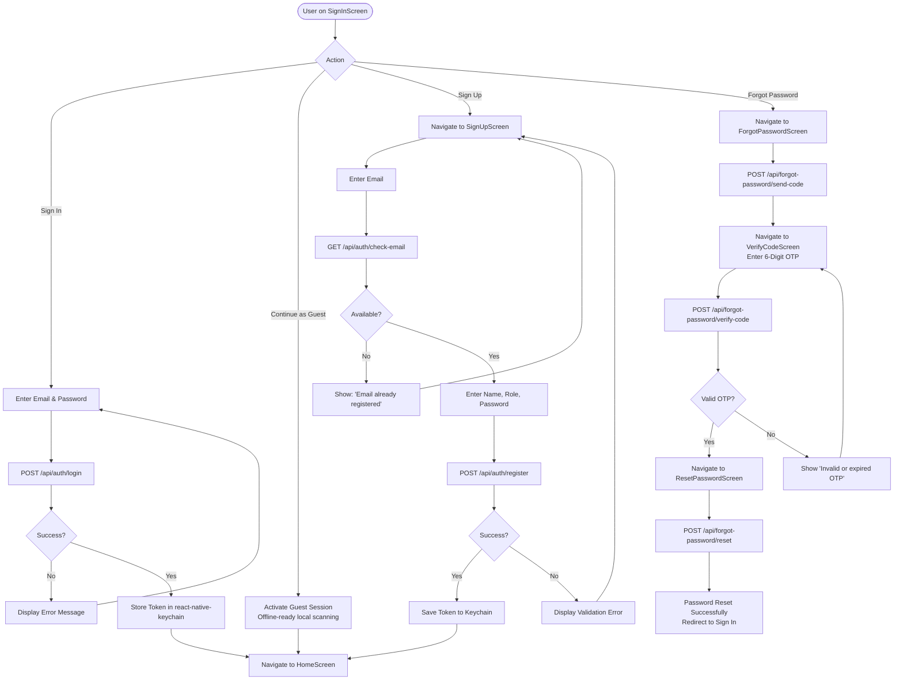
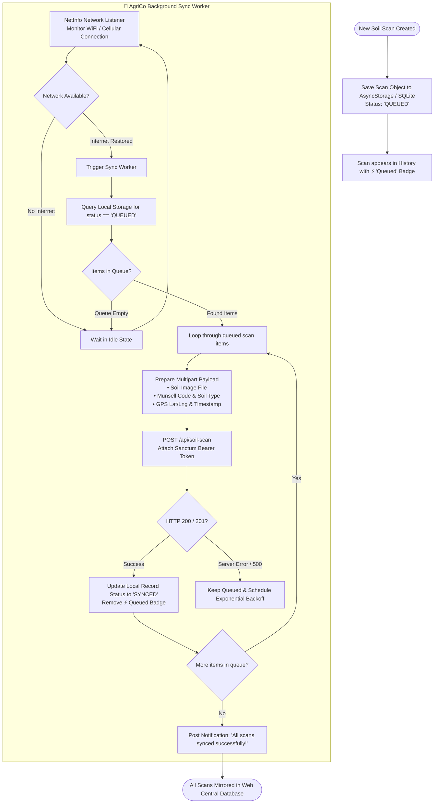
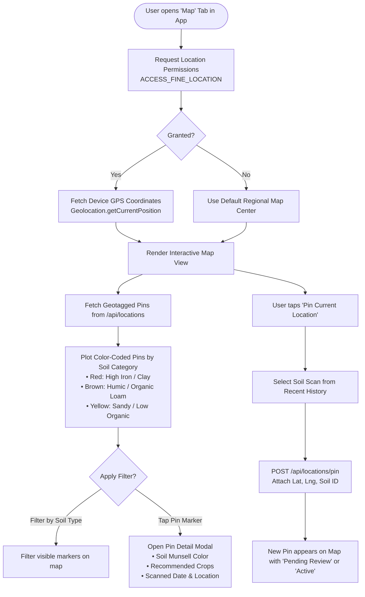
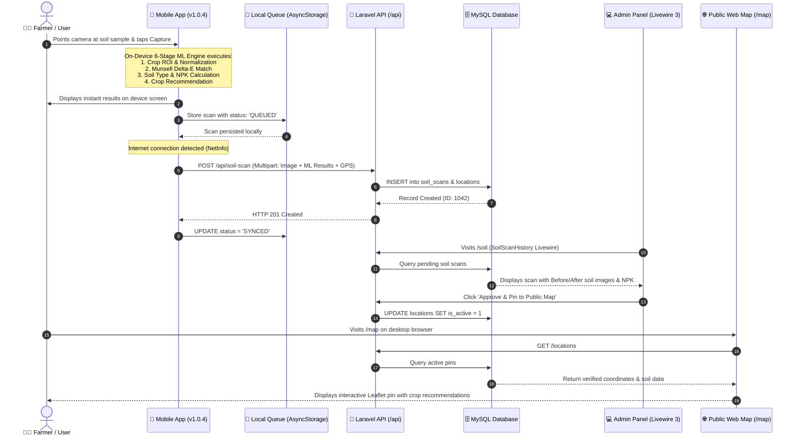

# 🌾 AgriCo System Flowcharts: Website & Mobile Application

Comprehensive architectural, operational, and user journey flowcharts for the **AgriCo Soil Analysis and Crop Recommendation System**, covering both the **Web Portal (Laravel 11 / Livewire 3)** and the **Mobile Application (React Native / On-Device ML)**.

---

## 📑 Table of Contents
1. [Master Ecosystem Architecture](#1-master-ecosystem-architecture)
2. [Website Flowcharts](#2-website-flowcharts)
   - [2.1 Website User Journey & Public Navigation](#21-website-user-journey--public-navigation)
   - [2.2 Web Soil Scanning & 6-Stage ML Analysis Pipeline](#22-web-soil-scanning--6-stage-ml-analysis-pipeline)
   - [2.3 Website Authentication & Password Reset Flow](#23-website-authentication--password-reset-flow)
   - [2.4 Admin & Super Admin Management Flow (Livewire 3)](#24-admin--super-admin-management-flow-livewire-3)
3. [Mobile Application Flowcharts](#3-mobile-application-flowcharts)
   - [3.1 Cold-Start, Auth Verification & In-App Auto-Update Flow](#31-cold-start-auth-verification--in-app-auto-update-flow)
   - [3.2 Mobile Authentication & Guest Onboarding](#32-mobile-authentication--guest-onboarding)
   - [3.3 On-Device 6-Stage Soil Scanning & Offline ML Pipeline](#33-on-device-6-stage-soil-scanning--offline-ml-pipeline)
   - [3.4 Offline Scan Queue & Background Cloud Sync](#34-offline-scan-queue--background-cloud-sync)
   - [3.5 Mobile Interactive GIS Map & GPS Pinning](#35-mobile-interactive-gis-map--gps-pinning)
4. [Cross-Platform End-to-End Sequence Diagram](#4-cross-platform-end-to-end-sequence-diagram)

---

## 1. Master Ecosystem Architecture

This diagram illustrates how all clients, backend services, cloud databases, and distribution pipelines connect.



---

## 2. Website Flowcharts

### 2.1 Website User Journey & Public Navigation

The high-level user navigation flow through the public website portal.



---

### 2.2 Web Soil Scanning & 6-Stage ML Analysis Pipeline

Detailed flowchart showing how a soil image is captured or uploaded on the web, analyzed through computer vision, matched with Munsell charts, and converted into fertilizer recommendations.

```mermaid
flowchart TD
    StartScan([User opens /scan]) --> InputMethod{Input Source}
    
    InputMethod -->|Webcam / Phone Camera| LiveCam[Activate Camera Stream\nnavigator.mediaDevices.getUserMedia]
    InputMethod -->|Upload Image| UploadFile[Upload Soil Image file\nJPEG / PNG]

    LiveCam --> CaptureFrame[Align Soil Sample in Reticle & Capture]
    UploadFile --> LoadCanvas[Load Image into HTML5 Canvas]
    CaptureFrame --> LoadCanvas

    subgraph CVPipeline ["🔬 Computer Vision & Color Normalization"]
        LoadCanvas --> CropRegion[Extract Center 50% ROI\nEliminate Background Clutter]
        CropRegion --> ColorNorm[White-Balance & Lighting Normalization\nStandardize RGB to D65 Illuminant]
        ColorNorm --> ExtractRGB[Extract Mean RGB & HSV Values]
        ExtractRGB --> ConvertLab[Convert RGB to CIELAB Color Space\nL*, a*, b*]
    end

    subgraph MLEngine ["🧠 6-Stage Machine Learning Determination"]
        ConvertLab --> Stage1[Stage 1: Soil Organic Matter & Moisture Index\nDerived from L* and Chroma]
        Stage1 --> Stage2[Stage 2: Munsell Nearest Neighbor Search\nCalculate Delta-E against 207 Color Chips]
        Stage2 --> Stage3[Stage 3: Texture & Soil Classification\nClay, Loam, Sandy Loam, Silt Loam]
        Stage3 --> Stage4[Stage 4: Nutrient Assessment\nEstimated N-P-K Ranges & pH Value]
        Stage4 --> Stage5[Stage 5: Crop Suitability Matrix\nScore Corn, Rice, Vegetables, Fruit Trees]
        Stage5 --> Stage6[Stage 6: Fertilizer Formulation\nRecommend 14-14-14, Urea, Organic Compost]
    end

    Stage6 --> DisplayResults[Display Comprehensive Result Card\n• Munsell Chip & Soil Name\n• Color Code & Sample ROI\n• Suitable Crops with Match %\n• NPK & Fertilizer Calculator]

    DisplayResults --> PinAction{Pin Soil Location to Map?}
    PinAction -->|Yes| FetchGPS[Get Geolocation Coordinates\nnavigator.geolocation]
    FetchGPS --> SubmitPin[Submit to /scan/pin\nStore in 'locations' table]
    SubmitPin --> PinnedSuccess[Pin added to Public Map]

    PinAction -->|No / Skip| SaveScan[Save Scan Record to /scan/store\nPersist in 'soil_scans' table]
    PinnedSuccess --> SaveScan
    SaveScan --> EndScan([Scan Completed & Viewable in History])
```



---

### 2.3 Website Authentication & Password Reset Flow

User registration, real-time validations, secure login, and 6-digit OTP code recovery.



---

### 2.4 Admin & Super Admin Management Flow (Livewire 3)

The internal management pipeline powered by Laravel Livewire 3 real-time components.



---

## 3. Mobile Application Flowcharts

### 3.1 Cold-Start, Auth Verification & In-App Auto-Update Flow

The launch sequence of the React Native mobile application, featuring automatic keychain credential verification and in-app APK auto-updating.

```mermaid
flowchart TD
    StartApp([User Launches AgriCo Mobile App]) --> SplashScreen[SplashScreen.js\nInitialize App State]
    
    SplashScreen --> NetCheck{Device Online?}
    NetCheck -->|Offline| OfflineMode[Set Offline Flag in Context] --> TokenProbe
    NetCheck -->|Online| OnlineMode[Set Online Flag in Context] --> CheckUpdate[Call updateService::checkForAppUpdate\nGET /api/app-version]

    subgraph AutoUpdate ["🚀 In-App Auto-Update Engine"]
        CheckUpdate --> VersionCompare{Server Version > Current App Version?\ne.g. v1.0.4 > v1.0.3}
        VersionCompare -->|No - Up to Date| TokenProbe
        VersionCompare -->|Yes - New Version| ShowModal[Present UpdateModal.js\n• Version v1.0.3 ➔ v1.0.4\n• Release Notes & File Size: 59.5 MB]
        
        ShowModal --> UpdateChoice{User Action}
        UpdateChoice -->|Later| DismissModal[Close Modal] --> TokenProbe
        UpdateChoice -->|Or download in browser| OpenChrome[Linking.openURL\nOpens verified GitHub CDN]
        UpdateChoice -->|Update Now| StartDirectDownload[Call downloadAndInstallApk]
        
        StartDirectDownload --> RNFSDownload[RNFS.downloadFile\nStream directly from Azure Blob CDN\nHTTP 200 - 62.3 MB]
        RNFSDownload --> ProgressUpdate[Update Progress Bar: 0% ➔ 100%]
        ProgressUpdate --> DownloadComplete{Download Status == 200?}
        
        DownloadComplete -->|Success| NativeInstall[Invoke NativeModules.InstallApk.install\nTarget: /cache/agrico-update.apk]
        NativeInstall --> AndroidInstaller([Launch Android System Package Installer\n'Update this app?'])
        
        DownloadComplete -->|Error / Fallback| FallbackBrowser[Fallback: Linking.openURL(directUrl)\nDownload in Browser]
    end

    subgraph AuthSession ["🔐 Keychain Credential Probe"]
        TokenProbe[Keychain.getGenericPassword\nService: agrico_user_token] --> HasToken{Token Found?}
        HasToken -->|Yes| ValidateToken[Call GET /api/user with Bearer Token]
        ValidateToken --> TokenValid{Token Valid?}
        TokenValid -->|Yes| SetUserContext[Set Authenticated User in AuthContext] --> HomeScreen[Navigate to HomeScreen.js]
        TokenValid -->|No / 401| ResetKeychain[Reset Keychain Token] --> SignInScreen[Navigate to SignInScreen.js]
        HasToken -->|No| SignInScreen
    end
```

---

### 3.2 Mobile Authentication & Guest Onboarding

The mobile authentication lifecycle with guest access for offline farm scanning.



---

### 3.3 On-Device 6-Stage Soil Scanning & Offline ML Pipeline

The heart of the mobile application: 100% on-device soil classification that operates even without internet access in remote agricultural fields.

```mermaid
flowchart TD
    OpenScanner([User taps 'Scan Soil' Tab]) --> CameraMount[Mount Camera Viewfinder\nreact-native-vision-camera / RNCamera]
    
    CameraMount --> AlignReticle[Display Target Reticle & Alignment Guide]
    AlignReticle --> AutoZoom[Auto-Zoom 1.5x on Central Soil Target]
    
    AlignReticle --> TriggerScan[User presses Capture Button]
    TriggerScan --> CapturePhoto[Capture Full-Res Soil Frame to Local Cache]

    subgraph OnDeviceML ["🧠 On-Device 6-Stage Machine Learning Pipeline"]
        CapturePhoto --> Step1[1. Pre-Processing & ROI Cropping\nExtract 300x300 center patch to eliminate background]
        Step1 --> Step2[2. Lighting & Color Normalization\nApply Gray-World algorithm to correct sunlight/shadows]
        Step2 --> Step3[3. Color Space Transformation\nExtract RGB ➔ Convert to CIELAB L*, a*, b*]
        
        Step3 --> Step4[4. Offline Munsell 207-Color Matching\nRun Delta-E (CIE76 / CMC) nearest neighbor against\nlocal munsellColors.json database]
        
        Step4 --> Step5[5. Soil Texture & Type Classification\nMap Munsell Hue/Value/Chroma to Soil Type:\nClay, Loam, Sandy Loam, Clay Loam, etc.]
        
        Step5 --> Step6[6. Agronomic Scoring & Fertilizer Engine\n• Estimate N-P-K nutrient status\n• Compute crop suitability index (% match)\n• Generate optimal fertilizer dosage]
    end

    Step6 --> DisplayMobileResult[Present Soil Analysis Result Sheet\n• Matched Munsell Code & Chip\n• Soil Classification & Soil Name\n• Ranked Suitable Crops\n• N-P-K Estimates & Recommended Fertilizer]

    DisplayMobileResult --> SaveDecision{Persist Scan?}
    SaveDecision -->|Yes| SaveToLocalQueue[Save to Local Offline Scan Queue\nStatus: 'QUEUED']
    SaveToLocalQueue --> CheckNetwork{Is Device Online?}
    
    CheckNetwork -->|Online| InstantSync[Sync immediately via /api/soil-scan] --> MarkedSynced[Mark Status: 'SYNCED']
    CheckNetwork -->|Offline| RemainQueued[Remain in Queue for Background Sync]

    MarkedSynced --> FinishedScan([Scan Complete & Stored in History])
    RemainQueued --> FinishedScan
```

---

### 3.4 Offline Scan Queue & Background Cloud Sync

How offline scans taken in remote fields are reliably buffered and synchronized once internet connection is restored.



---

### 3.5 Mobile Interactive GIS Map & GPS Pinning

Interactive map allowing farmers to view regional soil distributions and geotag their field samples.



---

## 4. Cross-Platform End-to-End Sequence Diagram

This sequence diagram depicts the complete lifecycle of a soil scan from the farmer's mobile camera in the field to the agricultural admin's portal and the public GIS web map.



---

## 5. Summary of System Highlights

| Feature | Website Portal | Mobile Application (v1.0.4) |
| :--- | :--- | :--- |
| **Technology** | Laravel 11, Livewire 3, Blade, Tailwind CSS | React Native, Vision Camera, RNFS, Vector Icons |
| **Soil ML Execution** | Server-side / HTML5 Canvas Web ML | **100% On-Device Offline Engine** (6 Stages) |
| **Munsell Chart** | 207 Interactive SVG/CSS Color Chips | 207 Offline Local Chips with CIELAB Delta-E |
| **Offline Operation** | Cached assets, online required for scan | **Fully Offline Scanning & History Queue** |
| **Updates** | Continuous Web Deployment | **In-App Auto-Updater** (Direct GitHub CDN Stream) |
| **Mapping Engine** | Leaflet.js with interactive clustering | Mobile Native Map with GPS Pinning |
| **Administration** | Full Livewire 3 Multi-Role Management | User Profile & Scan History Management |
