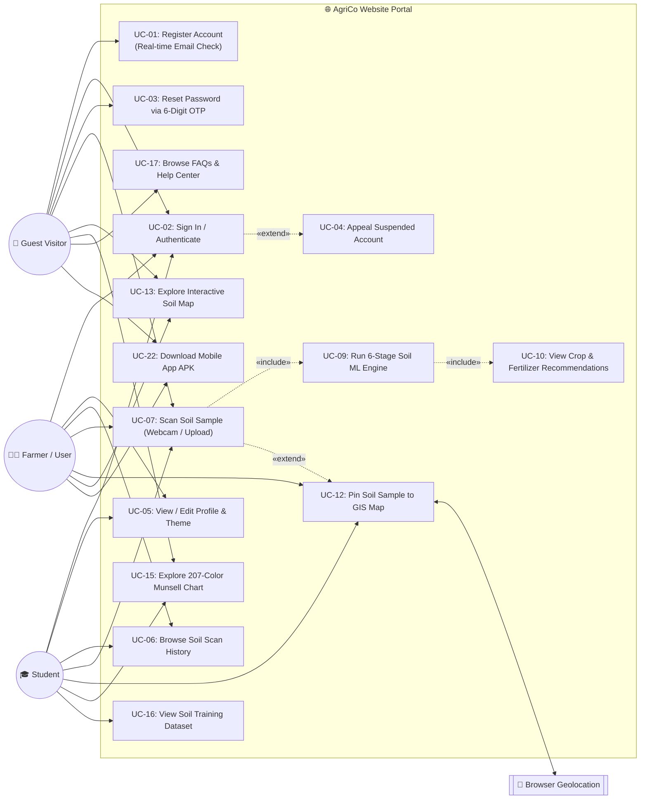
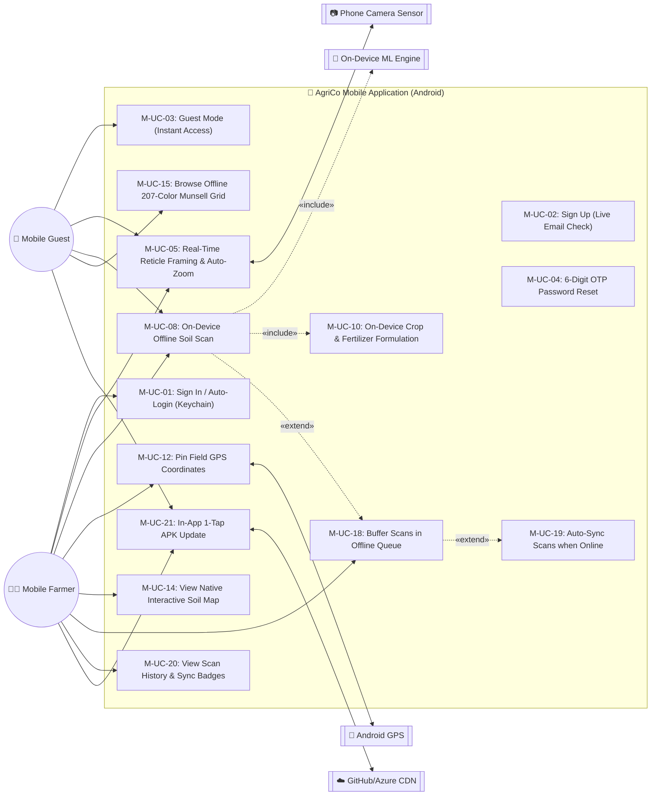
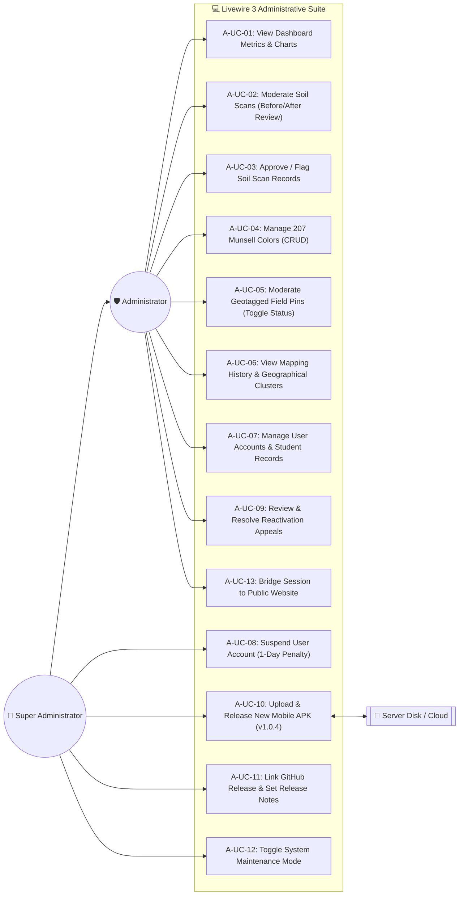

# 🌾 AgriCo Use Case Specifications: Website & Mobile Application

Comprehensive Use Case diagrams, actor profiles, and detailed functional specifications for the **AgriCo Soil Analysis and Crop Recommendation System**, covering both the **Web Application (Laravel 11 / Livewire 3)** and the **Mobile Application (React Native / On-Device ML)**.

---

## 📑 Table of Contents
1. [System Actors](#1-system-actors)
2. [Use Case Diagrams](#2-use-case-diagrams)
   - [2.1 Website Public & User Use Cases](#21-website-public--user-use-cases)
   - [2.2 Mobile Application Use Cases](#22-mobile-application-use-cases)
   - [2.3 Admin & Super Admin Panel Use Cases](#23-admin--super-admin-panel-use-cases)
3. [Use Case Catalog & Matrix](#3-use-case-catalog--matrix)
4. [Detailed Use Case Specifications](#4-detailed-use-case-specifications)
   - **4.1 Authentication & Account Management**
     - [UC-01: User Registration with Real-Time Validation](#uc-01-user-registration-with-real-time-validation)
     - [UC-02: User Authentication & Role Gating](#uc-02-user-authentication--role-gating)
     - [UC-03: 6-Digit OTP Password Reset](#uc-03-6-digit-otp-password-reset)
     - [UC-04: Suspended Account Reactivation Appeal](#uc-04-suspended-account-reactivation-appeal)
     - [UC-05: View / Edit Profile & Theme](#uc-05-view--edit-profile--theme)
     - [UC-06: Browse Soil Scan History](#uc-06-browse-soil-scan-history)
   - **4.2 Core Soil Scanning & Agronomic Analysis**
     - [UC-07: Web-Based Soil Sample Scanning](#uc-07-web-based-soil-sample-scanning)
     - [UC-08: On-Device Mobile Offline Soil Scanning](#uc-08-on-device-mobile-offline-soil-scanning)
     - [UC-09: 6-Stage Computer Vision & ML Determination](#uc-09-6-stage-computer-vision--ml-determination)
     - [UC-10: Crop Suitability & Fertilizer Dosage Calculation](#uc-10-crop-suitability--fertilizer-dosage-calculation)
     - [UC-11: View Before/After Soil Comparison](#uc-11-view-beforeafter-soil-comparison)
   - **4.3 GIS Mapping, Education & Reference**
     - [UC-12: Geotag & Pin Soil Sample to Map](#uc-12-geotag--pin-soil-sample-to-map)
     - [UC-13: Explore Interactive Web Soil Map](#uc-13-explore-interactive-web-soil-map)
     - [UC-14: Explore Mobile Native Map](#uc-14-explore-mobile-native-map)
     - [UC-15: Browse 207-Color Munsell Chart](#uc-15-browse-207-color-munsell-chart)
     - [UC-16: View Soil Training Dataset](#uc-16-view-soil-training-dataset)
     - [UC-17: Browse FAQs & Help Center](#uc-17-browse-faqs--help-center)
   - **4.4 Offline Queuing, Synchronization & Mobile Distribution**
     - [UC-18: Offline Scan Queuing & Background Auto-Sync](#uc-18-offline-scan-queuing--background-auto-sync)
     - [UC-19: Auto-Sync Scans when Online](#uc-19-auto-sync-scans-when-online)
     - [UC-20: View Offline Sync Badges (`Queued`/`Synced`)](#uc-20-view-offline-sync-badges-queuedsynced)
     - [UC-21: In-App 1-Tap APK Auto-Updating](#uc-21-in-app-1-tap-apk-auto-updating)
     - [UC-22: Download Mobile App APK](#uc-22-download-mobile-app-apk)
     - [UC-23: Check App Version & Maintenance Status](#uc-23-check-app-version--maintenance-status)
   - **4.5 Administrative Moderation & Governance**
     - [UC-24: Soil Scan Moderation & Verification](#uc-24-soil-scan-moderation--verification)
     - [UC-25: Munsell Color Catalog Management (CRUD)](#uc-25-munsell-color-catalog-management-crud)
     - [UC-26: Geotagged Map Pin Moderation (Toggle Status)](#uc-26-geotagged-map-pin-moderation-toggle-status)
     - [UC-27: User Directory & Student Records Review](#uc-27-user-directory--student-records-review)
     - [UC-28: Apply 1-Day User Account Suspension](#uc-28-apply-1-day-user-account-suspension)
     - [UC-29: Review & Resolve Reactivation Appeals](#uc-29-review--resolve-reactivation-appeals)
   - **4.6 Super Admin Releases & Maintenance**
     - [UC-30: Super Admin Mobile App Release Management](#uc-30-super-admin-mobile-app-release-management)
     - [UC-31: Upload APK & Configure Version Metadata](#uc-31-upload-apk--configure-version-metadata)
     - [UC-32: Toggle System Maintenance Mode](#uc-32-toggle-system-maintenance-mode)
     - [UC-33: Admin Seamless Bridge to Website](#uc-33-admin-seamless-bridge-to-website)
5. [Actor Traceability Matrix](#5-actor-traceability-matrix)

---

## 1. System Actors

| Actor Type | Actor Name | Platform | Description |
| :--- | :--- | :--- | :--- |
| **Primary** | **Farmer / Agriculturalist** | Web & Mobile | Field operator analyzing soil, viewing crop recommendations, calculating fertilizer dosage, and saving field scan history. |
| **Primary** | **Agriculture Student / Researcher** | Web & Mobile | Academic user conducting soil sampling, comparing Munsell charts, recording GPS field data, and testing soil samples. |
| **Primary** | **Guest / Unregistered Visitor** | Web & Mobile | Casual visitor testing soil scanning without an account, browsing public maps, and downloading the mobile APK. |
| **Administrative** | **System Administrator** | Web Portal | Agronomist or moderator managing scan records, reviewing Before/After images, moderating map pins, and managing Munsell colors. |
| **Administrative** | **Super Administrator** | Web Portal | Full-privilege administrator managing user accounts, handling suspensions, reviewing appeals, and publishing mobile APK releases. |
| **System / Hardware** | **Camera & Vision Hardware** | Web & Mobile | Webcams, phone camera sensors, and HTML5 canvas / native frame processors. |
| **System / Hardware** | **Device GPS Sensor** | Web & Mobile | W3C Geolocation API / Android Location Services providing latitude/longitude for soil pins. |
| **System / External** | **On-Device ML Engine** | Mobile Only | Embedded 6-stage colorimetric classifier running completely offline without server calls. |
| **System / External** | **GitHub & Azure CDN** | External Service | Verified release asset host streaming 59.5 MB production APK binaries to clients. |

---

## 2. Use Case Diagrams

### 2.1 Website Public & User Use Cases



---

### 2.2 Mobile Application Use Cases



---

### 2.3 Admin & Super Admin Panel Use Cases



---

## 3. Use Case Catalog & Matrix

| ID | Title | Actor(s) | Platform | Priority |
| :--- | :--- | :--- | :--- | :--- |
| **UC-01** | User Registration with Real-Time Validation | Guest, Student, Farmer | Web & Mobile | High |
| **UC-02** | User Authentication & Role Gating | All Registered Users | Web & Mobile | High |
| **UC-03** | 6-Digit OTP Password Reset | All Registered Users | Web & Mobile | Medium |
| **UC-04** | Suspended Account Reactivation Appeal | Suspended User | Web & Mobile | Medium |
| **UC-05** | View / Edit Profile & Theme | Farmer, Student, Admin | Web & Mobile | Low |
| **UC-06** | Browse Soil Scan History | Farmer, Student | Web & Mobile | High |
| **UC-07** | Web-Based Soil Sample Scanning | Guest, Farmer, Student | Web Only | High |
| **UC-08** | On-Device Mobile Offline Soil Scanning | Mobile Farmer, Guest | Mobile Only | Critical |
| **UC-09** | 6-Stage Computer Vision & ML Determination | System / ML Engine | Web & Mobile | Critical |
| **UC-10** | Crop Suitability & Fertilizer Dosage Calculation | Farmer, Student, Guest | Web & Mobile | High |
| **UC-11** | View Before/After Soil Comparison | Farmer, Student, Admin | Web & Mobile | High |
| **UC-12** | Geotag & Pin Soil Sample to Map | Farmer, Student | Web & Mobile | High |
| **UC-13** | Explore Interactive Web Soil Map | All Users | Web Only | Medium |
| **UC-14** | Explore Mobile Native Map | Mobile Users | Mobile Only | Medium |
| **UC-15** | Browse 207-Color Munsell Chart | All Users | Web & Mobile | Medium |
| **UC-16** | View Soil Training Dataset | Student, Researcher | Web Only | Low |
| **UC-17** | Browse FAQs & Help Center | All Users | Web & Mobile | Low |
| **UC-18** | Buffer Scans in Offline Queue | Mobile Farmer | Mobile Only | Critical |
| **UC-19** | Auto-Sync Scans when Online | Mobile Farmer, System | Mobile Only | Critical |
| **UC-20** | View Offline Sync Badges (`Queued`/`Synced`) | Mobile Farmer | Mobile Only | Medium |
| **UC-21** | In-App 1-Tap APK Auto-Updating | Mobile Users | Mobile Only | High |
| **UC-22** | Download Mobile App APK | All Web Visitors | Web Only | High |
| **UC-23** | Check App Version & Maintenance Status | Mobile App Client | Mobile Only | High |
| **UC-24** | Soil Scan Moderation & Verification | Administrator | Web (Admin) | High |
| **UC-25** | Munsell Color Catalog Management (CRUD) | Administrator | Web (Admin) | Medium |
| **UC-26** | Geotagged Map Pin Moderation (Toggle Status) | Administrator | Web (Admin) | High |
| **UC-27** | User Directory & Student Records Review | Administrator | Web (Admin) | Medium |
| **UC-28** | Apply 1-Day User Account Suspension | Super Administrator | Web (Admin) | Medium |
| **UC-29** | Review & Resolve Reactivation Appeals | Administrator | Web (Admin) | Medium |
| **UC-30** | Super Admin Mobile App Release Management | Super Administrator | Web (Admin) | High |
| **UC-31** | Upload APK & Configure Version Metadata | Super Administrator | Web (Admin) | High |
| **UC-32** | Toggle System Maintenance Mode | Super Administrator | Web (Admin) | Medium |
| **UC-33** | Admin Seamless Bridge to Website | Administrator | Web (Admin) | Low |

---

## 4. Detailed Use Case Specifications

---

### UC-01: User Registration with Real-Time Validation
* **Primary Actor:** Guest / Unregistered Farmer or Student
* **Platform:** Website (`/register`) & Mobile App (`SignUpScreen.js`)
* **Pre-conditions:** User has a valid email address and is not currently signed in.
* **Trigger:** User clicks "Sign Up" or "Create Account".

#### Main Success Scenario:
1. User enters desired email address into the input field.
2. The client fires a debounced request to `GET /auth/check-email?email=...`.
3. System verifies against the `users` table and indicates the email is available with a green checkmark.
4. User completes full name, user type (Farmer/Student/Researcher), Student/Farmer ID, and password.
5. User submits the registration form (`POST /register` on web, `POST /api/auth/register` on mobile).
6. System hashes password using Bcrypt, sets account `status = 'ACTIVE'`, and inserts the record.
7. System generates an authenticated session (Web cookie or Sanctum Bearer token).
8. System directs user to the main Dashboard (`/home` on web, `HomeScreen` on mobile).

#### Alternative / Exception Flows:
* **3a. Email Already Registered:**
  - System returns `exists: true`.
  - Client displays an inline alert: *"This email is already in use. Please sign in or use another email."*
  - Form submission remains locked until a unique email is provided.
* **5a. Validation Errors (e.g., Short password or missing fields):**
  - System returns HTTP 422 with validation errors.
  - Client highlights offending fields.

---

### UC-02: User Authentication & Role Gating
* **Primary Actor:** All Registered Users (Farmer, Student, Administrator, Super Administrator)
* **Platform:** Website (`/login`, `resources/views/auth/login.blade.php`) & Mobile App (`SignInScreen.js`)
* **Pre-conditions:** User has an existing registered account.
* **Trigger:** User opens application or enters login credentials.

#### Main Success Scenario:
1. User enters registered Email and Password.
2. User submits credentials (`POST /login` on web, `POST /api/auth/login` on mobile).
3. System verifies credentials against the `users` table using Bcrypt hash verification.
4. System inspects user account `status`:
   - If `status == 'ACTIVE'`: Proceed to session generation.
   - If `status == 'SUSPENDED'`: System halts login and triggers **UC-04 (Suspended Account Reactivation Appeal)**.
5. System establishes authenticated credentials:
   - **Web:** Sets encrypted HTTP-only session cookie and regenerates CSRF token.
   - **Mobile:** Issues personal access token via Laravel Sanctum and saves token securely in Android EncryptedSharedPreferences / Keychain.
6. System applies **Role-Based Routing Gating**:
   - If `role == 'SUPER_ADMIN'` or `role == 'ADMIN'`: Redirects to Administrative Control Center (`/dashboard`).
   - If `role == 'FARMER'` or `role == 'STUDENT'`: Redirects to Field Portal (`/home` on web, `HomeScreen` on mobile).
7. System logs login timestamp and client IP address in user session audit logs.

#### Alternative / Exception Flows:
* **3a. Invalid Password or Non-Existent Email:**
  - System logs failed attempt and returns HTTP 422 with message: *"These credentials do not match our records."*
  - System activates rate limiter: locks IP/email after 5 consecutive failed attempts for 60 seconds (`throttle:login`).
* **4a. Account Suspended by Super Admin:**
  - System rejects authentication and displays suspension overlay: *"Your account has been temporarily suspended for 24 hours. Reason: Policy Violation. Expiration: [Date/Time]."*

---

### UC-03: 6-Digit OTP Password Reset
* **Primary Actor:** Registered User (Farmer, Student, Administrator)
* **Platform:** Website (`/forgot-password`) & Mobile App (`ForgotPasswordScreen.js`, `OtpVerifyScreen.js`)
* **Pre-conditions:** User cannot recall password and has access to their registered email inbox.
* **Trigger:** User taps "Forgot Password?" link on login screen.

#### Main Success Scenario:
1. User enters their registered email address and submits the form.
2. System checks `users` table for email match.
3. System generates a cryptographically random 6-digit numeric One-Time PIN (OTP) (e.g., `849201`).
4. System stores OTP hash in `password_reset_tokens` table with a 15-minute expiration timestamp (`expires_at = now() + 15 minutes`).
5. System dispatches a formatted notification email containing the 6-digit OTP code.
6. Client transitions to OTP input screen with a 6-digit segmented PIN box and a 60-second resend countdown timer.
7. User inputs the 6-digit OTP received via email.
8. System validates that OTP matches and has not expired.
9. System transitions user to New Password screen.
10. User inputs new password meeting complexity criteria (minimum 8 characters) and confirms.
11. System hashes new password with Bcrypt, updates `users` table, purges used OTP token, and logs user in automatically.

#### Alternative / Exception Flows:
* **8a. Incorrect or Expired OTP:**
  - System returns error: *"Invalid or expired verification code."*
  - User can tap "Resend Code" after countdown finishes to generate a fresh OTP.

---

### UC-04: Suspended Account Reactivation Appeal
* **Primary Actor:** Suspended User
* **Platform:** Website (`/account-suspended`) & Mobile App (`SuspensionModal.js`)
* **Pre-conditions:** User account marked with `status = 'SUSPENDED'`.
* **Trigger:** User attempts authentication on suspended account.

#### Main Success Scenario:
1. User enters credentials on login form.
2. System detects `status = 'SUSPENDED'` and renders the Dedicated Suspension Screen.
3. Screen displays:
   - Suspension Infraction Details (e.g., *"Flagged for repeated spam pin creation"*).
   - Penalty Duration (e.g., *"1-Day Suspension ending tomorrow at 14:30"*).
4. System provides an interactive **Reactivation Appeal Form**:
   - Explanation / Justification text area.
   - Contact phone number / email confirmation.
5. User writes appeal message and submits form (`POST /appeal-suspension`).
6. System inserts appeal record into `appeals` table with `status = 'PENDING'` and alerts administrators.
7. System confirms: *"Appeal received. An administrator will review your request shortly."*

---

### UC-05: View / Edit Profile & Theme
* **Primary Actor:** Farmer, Student, Administrator
* **Platform:** Website (`/profile`) & Mobile App (`ProfileScreen.js`)
* **Pre-conditions:** Authenticated user session.
* **Trigger:** User taps profile avatar in top navigation.

#### Main Success Scenario:
1. User navigates to Profile Settings.
2. System loads current profile records: Full Name, Email, Farm/Institution, Phone, Student/Farmer ID, and Avatar photo.
3. User edits contact details or uploads a new avatar image.
4. User toggles UI theme preference:
   - **Light Forest Theme:** Bright daylight view optimized for outdoor sun visibility.
   - **Dark Emerald Theme:** Low-light night mode reducing battery drain on OLED screens.
5. User clicks "Save Changes".
6. System updates `users` record and persists theme preference in client LocalStorage / AsyncStorage.
7. UI updates theme dynamically without page refresh.

---

### UC-06: Browse Soil Scan History
* **Primary Actor:** Farmer, Student
* **Platform:** Website (`/history`, `SoilScanHistory.php`) & Mobile App (`HistoryScreen.js`)
* **Pre-conditions:** Authenticated user with one or more previous soil scans.
* **Trigger:** User selects "History" tab in navigation.

#### Main Success Scenario:
1. User navigates to Scan History view.
2. System queries database for records matching `user_id = auth()->id()` ordered by `created_at DESC`.
3. System renders cards/table showing:
   - Soil sample photo thumbnail.
   - Matched Munsell chip swatch and notation (e.g., `10YR 4/3 Dark Brown`).
   - Soil texture category (Clay Loam).
   - Top recommended crop (Rice - 94% match).
   - Scan date and geotag pin status.
4. User clicks "View Full Analysis" on any item:
   - System renders the full diagnostic report including Before/After image comparison (UC-11), NPK nutrient breakdown, and BSWM fertilizer dosage calculation (UC-10).
5. User can filter history by Date Range, Soil Texture, or Recommended Crop.
6. User can click "Download PDF Report" to generate a printable agronomic summary.

---

### UC-07: Web-Based Soil Sample Scanning
* **Primary Actor:** Farmer, Student, or Guest
* **Platform:** Website (`/scan`)
* **Pre-conditions:** Device has an active web camera or user has a soil photograph file.
* **Trigger:** User accesses `/scan` and initiates soil analysis.

#### Main Success Scenario:
1. User chooses input mode: **Live Camera** or **Upload Image File**.
2. If Live Camera is selected, browser requests `navigator.mediaDevices.getUserMedia` permissions.
3. System renders the video stream inside a bounding box reticle guide.
4. User places dry or moist soil sample in the center reticle and clicks "Capture Soil".
5. System renders the raw image onto an HTML5 Canvas.
6. System crops the center 50% region of interest (ROI) to remove foreign backgrounds.
7. System applies Gray-World white-balance lighting correction to D65 standard illuminant.
8. System executes **UC-09 (6-Stage Soil ML Engine)** to compute Munsell code, texture, NPK, and crops.
9. System renders the Before/After comparison image stitching the raw photo and normalized ROI.
10. System displays the comprehensive result sheet: Munsell chip, soil classification, suitable crops, and fertilizer calculator.
11. System prompts user: *"Pin this sample to the Interactive Soil Map?"*.

#### Alternative / Exception Flows:
* **2a. Camera Permission Denied:**
  - System displays: *"Camera access blocked. Please upload a soil image file instead."*
  - Automatically switches input mode to File Upload.
* **4a. Image Quality Too Dark / Blurry:**
  - Pre-processing calculates mean luminosity $L^* < 10$.
  - System prompts: *"Lighting is too low. Please ensure direct sunlight or bright natural lighting."*

---

### UC-08: On-Device Mobile Offline Soil Scanning
* **Primary Actor:** Mobile Farmer / Agriculture Student
* **Platform:** React Native Mobile App (`ScanSoilScreen.js`, `CameraService.js`)
* **Pre-conditions:** Device camera permission granted; user is in an agricultural field (online or offline).
* **Trigger:** User taps the "Scan Soil" floating center tab in the bottom navigation.

#### Main Success Scenario:
1. Mobile app mounts the native camera viewfinder (`react-native-vision-camera` or `expo-camera`).
2. App automatically applies a 1.5x optical/digital zoom factor and enables autofocus macro mode on the center target.
3. App overlays an interactive HUD with a circular guidance reticle (300x300 dp) and real-time lighting feedback (Lux meter indicator).
4. User positions the dry or moist soil sample within the reticle boundary under natural indirect sunlight.
5. User taps the haptic-feedback "Capture Soil" shutter button.
6. App captures full-resolution photo ($1920 \times 1080$ minimum) and caches it locally (`file:///.../agrico-soil-temp.jpg`).
7. **On-Device ML Engine** activates synchronously on the JavaScript thread / native bridge without network calls:
   - Crops exact 300x300 pixel center region of interest (ROI) to isolate soil and eliminate ground debris, vegetation, or user fingers.
   - Computes mean RGB values and transforms color space to CIE XYZ, then to CIELAB ($L^*, a^*, b^*$) using the D65 standard illuminant.
   - Executes Euclidean Delta-E ($\Delta E^*_{ab}$) distance search across all 207 Munsell soil standards loaded from local `munsellColors.json`.
   - Identifies the lowest distance match ($\Delta E < 3.0$ = high confidence match) determining Munsell notation (e.g., `10YR 4/3 Dark Brown`).
   - Evaluates chemical organic matter tier, agricultural soil texture, and primary NPK nutrient availability thresholds.
8. System executes **UC-10 (Crop Suitability & Fertilizer Dosage Calculation)** on-device.
9. App navigates immediately to the Analysis Results view with sub-300ms latency.
10. System persists the scan record in offline SQLite / AsyncStorage table with synchronization flag `status = 'QUEUED'`.
11. System invokes **UC-18 (Offline Scan Queuing & Background Auto-Sync)** in the background.

#### Alternative / Exception Flows:
* **1a. Camera Permission Denied or Restricted:**
  - System catches permission denial event (`Camera.requestCameraPermission() !== 'granted'`).
  - App displays an educational modal: *"AgriCo needs camera access to analyze soil samples in the field."*
  - Provides a 1-tap button to open system app permissions (`Linking.openSettings()`) or allows picking an existing image from the local gallery.
* **4a. Ambient Lighting Deficient (Too Dark or Overexposed):**
  - Real-time lux check or preliminary pixel array analysis returns luminosity $L^* < 12$ (underexposed) or $L^* > 92$ (flash glare washout).
  - App displays an amber warning badge on the viewfinder: *"Warning: Lighting too dark or high glare. Move to shaded natural sunlight."*
  - User can override or toggle the device camera flashlight torch in fill-light mode.
* **4b. Excessive Hand Motion or Angle Tilt:**
  - Accelerometer/gyroscope detects device pitch $> 45^\circ$.
  - Viewfinder displays leveling indicator: *"Hold phone parallel to the ground surface."*

---

### UC-09: 6-Stage Computer Vision & ML Determination
* **Primary Actor:** System ML Engine (Sub-process of UC-07 and UC-08)
* **Platform:** Web Canvas / Mobile Native JavaScript Core
* **Pre-conditions:** Normalized soil ROI pixel array provided.
* **Trigger:** Invoked automatically during soil frame capture.

#### Main Success Scenario:
1. **Stage 1 (Luminosity & Organic Humus Index):**
   - Calculates pixel array luminance: $Y = 0.2126R + 0.7152G + 0.0722B$.
   - Soils with $L^* < 30$ indicate high organic matter (humus $> 3.5\%$). Soils with $L^* > 65$ indicate low organic matter (humus $< 1.0\%$).
2. **Stage 2 (Munsell CIELAB Nearest Neighbor Match):**
   - Converts RGB to CIE XYZ ($X, Y, Z$), then to CIELAB coordinates ($L^*, a^*, b^*$).
   - Calculates $\Delta E = \sqrt{(L_1 - L_2)^2 + (a_1 - a_2)^2 + (b_1 - b_2)^2}$ against 207 calibrated Munsell chips.
   - Extracts exact Hue, Value, Chroma, and common agricultural soil color name.
3. **Stage 3 (Soil Texture Classification):**
   - Evaluates chroma and hue ratios to classify into USDA/BSWM soil texture classes: Clay, Silty Clay, Sandy Clay Loam, Clay Loam, Loam, Sandy Loam, or Silt Loam.
4. **Stage 4 (Estimated Nutrient Rating):**
   - Correlates Munsell color matrix with empirical soil fertility indices:
     - Available Nitrogen (N): High, Moderate, or Deficient.
     - Available Phosphorus (P): High, Medium, or Low.
     - Available Potassium (K): Sufficient or Depleted.
     - Estimated Soil pH Range: Acidic ($pH < 5.5$), Neutral ($pH\ 6.0 - 7.0$), or Alkaline ($pH > 7.5$).
5. **Stage 5 (Crop Suitability Scoring):**
   - Cross-references soil classification against Philippine agricultural crops (Rice, Yellow Corn, White Corn, Vegetables, Legumes, Root Crops, Fruit Trees).
   - Generates ranked match percentages ($0\% - 100\%$) and categorical suitability ratings (*"Highly Suitable"*, *"Moderately Suitable"*, *"Marginally Suitable"*).
6. **Stage 6 (Fertilizer Formulation):**
   - Calculates base recommended fertilizer dosage per hectare for top-ranked crops (Complete 14-14-14, Urea 46-0-0, MOP 0-0-60, and Organic Vermicast).
7. System packages output into a standardized JSON payload and delivers it to the presentation layer.

---

### UC-10: Crop Suitability & Fertilizer Dosage Calculation
* **Primary Actor:** Farmer, Agriculture Student, System Agronomic Engine
* **Platform:** Website (`/scan`, `/history`) & Mobile App (`ScanSoilScreen.js`, `HistoryDetailScreen.js`)
* **Pre-conditions:** Soil analysis completed (UC-07 or UC-08); soil texture and nutrient ratings available.
* **Trigger:** User reviews soil analysis report or enters the Interactive Fertilizer Calculator.

#### Main Success Scenario:
1. System displays the ranked **Crop Suitability Matrix**:
   - Primary Recommended Crops with match scores (e.g., Rice: 94%, Corn: 88%, Tomato: 82%, Mungbean: 75%).
   - Agronomic rationale tag (e.g., *"Clay Loam provides optimal water retention and nutrient exchange for Lowland Rice."*).
2. User selects a target crop from the list or picks an alternative crop to test feasibility.
3. User enters field parameters:
   - Land Area size (numerical input).
   - Unit measurement (Hectares or Square Meters, defaults to 1.0 Hectare).
   - Cropping season (Wet Season / Dry Season).
4. System calculates customized nutrient requirements based on Bureau of Soils and Water Management (BSWM) guidelines:
   - Total Nitrogen (N), Phosphate ($P_2O_5$), and Potash ($K_2O$) target in kg/ha.
   - Converts requirements into commercial fertilizer bag counts (50 kg bags):
     - Complete 14-14-14 (Bags/ha).
     - Urea 46-0-0 (Bags/ha).
     - Muriate of Potash 0-0-60 (Bags/ha).
     - Organic Fertilizer / Chicken Manure / Compost (Bags/ha).
5. System displays the **Split Application Schedule**:
   - **Basal Application:** Applied during final land preparation / transplanting (50% N + 100% P + 50% K + 100% Organic).
   - **First Top-Dress:** Applied 21–25 days after transplanting (25% N).
   - **Second Top-Dress (Panicle Initiation / Flowering):** Applied 45–50 days after planting (remaining 25% N + 50% K).
6. User can save calculation to field notes or export/print the Fertilizer Advisory Report.

#### Alternative / Exception Flows:
* **3a. Small Backyard / Urban Garden Area (< 0.1 Hectare):**
  - User toggles unit to Square Meters ($m^2$).
  - System dynamically adjusts fertilizer output from 50kg bags to exact grams ($g$) and tablespoons per plant hole.
* **4a. Highly Acidic Soil Detected ($pH < 5.0$):**
  - System flags warning banner: *"High soil acidity may inhibit phosphorus uptake."*
  - Recommends Agricultural Lime ($CaCO_3$) application rate (1–2 tons/ha) 3 weeks prior to planting.

---

### UC-11: View Before/After Soil Comparison
* **Primary Actor:** Farmer, Student, Administrator
* **Platform:** Website (`/scan`, `/soil`, `SoilScanHistory.php`) & Mobile App (`ScanSoilScreen.js`)
* **Pre-conditions:** Soil sample scanned; raw captured frame and processed 300x300 ROI stored.
* **Trigger:** User taps "Compare Before/After" or opens scan audit details.

#### Main Success Scenario:
1. System retrieves original unprocessed camera frame and normalized ROI patch.
2. System initializes the **Interactive Before/After View**:
   - **Left / Base Layer:** Raw camera capture displaying ambient color cast, natural surface shadows, and peripheral background.
   - **Right / Overlay Layer:** Calibrated 300x300 ROI showing Gray-World white-balanced pixels, uniform illumination normalization, and matched Munsell color chip swatch.
3. User interacts with the split-slider handle to drag left/right, directly inspecting color correction accuracy.
4. User taps "Magnify" to zoom in (200% - 400%) on pixel grain to verify soil aggregate structure.
5. System displays side-by-side diagnostic metrics:
   - Raw RGB distribution: $(R_{raw}, G_{raw}, B_{raw})$.
   - Corrected D65 RGB: $(R_{D65}, G_{D65}, B_{D65})$.
   - Delta-E match confidence score ($\Delta E$).
   - Munsell notation tag overlay (`10YR 3/2 Very Dark Grayish Brown`).
6. User confirms image quality and proceeds to pin sample or save report.

#### Alternative / Exception Flows:
* **2a. Low-Bandwidth / Fallback Rendering:**
  - If WebGL / Canvas split-slider is unavailable, system falls back to static side-by-side cards with high-contrast borders.

---

### UC-12: Geotag & Pin Soil Sample to Map
* **Primary Actor:** Farmer, Student
* **Platform:** Website (`/scan`) & Mobile App (`ScanSoilScreen.js`, `LocationService.js`)
* **Pre-conditions:** Soil analysis completed (UC-07 or UC-08); device GPS sensor or manual map pointer available.
* **Trigger:** User selects "Pin Location" after reviewing soil scan results.

#### Main Success Scenario:
1. User taps "Pin Location" on the analysis result card.
2. System requests current geospatial coordinates ($Latitude, Longitude$) via W3C Geolocation API (web) or Android FusedLocationProviderClient (mobile).
3. System captures current coordinates with accuracy radius (e.g., $Lat: 14.5995, Lng: 120.9842 \pm 4.2m$).
4. User fills out optional field metadata:
   - Field Name / Parcel Tag (e.g., *"North Paddy - Lot 12"*).
   - Province, Municipality, and Barangay.
   - Farm notes (crop history, irrigation source).
5. User submits the pin request:
   - **Web:** Dispatches `POST /scan/pin` with CSRF token and `soil_scan_id`.
   - **Mobile:** Dispatches `POST /api/locations/pin` with Sanctum Bearer token.
6. Server validates coordinates inside Philippine territorial boundaries ($4.5^\circ N - 21.5^\circ N$, $116.0^\circ E - 127.0^\circ E$).
7. Server inserts new record into `locations` table linked to `soil_scan_id`, sets `status = 'ACTIVE'` (or `PENDING` for moderation), and commits transaction.
8. System displays confirmation: *"Soil sample pinned successfully to GIS map!"*.
9. The new marker immediately renders on the interactive map with color-coded soil classification icon.

#### Alternative / Exception Flows:
* **2a. GPS Disabled or Location Permission Denied:**
  - System catches error code 1 (`PERMISSION_DENIED`) or timeout.
  - System prompts: *"GPS location unavailable. Would you like to select your field location on the map manually?"*
  - System renders an interactive map picker modal allowing user to tap and drop a pin on their exact field parcel.
* **5a. Mobile Device Offline:**
  - System captures available GPS coordinates from hardware and saves them directly into the local SQLite scan record.
  - Marks pin status as `QUEUED_PIN` to be transmitted to server during **UC-19 (Auto-Sync Scans when Online)**.

---

### UC-13: Explore Interactive Web Soil Map
* **Primary Actor:** All Users (Farmer, Student, Researcher, Administrator, Guest)
* **Platform:** Website (`/map`, `resources/views/website/map.blade.php`, Leaflet.js)
* **Pre-conditions:** Web browser with JavaScript enabled.
* **Trigger:** User clicks "Interactive Map" in website navigation.

#### Main Success Scenario:
1. User accesses `/map`.
2. System initializes Leaflet.js map canvas centered over the Philippines with OpenStreetMap tiles.
3. System fires AJAX request `GET /api/locations` to retrieve all verified public soil scan pins.
4. Server returns JSON array of points with latitude, longitude, soil texture, Munsell chip, and suitability ratings.
5. System plots color-coded circle markers across the map canvas:
   - **Clay / Heavy Clay:** Orange marker
   - **Loam / Clay Loam:** Emerald green marker
   - **Sandy Loam / Sand:** Amber yellow marker
   - **Silt Loam / Silt:** Blue marker
6. System enables dynamic Leaflet.markercluster clustering to aggregate dense clusters into numbered grouping hubs.
7. User interacts with multi-facet sidebar filters:
   - Filter by Soil Texture (Clay, Loam, Sandy Loam).
   - Filter by Recommended Crop (Rice, Corn, Tomato, Legumes).
   - Filter by Date Range or Region/Province.
8. User clicks on any map pin:
   - Leaflet popup opens displaying thumbnail soil photograph, Munsell color chip swatch, USDA soil category, top crop recommendation, and scan timestamp.
   - Includes "View Full Soil Analysis" action link.
9. User clicks "Locate Me" button to center map on their current GPS coordinates.

---

### UC-14: Explore Mobile Native Map
* **Primary Actor:** Mobile Farmer, Agriculture Student
* **Platform:** React Native Mobile App (`MapScreen.js`, `react-native-maps`)
* **Pre-conditions:** Mobile app installed; device connected to internet or cached map tiles available.
* **Trigger:** User taps "Map" tab on bottom navigation.

#### Main Success Scenario:
1. Mobile app mounts native map view (`MapView` component from `react-native-maps`).
2. App queries `GET /api/locations` and caches pins in local SQLite storage.
3. App renders custom native marker pins displaying soil category badges.
4. User taps the floating action button (FAB) "Center on My Field":
   - App requests device location and smoothly animates camera to user's GPS position ($zoom = 15$).
5. User taps a soil marker:
   - Native bottom sheet modal slides up showing:
     - Soil classification title and color chip.
     - Top recommended crop and suitability score.
     - Farmer notes and barangay name.
     - Button: "View Agronomic Recommendations".
6. User can switch map tile layers between **Standard Terrain** and **Satellite Aerial View**.

#### Alternative / Exception Flows:
* **2a. Device Offline in Remote Farmland:**
  - App catches network timeout and retrieves previously cached location pins from SQLite.
  - App displays top notification chip: *"Showing cached soil map data (Offline mode)."*

---

### UC-15: Browse 207-Color Munsell Chart
* **Primary Actor:** All Users (Student, Farmer, Researcher, Administrator)
* **Platform:** Web (`/munsell`, `resources/views/website/munsell.blade.php`) & Mobile (`MunsellScreen.js`)
* **Pre-conditions:** None.
* **Trigger:** User navigates to "Munsell Chart" in website navbar or mobile menu.

#### Main Success Scenario:
1. System renders the interactive 207-Color Munsell Soil Color Matrix grouped by Hue tabs:
   - `10R`, `2.5YR`, `5YR`, `7.5YR`, `10YR`, `2.5Y`, `5Y`, and `GLEY` pages.
2. User selects a Hue tab (e.g. `10YR` — the most common agricultural soil hue).
3. System renders the 2D matrix:
   - Vertical axis: Soil **Value** (lightness from 2 to 8).
   - Horizontal axis: Soil **Chroma** (color purity from 1 to 8).
4. System displays each chip with calibrated sRGB color rendering, Munsell code (e.g., `10YR 4/4`), and common name (e.g., `Dark Yellowish Brown`).
5. User types in the live search bar (e.g., *"Dark Brown"* or *"5/3"*):
   - Grid filters in real time to matching chips.
6. User clicks/taps an individual chip:
   - Modal opens displaying:
     - Calibrated RGB and CIELAB ($L^*, a^*, b^*$) coordinates.
     - Hexadecimal web color code (`#...`).
     - Associated soil properties (drainage, organic matter rating, aeration).
     - Typical agricultural crop performance in this soil color tier.

---

### UC-16: View Soil Training Dataset
* **Primary Actor:** Agriculture Student, Academic Researcher
* **Platform:** Web Portal (`/training-dataset`)
* **Pre-conditions:** Web access.
* **Trigger:** User clicks "Training Dataset" from education / footer links.

#### Main Success Scenario:
1. System presents the curated photographic database of Philippine agricultural soil samples.
2. System displays searchable, paginated data table containing:
   - Sample ID and Regional Origin (e.g., Central Luzon, CALABARZON, Western Visayas).
   - Laboratory Standard Chemical Analysis (Organic Matter %, Available P ppm, Exchangeable K cmol/kg, Soil pH).
   - Ground-truth Munsell Soil Color notation verified by soil scientists.
   - Physical texture classification (Clay, Silt Loam, Sandy Loam).
3. User clicks on any sample row:
   - High-resolution calibrated macro photograph opens with color calibration card visible.
4. User clicks "Download Dataset (CSV/JSON)" to export open-access soil metrics for academic modeling.

---

### UC-17: Browse FAQs & Help Center
* **Primary Actor:** All Users
* **Platform:** Web (`/faq`) & Mobile (`HelpCenterScreen.js`)
* **Pre-conditions:** None.
* **Trigger:** User selects "FAQ" or "Help Center".

#### Main Success Scenario:
1. System displays categorized FAQ accordion sections:
   - **Soil Photography Best Practices:** How to avoid shadow casts, ideal indirect sunlight, moist vs. dry soil preparation.
   - **Munsell Color Science:** Why Delta-E 1976 color matching is used and how hue/value/chroma relate to soil fertility.
   - **Offline Mode & Sync:** How the app functions without cellular signal and how sync queues operate.
   - **Crop & Fertilizer Calculations:** How BSWM fertilizer guidelines translate to 50kg bag dosages.
   - **App Updates:** How the in-app 1-tap APK updater upgrades the mobile application.
2. User clicks/taps an accordion item to expand detailed illustrated instructions.
3. User can click "Contact Support" to send an inquiry directly to AgriCo administrators.

---

### UC-18: Offline Scan Queuing & Background Auto-Sync
* **Primary Actor:** Mobile Farmer, System NetInfo Background Service
* **Platform:** React Native Mobile App (`ScanSoilScreen.js`, `storageService.js`)
* **Pre-conditions:** Mobile device camera scan completed while device has no internet connectivity.
* **Trigger:** Soil scan captured and analyzed while offline.

#### Main Success Scenario:
1. Mobile app executes on-device ML colorimeter (UC-08 and UC-09) and obtains full results locally.
2. System saves the full scan payload to persistent local storage (SQLite database / encrypted AsyncStorage):
   - Local timestamp, soil photo file path (`file:///...`), calculated Munsell code, texture, NPK ratings, crop recommendations, and GPS coordinates.
   - Synchronization flag: `sync_status = 'QUEUED'`.
   - Retry counter: `retry_count = 0`.
3. System renders the scan result immediately on screen with a prominent banner: *"Scan Saved Locally (Offline)"*.
4. App registers a network state change listener using `@react-native-community/netinfo`.
5. When connectivity is restored, system triggers **UC-19 (Auto-Sync Scans when Online)**.

---

### UC-19: Auto-Sync Scans when Online
* **Primary Actor:** Mobile App Client, System NetInfo Worker, Laravel REST API
* **Platform:** Mobile App (`syncService.js`) & Laravel Backend (`/api/soil-scan`)
* **Pre-conditions:** One or more scan records exist in local SQLite with `sync_status = 'QUEUED'`.
* **Trigger:** Device network status transitions from disconnected to connected (`isConnected === true` and `isInternetReachable === true`).

#### Main Success Scenario:
1. NetInfo event listener detects active internet connection.
2. `syncService` awakens and queries local SQLite: `SELECT * FROM scans WHERE sync_status = 'QUEUED' ORDER BY created_at ASC`.
3. If user is authenticated, system attaches Sanctum Bearer token; if guest, app marks records as guest scans.
4. For each queued item:
   - App constructs multipart/form-data HTTP request containing image binary (`photo`), Munsell data, and coordinates.
   - App dispatches `POST /api/soil-scan`.
   - Laravel server validates payload, stores uploaded image in `storage/app/public/scans/`, creates record in `soil_scans` table, and returns HTTP 201 Created with new server `id`.
   - App updates local SQLite record: `sync_status = 'SYNCED'`, `server_id = res.data.id`.
5. System displays in-app toast notification: *"All offline scans successfully synced to cloud!"*.
6. History screen updates in real time, removing queued warning badges.

#### Alternative / Exception Flows:
* **4a. Temporary Network Drop During Upload:**
  - HTTP request times out or network connection drops mid-stream.
  - App catches network error, increments `retry_count += 1`, and keeps item as `sync_status = 'QUEUED'`.
  - Service schedules retry using exponential backoff (15s, 30s, 60s, up to 5 attempts).
* **4b. Authentication Token Expired (HTTP 401):**
  - Server rejects request with 401 Unauthorized.
  - App halts automatic queue processing without deleting local scans.
  - App prompts user: *"Session expired. Please sign in to sync your offline scans."*

---

### UC-20: View Offline Sync Badges (`Queued`/`Synced`)
* **Primary Actor:** Mobile Farmer
* **Platform:** React Native Mobile App (`HistoryScreen.js`, `ScanCard.js`)
* **Pre-conditions:** User opens Scan History tab.
* **Trigger:** Navigation to History screen.

#### Main Success Scenario:
1. App queries local SQLite database and active session cache.
2. System renders unified list of soil scans sorted reverse-chronologically.
3. For each scan item card, app checks `sync_status`:
   - If `sync_status === 'QUEUED'`: Renders high-visibility amber pill badge: ⚡ *"Queued (Offline)"*.
   - If `sync_status === 'SYNCED'`: Renders subtle emerald pill badge: ☁️ *"Synced"*.
   - If `sync_status === 'FAILED'`: Renders red warning badge: ⚠️ *"Sync Failed - Tap to Retry"*.
4. Top header displays summary bar: *"2 scans pending upload"*.
5. User taps "Sync Now" button on header or individual card to trigger immediate upload attempt.

---

### UC-21: In-App 1-Tap APK Auto-Updating
* **Primary Actor:** Mobile User (Farmer, Student, Guest)
* **Platform:** React Native Mobile App (`UpdateModal.js`, `updateService.js`, `InstallApk.js`)
* **Pre-conditions:** Mobile app client running older version (e.g. `v1.0.3`); active release on server is newer (`v1.0.4`).
* **Trigger:** App startup or user navigates to Settings -> "Check for Updates".

#### Main Success Scenario:
1. During initialization, app dispatches `GET /api/app-version` with client version in query parameters (`?current_version=1.0.3`).
2. Server queries `applications` table, identifies latest active release `v1.0.4` with `direct_apk_url` pointing to verified Azure CDN stream and GitHub release notes.
3. App determines `1.0.4 > 1.0.3` and displays the modal `UpdateModal`:
   - Header: *"New Version Available: v1.0.4"*
   - Download size: `59.5 MB`
   - Release highlights: Bullet list of enhancements and bug fixes.
4. User taps **"Update Now"**.
5. App invokes background download task via `react-native-fs` (`RNFS.downloadFile`):
   - Streams binary to local cache: `/data/user/0/com.agrico.mobile/cache/agrico-update-v1.0.4.apk`.
   - Renders animated progress bar ($0\% \rightarrow 100\%$) with current download speed and megabytes transferred.
6. Download finishes with HTTP 200 OK.
7. System verifies file integrity (checks downloaded file size $\approx 59.5\text{ MB}$).
8. App invokes native Android module `InstallApk.install(cachedApkPath)`:
   - Grants temporary `FLAG_GRANT_READ_URI_PERMISSION` via Android FileProvider (`com.agrico.mobile.fileprovider`).
9. Android system PackageInstaller intent launches:
   - System prompt appears: *"Do you want to update this application? AgriCo [Update] [Cancel]"*.
10. User confirms "Update". Android installs package and restarts app into `v1.0.4`.

#### Alternative / Exception Flows:
* **4a. User Prefers External Browser Download:**
  - User taps secondary link: *"Or download APK directly in browser"*.
  - App calls `Linking.openURL(downloadUrl)` opening Android Chrome at `/download/apk`.
  - Browser downloads APK directly with standard download notification.
* **5a. Direct In-App Download Interrupted / Network Drops:**
  - Network disconnection causes `RNFS.downloadFile` error.
  - App displays alert: *"Download interrupted. Tap Retry or use the browser download link."*
  - Provides instant "Retry Download" action.

---

### UC-22: Download Mobile App APK
* **Primary Actor:** All Web Visitors, Farmers, Students
* **Platform:** Website (`/download`, `resources/views/website/download.blade.php`, `AppVersionController.php`)
* **Pre-conditions:** Web browser on PC, tablet, or smartphone.
* **Trigger:** User clicks "Download Mobile App" on website hero or navigation.

#### Main Success Scenario:
1. User navigates to `/download`.
2. System queries active application metadata from `applications` table (`status = 'ACTIVE'`).
3. Web page renders the official mobile application release showcase:
   - Current Version: **v1.0.4**
   - File Size: **59.5 MB**
   - SHA-256 Checksum: `7719354a13b4e912e94037bdc8aa96401643d5ce7e1d4a2d9997bbdd524dee78`
   - OS Compatibility: Android 8.0 (Oreo) through Android 15
   - Release Notes & Change Log.
   - High-resolution QR code allowing mobile users to scan and download directly onto smartphones.
4. User clicks **"Download APK (v1.0.4)"**.
5. Server routes request to `GET /download/apk`.
6. Server issues HTTP 302 redirect to the verified Azure Blob CDN / GitHub Release asset stream.
7. User's browser downloads `agrico-app-v1.0.4.apk`.
8. Web page displays step-by-step installation instructions:
   - Step 1: Open the downloaded `.apk` file from the Downloads folder.
   - Step 2: Allow installation from "Unknown Sources / This Source" in Android Settings.
   - Step 3: Tap "Install" and launch AgriCo.

---

### UC-23: Check App Version & Maintenance Status
* **Primary Actor:** Mobile Application Client (Automated System Check)
* **Platform:** Mobile App (`updateService.js`) & Laravel API (`AppVersionController.php`)
* **Pre-conditions:** Device launched with internet access.
* **Trigger:** App startup event or resumed from background.

#### Main Success Scenario:
1. Mobile app client dispatches HTTP `GET /api/app-version` with header `X-App-Platform: Android`.
2. Laravel backend inspects cache/database:
   - Checks if `MAINTENANCE_MODE` is enabled in application settings.
   - Queries `applications` table for the record where `status = 'ACTIVE'` order by `id DESC`.
3. Server returns JSON response:
   ```json
   {
     "latest_version": "v1.0.4",
     "version_code": 5,
     "min_supported_version": "v1.0.0",
     "direct_apk_url": "https://...azureedge.net/.../agrico-app-v1.0.4.apk",
     "github_release_url": "https://github.com/agricosite77-oss/agrico/releases/tag/v1.0.4",
     "is_maintenance": false,
     "release_notes": [
       "Added direct 1-tap in-app APK updating",
       "Improved CIELAB Delta-E Munsell classification accuracy",
       "Enhanced offline scan queue synchronization"
     ]
   }
   ```
4. If `is_maintenance === true`:
   - Mobile app displays an unclosable full-screen overlay: *"AgriCo is currently undergoing scheduled system maintenance. Please try again later."*
5. If `client_version < min_supported_version`:
   - System marks update as **Mandatory**; disables "Dismiss" button on `UpdateModal`.
6. If `client_version < latest_version`:
   - System triggers **UC-21 (In-App 1-Tap APK Auto-Updating)**.
7. If `client_version == latest_version`:
   - App proceeds silently to Home dashboard.

---

### UC-24: Soil Scan Moderation & Verification
* **Primary Actor:** System Administrator
* **Platform:** Web Admin Panel (`/soil`, `SoilScanHistory.php`, Livewire 3)
* **Pre-conditions:** Administrator or Super Administrator authenticated into `/dashboard`.
* **Trigger:** Administrator navigates to `/soil` in the admin sidebar.

#### Main Success Scenario:
1. Administrator opens the Soil Scan Moderation table.
2. Livewire 3 component renders a reactive, searchable table of all submitted soil scans across Web and Mobile platforms.
3. Administrator filters by: Unverified Scans, Date Range, Soil Texture Category, or Submitting User.
4. Administrator clicks "Inspect Scan Details" on any record.
5. Livewire opens the **Agronomic Inspection Modal**:
   - Submitting Farmer/Student profile and contact info.
   - Captured timestamp and submission platform (Web Browser / Android Mobile App).
   - Interactive Before/After image comparison: Raw field photograph on the left vs. 300x300 D65-calibrated ROI on the right.
   - Evaluated Munsell color notation, chip swatch, and Euclidean Delta-E distance score.
   - Estimated chemical N-P-K nutrient breakdown and crop recommendation rankings.
   - Geotagged coordinates with interactive Leaflet mini-map preview.
6. Administrator validates that the photograph contains genuine agricultural soil (no foreign objects, hands, or synthetic materials).
7. Administrator clicks **"Verify & Approve Scan"** or **"Flag as Inaccurate / Review Needed"**.
8. Livewire updates the database record (`verification_status = 'APPROVED'`), emits browser toast notification, and updates row status badge reactively without a full page reload.

#### Alternative / Exception Flows:
* **7a. Inappropriate or Spurious Image Detected (e.g. Non-soil photo):**
  - Administrator clicks "Reject & Delete Scan".
  - System soft-deletes scan record and removes associated location pin from the public GIS map.

---

### UC-25: Munsell Color Catalog Management (CRUD)
* **Primary Actor:** System Administrator
* **Platform:** Web Admin Panel (`/munsell-management`, `ManageMunsell.php`, Livewire 3)
* **Pre-conditions:** Administrator permissions.
* **Trigger:** Administrator clicks "Munsell Colors" in admin navigation.

#### Main Success Scenario:
1. Administrator navigates to Munsell Color Catalog.
2. Livewire table displays the comprehensive database of 207 Munsell soil standards:
   - Hue, Value, Chroma notation (e.g., `10YR 5/4`).
   - Descriptive color name (e.g., `Yellowish Brown`).
   - Hexadecimal color code (`#9A7B4F`) and calibrated visual swatch.
   - CIELAB coordinates ($L^*, a^*, b^*$).
   - Associated agricultural soil characteristics (drainage classification, organic matter rating).
3. Administrator clicks **"Add Munsell Standard"**:
   - Fills in Hue page, Value, Chroma, calibrated sRGB hex code, and CIELAB metrics.
   - Assigns default soil texture and Philippine agronomic crop affinities.
   - Livewire validates uniqueness of the Hue/Value/Chroma triplet and saves to `munsell_colors` table.
4. Administrator can edit existing color mappings or adjust nutrient correlation weights.
5. System invalidates and regenerates cached `munsellColors.json` file for the mobile app and web classifier.

---

### UC-26: Geotagged Map Pin Moderation (Toggle Status)
* **Primary Actor:** System Administrator
* **Platform:** Web Admin Panel (`/manage-map`, `ManageMap.php`, Livewire 3)
* **Pre-conditions:** Administrator permissions.
* **Trigger:** Administrator navigates to `/manage-map`.

#### Main Success Scenario:
1. Administrator opens Map Pin Moderation view.
2. Livewire renders an administrative Leaflet GIS map with all public and pending markers, alongside a paginated pin directory table.
3. Administrator clicks on a pending or user-reported map pin.
4. System displays the Pin Audit Flyout:
   - Farmer/Student user name and user ID.
   - GPS Latitude and Longitude with reverse-geocoded barangay and municipality.
   - Linked soil scan photo thumbnail and soil classification.
   - Current status: `PENDING`, `ACTIVE`, or `FLAGGED`.
5. Administrator clicks **"Approve Pin"** (sets `status = 'ACTIVE'`) or **"Unpublish Pin"** (sets `status = 'HIDDEN'`).
6. Livewire updates the `locations` table instantly and updates the marker icon color on the map canvas.

#### Alternative / Exception Flows:
* **5a. Malicious / Off-Shore Pin Coordinates:**
  - Coordinates fall outside valid land boundary or in open ocean.
  - System flags warning: *"Location coordinates outside designated agricultural territory."*
  - Administrator clicks "Reject & Delete Pin".

---

### UC-27: User Directory & Student Records Review
* **Primary Actor:** System Administrator, Super Administrator
* **Platform:** Web Admin Panel (`/manage-user`, `ManageUser.php`, Livewire 3)
* **Pre-conditions:** Administrator permissions.
* **Trigger:** Administrator navigates to `/manage-user`.

#### Main Success Scenario:
1. Administrator opens User Management interface.
2. Livewire renders paginated directory of registered accounts with search filtering (by Name, Email, Student ID, or User Role).
3. Administrator clicks "Inspect User Profile":
   - Displays Account Status (`ACTIVE`, `SUSPENDED`).
   - Role (`FARMER`, `STUDENT`, `RESEARCHER`, `ADMIN`).
   - Agricultural Institution / University and Student ID card photo.
   - Total Scans Conducted count and Map Pins Contributed count.
4. For student accounts, Administrator verifies university registration credentials and grants "Verified Academic Researcher" badge.
5. System logs review action in administrative audit trail.

---

### UC-28: Apply 1-Day User Account Suspension
* **Primary Actor:** Super Administrator
* **Platform:** Web Admin Panel (`/manage-user`, `ManageUser.php`, Livewire 3)
* **Pre-conditions:** Super Administrator permissions (`isSuperAdmin() == true`).
* **Trigger:** User violates system guidelines (spamming invalid scans, posting abusive map remarks).

#### Main Success Scenario:
1. Super Administrator selects the offending user in `ManageUser.php`.
2. Super Administrator clicks **"Suspend User (1-Day Penalty)"**.
3. Super Administrator selects or enters the violation rationale:
   - *"Spamming non-soil photographs"*
   - *"Repeated submission of inaccurate GPS coordinates"*
   - *"Community guidelines violation"*
4. System updates user record in `users` table:
   - Sets `status = 'SUSPENDED'`.
   - Sets `suspended_until = now()->addHours(24)`.
   - Records violation details in `suspension_reason`.
5. System automatically invalidates all active Sanctum tokens in `personal_access_tokens` table, instantly terminating any active mobile app sessions.
6. Livewire displays confirmation alert: *"Account suspended for 24 hours. User will be redirected to the appeal flow on next access."*

---

### UC-29: Review & Resolve Reactivation Appeals
* **Primary Actor:** Administrator, Super Administrator
* **Platform:** Web Admin Panel (`/manage-user`, `AppealsModal.php`, Livewire 3)
* **Pre-conditions:** One or more pending user appeals in `appeals` table.
* **Trigger:** Administrator clicks "Appeals" tab in User Management.

#### Main Success Scenario:
1. Administrator views the list of pending appeals submitted by suspended users (originating from UC-04).
2. Administrator selects an appeal record:
   - Displays user history, suspension reason, original suspension timestamp, and user's submitted justification text.
3. Administrator reviews the explanation:
   - **Option A (Approve & Reinstate):** Administrator clicks "Approve Appeal".
     - System updates user record: `status = 'ACTIVE'`, `suspended_until = null`.
     - System marks appeal `status = 'RESOLVED_APPROVED'`.
     - System sends automated email informing user their account has been restored.
   - **Option B (Deny Appeal):** Administrator clicks "Deny Appeal".
     - System marks appeal `status = 'RESOLVED_DENIED'`.
     - 24-hour suspension timer remains in full effect until natural expiration.
4. Livewire updates the appeal list and user status reactively.

---

### UC-30: Super Admin Mobile App Release Management
* **Primary Actor:** Super Administrator
* **Platform:** Web Admin Panel (`/upload-application`, `UploadApplication.php`, Livewire 3)
* **Pre-conditions:** User authenticated as Super Administrator (`isSuperAdmin() == true`).
* **Trigger:** Super Administrator navigates to `/upload-application`.

#### Main Success Scenario:
1. Super Administrator enters the Mobile Application Release Hub.
2. Livewire component displays active release dashboard:
   - **Active Production Release Card:** Displays current version (e.g., `v1.0.4`), file size (`59.5 MB`), SHA-256 hash, and download count.
   - **Direct CDN URL Status:** Displays health check for Azure Blob CDN / GitHub Release asset endpoint.
   - **Archived Versions List:** Historical records (`v1.0.3`, `v1.0.2`, `v1.0.1`) with release dates and changelog notes.
3. Super Administrator can trigger **UC-31 (Upload APK & Configure Version Metadata)** or **UC-32 (Toggle System Maintenance Mode)**.

---

### UC-31: Upload APK & Configure Version Metadata
* **Primary Actor:** Super Administrator
* **Platform:** Web Admin Panel (`UploadApplication.php`, Livewire 3)
* **Pre-conditions:** Super Administrator possesses a production-signed Android APK binary (`agrico-app-v1.0.4.apk`).
* **Trigger:** Super Administrator clicks "New Release" in the Application Release Hub.

#### Main Success Scenario:
1. Super Administrator fills out release configuration form:
   - Version Tag: `v1.0.4`
   - Android Version Code: `5`
   - Minimum Required Client Version: `v1.0.0`
   - Official GitHub Release Tag URL: `https://github.com/agricosite77-oss/agrico/releases/tag/v1.0.4`
   - Direct Azure CDN / Asset URL: `https://.../agrico-app-v1.0.4.apk`
   - Release Notes (bulleted changelog of features and fixes).
2. Super Administrator uploads the production APK file via Livewire file upload input or specifies direct CDN link.
3. System validates binary integrity: verifies `.apk` extension, computes SHA-256 checksum, and confirms file size ($\approx 59.5\text{ MB}$).
4. Super Administrator clicks **"Publish Release"**.
5. Livewire component:
   - Stores APK in `storage/app/public/applications/agrico-app-v1.0.4.apk`.
   - Sets any existing active release to `status = 'ARCHIVED'`.
   - Inserts new record into `applications` table with `status = 'ACTIVE'`.
   - Clears application version cache tag (`app_version_cache`).
6. System immediately serves the new version metadata through `GET /api/app-version`.
7. All connected mobile apps running older builds prompt users via **UC-21 (In-App 1-Tap APK Auto-Updating)**.

---

### UC-32: Toggle System Maintenance Mode
* **Primary Actor:** Super Administrator
* **Platform:** Web Admin Panel (`UploadApplication.php`, `AdminDashboard.php`)
* **Pre-conditions:** Super Administrator permissions.
* **Trigger:** Super Administrator schedules maintenance or emergency updates.

#### Main Success Scenario:
1. Super Administrator navigates to Release Hub / System Settings.
2. Super Administrator toggles the "System Maintenance Mode" switch to **Active**.
3. Super Administrator provides maintenance advisory text: *"Scheduled server maintenance in progress. Please check back at 18:00 PHT."*
4. System updates configuration in database / Redis cache: `app_maintenance = true`.
5. All incoming calls to `GET /api/app-version` return `"is_maintenance": true`.
6. Connected mobile applications immediately display non-dismissible maintenance overlays.
7. Web visitors viewing the public portal receive a top informational notification banner.
8. When maintenance concludes, Super Administrator toggles switch to **Inactive**; normal client operations resume immediately.

---

### UC-33: Admin Seamless Bridge to Website
* **Primary Actor:** Administrator, Super Administrator
* **Platform:** Web Admin Panel (`/dashboard`, Top Navbar Bridge)
* **Pre-conditions:** Administrator authenticated in `/dashboard`.
* **Trigger:** Administrator clicks "Farmer Portal / Website" in top navbar.

#### Main Success Scenario:
1. Administrator clicks "View Website / Farmer Portal" button in the admin header.
2. System transitions user to public web routes (`/home`, `/scan`, `/map`) while preserving admin session authentication.
3. System renders a persistent top **Admin Navigation Bar**:
   - Quick return button: *"Return to Admin Dashboard"*.
   - Contextual moderator actions on public pages (e.g. "Moderate this Pin" button directly on map popups).
4. Administrator can test live soil sample analysis, upload photos, or view public GIS maps from the end-user perspective without signing out.

---

---

## 5. Actor Traceability Matrix

| Use Case | Guest Visitor | Farmer | Student | Administrator | Super Admin | System Services |
| :--- | :---: | :---: | :---: | :---: | :---: | :---: |
| **UC-01: Register Account** | X | | X | | | Email Service |
| **UC-02: Sign In / Auth** | | X | X | X | X | Sanctum / Sessions |
| **UC-03: OTP Password Reset** | | X | X | X | X | Mailer / OTP Engine |
| **UC-04: Appeal Suspension** | | X | X | | | |
| **UC-05: Profile & Theme** | | X | X | X | X | |
| **UC-06: Scan History** | | X | X | | | MySQL |
| **UC-07: Web Soil Scan** | X | X | X | | | HTML5 Canvas / Webcam |
| **UC-08: Mobile Offline Scan**| X | X | X | | | Camera / Vision |
| **UC-09: 6-Stage ML Engine** | X | X | X | | | **On-Device ML Engine** |
| **UC-10: Crop & Fertilizer** | X | X | X | | | Agronomic Engine |
| **UC-11: Before/After View** | | X | X | X | X | Canvas Stitcher |
| **UC-12: Pin Map Geotag** | | X | X | | | **GPS Sensor** |
| **UC-13: Web GIS Map** | X | X | X | X | X | Leaflet.js |
| **UC-14: Mobile Native Map** | X | X | X | | | Mobile Map View |
| **UC-15: Munsell Chart** | X | X | X | X | X | 207-Chip Matrix |
| **UC-16: Training Dataset** | X | | X | X | X | Real Soil DB |
| **UC-17: FAQs & Support** | X | X | X | | | |
| **UC-18: Offline Queuing** | | X | X | | | **AsyncStorage / SQLite** |
| **UC-19: Auto-Sync Online** | | X | X | | | **NetInfo / REST API** |
| **UC-20: Sync Badges** | | X | X | | | UI Badge Renderer |
| **UC-21: In-App Auto-Update** | X | X | X | | | **GitHub / Azure CDN** |
| **UC-22: Web APK Download** | X | X | X | | | Storage / CDN |
| **UC-23: Version API Check** | | | | | | AppVersionController |
| **UC-24: Scan Moderation** | | | | X | X | Livewire 3 |
| **UC-25: Munsell CRUD** | | | | X | X | Livewire 3 |
| **UC-26: Map Pin Moderation** | | | | X | X | Livewire 3 |
| **UC-27: User Management** | | | | X | X | Livewire 3 |
| **UC-28: 1-Day Suspension** | | | | | X | Livewire 3 |
| **UC-29: Reactivation Review**| | | | X | X | Livewire 3 |
| **UC-30: Release Manager** | | | | | X | Livewire 3 |
| **UC-31: Upload APK** | | | | | X | Disk Storage |
| **UC-32: Maintenance Mode** | | | | | X | Cache / DB |
| **UC-33: Admin Web Bridge** | | | | X | X | Session Bridge |
