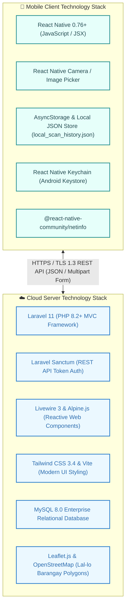
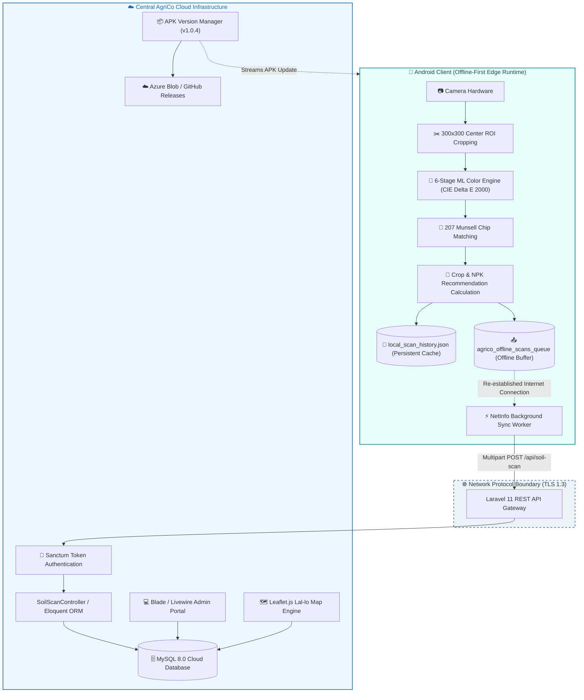
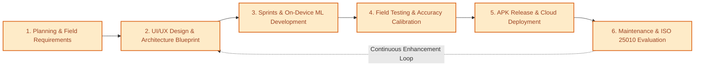
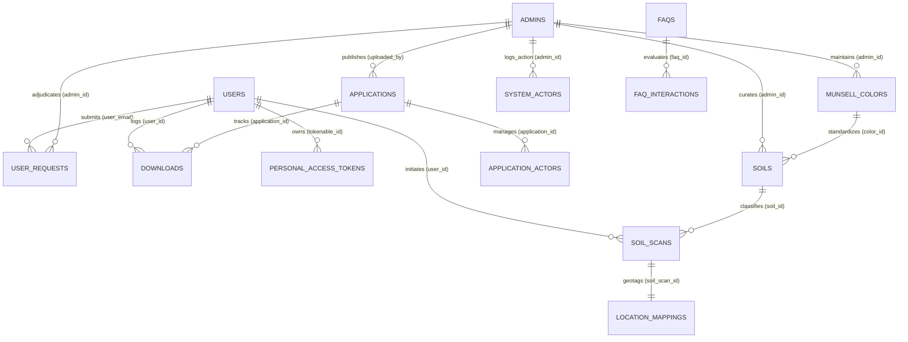
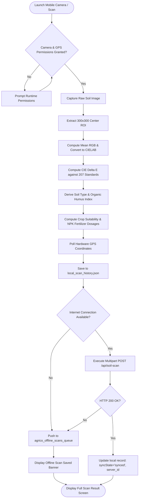
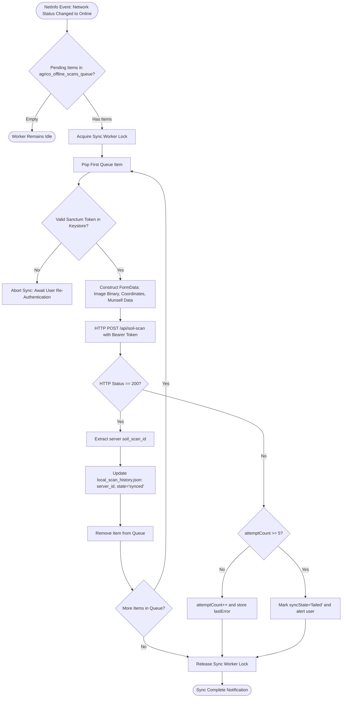
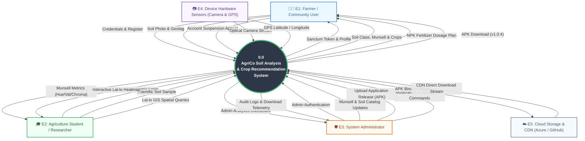
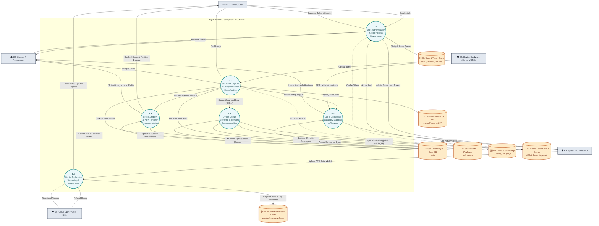

# AgriCo: A Web-Based Soil Color Determination and Scan-Based Soil Reporting System with Location Mapping and Offline Mobile Application Support

**A Capstone Project Proposal**

Presented to the Faculty of the  
**College of Information and Computing Sciences**  
**Cagayan State University - Lal-lo Campus**  
Lal-lo, Cagayan  

In Partial Fulfillment of the Academic Requirements for the Degree  
**Bachelor of Science in Information Technology**  

By:  
**CARL ASHLEY P. CAOILAN**  
**KENT JORDAN M. ALBERTO**  
**EMMANUEL JR. A. DE LA CRUZ**  

**APRIL 2026**

---

## 📑 Table of Contents
1. [Chapter I: The Problem and Its Background](#chapter-i-the-problem-and-its-background)
   - [1.1 Introduction & Background](#11-introduction--background)
   - [1.2 Conceptual Framework (IPO Model)](#12-conceptual-framework-ipo-model)
   - [1.3 Statement of the Problem](#13-statement-of-the-problem)
   - [1.4 Objectives of the Study](#14-objectives-of-the-study)
   - [1.5 Scope and Delimitations of the Study](#15-scope-and-delimitations-of-the-study)
   - [1.6 Significance of the Study](#16-significance-of-the-study)
   - [1.7 Definition of Terms](#17-definition-of-terms)
2. [Chapter II: Review of Related Literature and Studies](#chapter-ii-review-of-related-literature-and-studies)
   - [2.1 Foreign Literature & Studies](#21-foreign-literature--studies)
   - [2.2 Local Literature & Studies](#22-local-literature--studies)
   - [2.3 Synthesis of the Reviewed Literature](#23-synthesis-of-the-reviewed-literature)
3. [Chapter III: Technical Background](#chapter-iii-technical-background)
   - [3.1 System Requirements Analysis](#31-system-requirements-analysis)
   - [3.2 Hardware Specifications (Server & Client)](#32-hardware-specifications-server--client)
   - [3.3 Software Specifications & Technology Stack](#33-software-specifications--technology-stack)
   - [3.4 Peopleware Requirements](#34-peopleware-requirements)
   - [3.5 System Architecture (Offline-First Hybrid Architecture)](#35-system-architecture-offline-first-hybrid-architecture)
4. [Chapter IV: Research Methodology](#chapter-iv-research-methodology)
   - [4.1 Research Design & Software Development Model (Agile SDLC)](#41-research-design--software-development-model-agile-sdlc)
   - [4.2 Use Case Analysis & Actor Interaction Models](#42-use-case-analysis--actor-interaction-models)
   - [4.3 Entity Relationship Diagram (ERD)](#43-entity-relationship-diagram-erd)
   - [4.4 Entities, Attributes, and Domain Specifications (Academic Reference Tables)](#44-entities-attributes-and-domain-specifications-academic-reference-tables)
   - [4.5 System Flowcharts & Procedural Logic](#45-system-flowcharts--procedural-logic)
   - [4.6 Data Flow Diagrams (Level 0 Context & Decomposed Level 0 Subsystems)](#46-data-flow-diagrams-level-0-context--decomposed-level-0-subsystems)
   - [4.7 Hierarchical Input-Process-Output (HIPO) Models](#47-hierarchical-input-process-output-hipo-models)
   - [4.8 Locale of the Study & Target Participants](#48-locale-of-the-study--target-participants)
   - [4.9 Data Gathering Procedures & Research Instruments](#49-data-gathering-procedures--research-instruments)
   - [4.10 Ethical Considerations & Data Privacy](#410-ethical-considerations--data-privacy)
   - [4.11 User Interface Wireframes & System Prototypes](#411-user-interface-wireframes--system-prototypes)
5. [References (APA 7th Edition)](#references-apa-7th-edition)

---

## Chapter I: The Problem and Its Background

### 1.1 Introduction & Background

Soil color serves as one of the most critical diagnostic properties for assessing soil health, providing foundational insights into mineralogy, organic matter content, soil drainage regimes, and overall land productivity. For more than a century, the **Munsell Soil Color Chart (MSCC)** has remained the international standard for soil classification among soil scientists, agronomists, and environmental researchers. The traditional methodology requires field practitioners to manually compare fresh soil clods against printed color chips arranged by Hue, Value, and Chroma under standardized natural illumination.

Despite its ubiquity, this traditional visual approach presents severe operational constraints:
1. **Human Subjectivity & Environmental Inconsistency:** Visual matching depends heavily on subjective human perception, chromatic acuity, observer fatigue, and ambient solar illumination. Variations in cloud cover, canopy shading, and sample moisture systematically alter visual perception, producing inconsistent classifications.
2. **Prohibitive Equipment Costs & Fragility:** Physical Munsell charts are costly, fragile paper books susceptible to mud, water damage, and ultraviolet pigment fading in outdoor field conditions, limiting accessibility for students, agricultural extension workers, and smallholder farmers.
3. **Absence of Digital Documentation & Geotagging:** Traditional evaluations rely on handwritten field notebooks. This manual record-keeping lacks automated spatial indexing, temporal versioning, and integration with geographic information systems (GIS), resulting in fragmented records and lost agricultural intelligence.
4. **Disconnection from Crop & Fertilizer Decision Support:** Identifying a soil color notation (e.g., `10YR 4/3`) has limited immediate value to farmers unless translated into actionable agronomic guidance, such as soil fertility status, crop suitability rankings, and precise fertilizer dosage calculations.

In developing agricultural economies such as the Philippines, and specifically within the agricultural valleys of **Cagayan Province**, these challenges are acute. At **Cagayan State University - Lal-lo Campus**, faculty and students of the **College of Agriculture** conduct intensive soil assessments across the municipality's 37 barangays. However, field evaluations remain constrained by manual charts and unstable rural internet connectivity.

To address these interconnected problems, this capstone study introduces **AgriCo: A Web-Based Soil Color Determination and Scan-Based Soil Reporting System with Location Mapping and Offline Mobile Application Support**. AgriCo bridges smartphone computer vision with an offline-first mobile architecture and a cloud-based web portal, enabling users to capture soil samples, compute color metrics against the 207 Munsell color standard, generate crop and fertilizer recommendations, map GPS coordinates across Lal-lo barangays, and synchronize records seamlessly when internet access is available.

---

### 1.2 Conceptual Framework (IPO Model)

The conceptual framework follows the **Input-Process-Output (IPO)** model, incorporating modern software engineering standards under **ISO/IEC 25010:2011**:

---

### 1.3 Statement of the Problem

Agricultural students, researchers, and local farmers in Lal-lo, Cagayan face significant obstacles in conducting timely, objective, and spatially documented soil assessments. The traditional process relies on visual color charts that are subjective, slow, and disconnected from decision-making tools.

#### Specific Research Questions:
1. What are the specific operational limitations, observer error rates, and documentation delays encountered when using traditional Munsell charts within the CSU Lal-lo College of Agriculture?
2. How can an integrated system be engineered using **React Native on-device computer vision** and **Laravel 11 cloud architecture** to achieve automated Munsell color matching and crop recommendations under both online and offline field conditions?
3. What algorithms and data models are required to translate digital camera RGB pixels into accurate CIELAB Munsell notations and generate NPK fertilizer dosage prescriptions tailored to Lal-lo soil varieties?
4. How effective is the offline synchronization mechanism in preserving field scan data, GPS coordinates, and sample photos without packet loss in rural areas with intermittent connectivity?
5. What is the level of software quality of the developed AgriCo system when evaluated by IT experts, agriculture faculty, and students against the **ISO/IEC 25010:2011** software quality criteria (Functional Suitability, Performance Efficiency, Usability, Reliability, Security, Maintainability, Portability)?

---

### 1.4 Objectives of the Study

#### General Objective:
To design, develop, and evaluate **AgriCo: A Web-Based Soil Color Determination and Scan-Based Soil Reporting System with Location Mapping and Offline Mobile Application Support** for Cagayan State University - Lal-lo Campus.

#### Specific Objectives:
1. To develop a cross-platform mobile application using **React Native** that executes on-device image preprocessing, center-ROI cropping (300x300 pixels), and color space conversion (RGB to CIELAB).
2. To implement a computational color-matching algorithm based on the **CIE Delta E 2000 formula** against a structured catalog of **207 standard Munsell reference chips**.
3. To build an agronomic recommendation engine that correlates classified soil types (e.g., Lal-lo Clay Loam, Sandy Loam) with suitable local crops (Rice, Corn, Tobacco, Peanut, Cassava, Eggplant) and computes NPK fertilizer dosages in standard 50kg bags per hectare.
4. To establish an **offline-first data persistence mechanism** utilizing local JSON storage (`local_scan_history.json`), encrypted session keychains, and an automated background synchronization worker (`scanSyncService.js`).
5. To deploy a cloud-based web portal using **Laravel 11, Livewire 3, and MySQL 8.0** that features interactive **Leaflet.js GIS mapping** across the 37 barangays of Lal-lo, an administrative control dashboard, and APK release versioning.
6. To evaluate the system's performance, usability, and technical compliance with the **ISO/IEC 25010:2011** standard among IT professionals, agriculture faculty, and student evaluators.

---

### 1.5 Scope and Delimitations of the Study

#### Scope:
- **Optical Color Determination:** Digital capture of soil surfaces using smartphone cameras; automated cropping of a standardized center 300x300 pixel Region of Interest (ROI); mathematical extraction of dominant RGB/HEX; and mapping to Munsell Hue, Value, Chroma, and Color Name.
- **Agronomic Guidance:** Automatic calculation of the Soil Organic Humus Index and generation of crop suitability scores and NPK fertilizer dosage formulas.
- **Geographic Coverage:** Geospatial mapping specifically calibrated for the **37 barangays of Lal-lo, Cagayan**, utilizing GPS boundary approximations and interactive map pins.
- **Dual-Platform Architecture:**
  - **Mobile Client (Android):** Offline scanning, local data caching, on-device color calculation, offline queue management, and background network synchronization.
  - **Web Portal (Desktop/Browser):** Administrative governance, user verification, suspension management, Munsell catalog maintenance, full-screen GIS heatmaps, and APK distribution management.

#### Delimitations:
- **Chemical Laboratory Testing:** The system does not replace wet-chemistry laboratory soil testing (spectrophotometry, Kjeldahl nitrogen digestion, or atomic absorption). Its recommendations are derived from optical surface color indicators and established soil series benchmarks.
- **Lighting Extremes:** While the system employs mathematical ROI averaging and Delta E tolerances, extreme darkness, high-glare direct flash reflection, or water-saturated mud samples may distort optical readings. Users are advised to photograph moist or dry samples under indirect natural daylight.
- **Operating System Platform:** The mobile application is targeted and compiled for **Android (SDK 26 to 34)**; iOS compilation is outside the primary scope.

---

### 1.6 Significance of the Study

- **For Smallholder Farmers:** Provides an immediate, free, and accessible digital soil assessment tool that demystifies scientific soil classification, helping them select viable crops and avoid fertilizer misapplication.
- **For Agriculture Students and Researchers:** Serves as a digital field companion at CSU Lal-lo, eliminating the need to carry expensive Munsell books and streamlining experimental soil data collection with automatic geotagging.
- **For Faculty and Extension Workers:** Delivers centralized, verifiable spatial records of soil testing activities across the municipality, facilitating data-driven agricultural extension programs.
- **For Local Government Units (LGU Lal-lo):** Yields a municipal-wide soil fertility and crop suitability map that assists agricultural officers in land-use planning and disaster recovery assessments.
- **For Future Researchers:** Establishes an architectural foundation for integrating edge machine learning, mobile computer vision, and offline synchronization in Philippine rural technology initiatives.

---

### 1.7 Definition of Terms

- **CIELAB Color Space:** A device-independent, mathematically uniform color model expressing color as three numerical values: $L^*$ for perceptual lightness, and $a^*$ and $b^*$ for the four unique colors of human vision (green-red and blue-yellow).
- **CIE Delta E ($\Delta E$):** A standardized metric representing the Euclidean distance between two colors in the CIELAB color space, where lower values signify greater visual similarity.
- **Hue, Value, Chroma:** The three dimensions of the Munsell system: Hue represents the spectral color family (e.g., `10YR`); Value indicates darkness or lightness ($0$ to $10$); Chroma represents saturation or purity ($0$ to $8$).
- **Offline-First Architecture:** A software development paradigm where application logic, data capture, and storage are executed locally on the device by default, synchronizing with remote cloud servers opportunistically when network connectivity is established.
- **Region of Interest (ROI):** A designated rectangular pixel boundary (standardized at 300x300 pixels) extracted from the center of a captured photograph to isolate the soil sample from surrounding background noise.
- **NPK Rating:** The percentage content of Nitrogen (N), Phosphorus (P), and Potassium (K) in agricultural fertilizers, used by AgriCo to calculate required 50kg bags per hectare.

---

## Chapter II: Review of Related Literature and Studies

### 2.1 Foreign Literature & Studies

Digital image processing and smartphone-based colorimetry have gained substantial momentum in international soil science:
- **Naeimi et al. (2024)** demonstrated that smartphone cameras, when paired with structured digital color transformations, enable rapid soil quality predictions. They emphasized that converting raw sensor data into device-independent color spaces mitigates natural ambient lighting variations.
- **Kautsar et al. (2024)** evaluated mobile color calibration against standard color cards, establishing that the CIELAB color space significantly outperforms standard RGB in resolving subtle soil moisture and humus transitions in field environments.
- **Wu et al. (2018)** verified the quantitative relationship between Soil Organic Matter (SOM) and digital color intensity ($R^2 = 0.85$), proving that digital cameras provide a reliable, low-cost proxy for surface soil organic carbon estimation.
- **Baek et al. (2022)** simulated 12 distinct illumination environments and demonstrated that calculating color differences via CIELAB coordinates ensures classification consistency across varying solar angles, effectively removing human observer bias.
- **Syafutra et al. (2025)** developed optical sensor prototypes that confirmed automated color matching against Munsell standards reduces classification time from minutes to milliseconds while guaranteeing repeatability.
- **Ben Abderrahmane et al. (2025)** presented an integrated architectural roadmap linking field data collection with cloud-based Geographic Information Systems (GIS), arguing that digital soil mapping systems must combine on-site sensing with centralized spatial intelligence to support regional agricultural planning.

---

### 2.2 Local Literature & Studies

Within the Philippine agricultural sector, government institutions and local researchers have underscored the critical need for digitized soil intelligence:
- **Philippine Rice Research Institute (PhilRice, 2023):** Developed the PhilRice Soil Information System (PSIS) as an online repository for provincial soil series. While valuable, PSIS serves primarily as an informational web library rather than a field-deployable scanning utility.
- **Bureau of Soils and Water Management (BSWM, 2025):** Established Mobile Soil Laboratories (MSL) across rural provinces to bring testing closer to farmers. However, these laboratories require dedicated vehicles, heavy chemical reagents, and specialized personnel, limiting continuous access for remote barangays.
- **Subia et al. (2023):** Engineered an automated soil color analyzer utilizing single-board computer processing and the Delta E algorithm, proving the feasibility of computer vision for Philippine soil health evaluation.
- **Calimodag et al. (2024) & Alejo and Fiegalan (2025):** Explored GIS mapping of municipal soil series in Iloilo and Nueva Ecija, concluding that visual, spatial representations of soil types are essential for optimizing regional crop selection (Rice, Corn, Onion) and fertilizer allocations.
- **Dela Cruz et al. (2025):** Developed an Android-based monitoring app for farmers in Alaminos City, achieving an "Excellent" rating under ISO 25010 and proving that Filipino smallholders readily adopt intuitive mobile interfaces when designed for rural constraints.

---

### 2.3 Synthesis of the Reviewed Literature

The literature confirms that smartphone cameras and digital image processing can achieve classification accuracy comparable to or exceeding traditional visual Munsell matching, while eliminating human subjectivity. However, existing foreign implementations frequently assume continuous internet connectivity or rely on costly external optical calibration rigs. Conversely, local Philippine efforts either center on static web repositories (PhilRice PSIS) or require mobile laboratory vehicles (BSWM MSL). 

A critical research and engineering gap remains: **the absence of a unified, offline-first mobile application capable of on-device Munsell matching (207 reference chips) and agronomic crop recommendation, coupled with an automated background sync engine and a municipal GIS web dashboard tailored to rural Philippine communities such as Lal-lo, Cagayan.** AgriCo is specifically designed to bridge this gap.

---

## Chapter III: Technical Background

### 3.1 System Requirements Analysis

AgriCo is designed around an **Offline-First Hybrid Architecture**. The mobile application operates autonomously in the field without internet connectivity, storing scan records in a secure local sandbox. When network access is detected, the mobile client executes background multipart HTTP uploads to the centralized cloud server. The cloud web portal delivers administrative governance, municipal GIS heatmaps, and mobile application distribution.

---

### 3.2 Hardware Specifications (Server & Client)

| Component | Cloud Server Specifications (Recommended) | Field Mobile Client Specifications (Minimum) |
| :--- | :--- | :--- |
| **Device Type** | Cloud Virtual Server / Production Host | Android Smartphone |
| **Processor (CPU)** | Intel Core i5 / AMD Ryzen 5 (4+ Cores, 2.9–4.3 GHz) | Octa-Core Processor (e.g., MediaTek Helio G81 / Snapdragon 680) |
| **System Memory (RAM)**| 16 GB DDR4/DDR5 | 4 GB RAM (8 GB Recommended for rapid camera processing) |
| **Storage Capacity** | 512 GB NVMe SSD | 64 GB Internal Storage (with 500 MB free for local cache) |
| **Camera Hardware** | N/A | 13 MP Rear Camera with Autofocus and LED Flash |
| **Sensors** | N/A | Hardware GPS / GLONASS Receiver |
| **Network Interface** | 100 Mbps Dedicated Ethernet / Static IP | Wi-Fi 802.11 b/g/n, 4G LTE / 5G Mobile Data |

---

### 3.3 Software Specifications & Technology Stack

The AgriCo platform leverages modern web and mobile frameworks selected for high performance, maintainability, and offline resilience:

#### Detailed Software Component Catalog:
1. **React Native (Mobile Client Framework):** Cross-platform mobile framework compiling to native Android bytecode. Executes on-device camera manipulation, canvas cropping, and mathematical Delta E matching without server round-trips.
2. **Laravel 11 & PHP 8.2+ (Backend Web Framework):** Modern PHP framework enforcing Model-View-Controller (MVC) architecture, robust Eloquent ORM relationships, database migrations, and rate-limited RESTful API endpoints.
3. **Laravel Sanctum:** Provides lightweight, cryptographically secure bearer token authentication for mobile clients and session cookie auth for web portal users.
4. **Livewire 3 & Alpine.js:** Full-stack reactive framework for Laravel, enabling real-time administrative dashboard updates, filtering, and pagination without heavy single-page application (SPA) complexity.
5. **MySQL 8.0:** Master relational database management system enforcing ACID compliance, foreign key constraints, spatial indexing, and transactional data integrity.
6. **Leaflet.js:** Open-source JavaScript library utilized within the administrative portal to render interactive GIS maps, GPS markers, and color-coded soil clusters across the 37 barangays of Lal-lo.
7. **Local Document Store & Android Keystore:** Client-side persistence combining a structured JSON document store (`local_scan_history.json`), an offline queue store (`agrico_offline_scans_queue`), and hardware-backed credential storage via Android Keystore.

---

### 3.4 Peopleware Requirements

1. **System Developers (BSIT Proponents):** Responsible for architecture design, coding, computer vision calibration, API development, automated testing, and deployment.
2. **System Administrators (CSU Lal-lo Faculty & IT Staff):** Manage user authorizations, review suspension appeals, maintain the 207 Munsell reference database, publish APK updates, and audit system activity logs.
3. **End Users (Agriculture Students, Researchers & Smallholder Farmers):** Capture field soil samples, inspect classification results, apply fertilizer dosages, and contribute verified spatial soil records.

---

### 3.5 System Architecture (Offline-First Hybrid Architecture)

---

## Chapter IV: Research Methodology

### 4.1 Research Design & Software Development Model (Agile SDLC)

The study implements an **Agile Software Development Life Cycle (SDLC)** combining iterative sprint cycles with empirical software quality evaluation under **ISO/IEC 25010:2011**:

- **Phase 1: Planning (Weeks 1–3):** Problem identification at CSU Lal-lo College of Agriculture; baseline documentation of traditional Munsell matching challenges; formulation of project objectives.
- **Phase 2: Requirements & Architectural Design (Weeks 4–7):** Formalization of Use Cases, DFD Level 0, Entity-Attribute-Domain tables, database schemas, and Figma high-fidelity UI prototypes.
- **Phase 3: Development & Iterative Sprints (Weeks 8–15):** Construction of the React Native mobile client, Laravel 11 backend, CIE Delta E computer vision algorithms, and MySQL schemas.
- **Phase 4: Testing & Calibration (Weeks 16–18):** Benchmarking digital Munsell classifications against physical soil samples; validating offline queue resilience and zero-data-loss synchronization.
- **Phase 5: Deployment & Release (Weeks 19–20):** Staging the cloud web portal, configuring Azure Blob/GitHub release pipelines for APK build distribution (`v1.0.4`), and conducting field trials across Lal-lo barangays.
- **Phase 6: Evaluation & Maintenance (Weeks 21–22):** Formal administration of ISO 25010 evaluation instruments with IT experts, agriculture faculty, and students.

---

### 4.2 Use Case Analysis & Actor Interaction Models

```mermaid
flowchart TD
    subgraph Actors ["System Actors"]
        A_User["🧑‍🌾 Farmer / General User"]
        A_Stud["🎓 Agriculture Student / Researcher"]
        A_Admin["🛡️ System Administrator"]
        A_Guest["👤 Guest User (Unregistered)"]
    end

    subgraph MobileUC ["📱 Mobile Application Use Cases"]
        UC01["UC-01: Capture & Preprocess Soil Sample"]
        UC02["UC-02: Offline Munsell Matching & Analysis"]
        UC03["UC-03: View Crop & Fertilizer Prescription"]
        UC04["UC-04: Offline Queue Buffering & Cloud Sync"]
        UC05["UC-05: Local Scan History Management"]
    end

    subgraph WebUC ["💻 Web Portal Use Cases"]
        UC06["UC-06: Interactive Lal-lo GIS Barangay Mapping"]
        UC07["UC-07: User Verification & Suspension Governance"]
        UC08["UC-08: Munsell Catalog & Soil Standard Management"]
        UC09["UC-09: Mobile APK Release Publishing (v1.0.4)"]
        UC10["UC-10: System Audit Telemetry & Appeal Adjudication"]
    end

    A_Guest --> UC01
    A_Guest --> UC02
    A_User --> UC01
    A_User --> UC02
    A_User --> UC03
    A_User --> UC04
    A_User --> UC05
    A_Stud --> UC01
    A_Stud --> UC02
    A_Stud --> UC03
    A_Stud --> UC04
    A_Stud --> UC05
    A_Stud --> UC06
    A_Admin --> UC06
    A_Admin --> UC07
    A_Admin --> UC08
    A_Admin --> UC09
    A_Admin --> UC10

    classDef act fill:#ebf8ff,stroke:#3182ce,stroke-width:2px,color:#2b6cb0;
    classDef uc fill:#f0fff4,stroke:#38a169,stroke-width:2px,color:#276749;
    class A_User,A_Stud,A_Admin,A_Guest act;
    class UC01,UC02,UC03,UC04,UC05,UC06,UC07,UC08,UC09,UC10 uc;
```

---

### 4.3 Entity Relationship Diagram (ERD)

---

### 4.4 Entities, Attributes, and Domain Specifications (Academic Reference Tables)

The following tables document the official Entity-Attribute-Domain specifications for all Central Cloud Database entities and Mobile Client Local Storage entities. Primary Keys are designated with an underline (`<u>PK</u>`), Foreign Keys with italics (`*FK*`), and domain constraints explicitly define permitted character sets and value ranges:

#### 1. Central Database Entities (Laravel 11 / MySQL 8.0)

| ENTITY | ATTRIBUTES | DOMAIN |
| :--- | :--- | :--- |
| **User** | <u>User_ID</u> | `0-9` *(or formatted `USR-XXXX`)* |
| | Full_Name | `a-z, A-Z, spaces` |
| | Email | `a-z, A-Z, 0-9, @, ., _, -` |
| | Password | `a-z, A-Z, 0-9, Symbols` *(Bcrypt hash string)* |
| | Role | `'farmer', 'student', 'researcher', 'admin', 'superadmin'` |
| | Student_ID | `a-z, A-Z, 0-9, -` *(Optional)* |
| | Section | `a-z, A-Z, 0-9, spaces` *(Optional)* |
| | Student_Record_Status | `'active', 'pending', 'graduated'` |
| | Status | `'ACTIVE', 'SUSPENDED'` |
| | Suspend_Reason | `a-z, A-Z, 0-9, Symbols, spaces` |
| | Suspended_Until | `YYYY-MM-DD HH:MM:SS` *(Datetime)* |
| | *Suspended_By_Admin_ID* | `a-z, A-Z, 0-9, -` *(FK -> Admin.Admin_ID)* |
| | *Last_Admin_ID* | `a-z, A-Z, 0-9, -` *(FK -> Admin.Admin_ID)* |
| | Profile_Photo_Path | `a-z, A-Z, 0-9, /, ., _, -` *(File path)* |
| | Is_Online | `0, 1` *(Boolean)* |
| | Theme | `'light', 'dark'` |
| | Created_At | `YYYY-MM-DD HH:MM:SS` *(Datetime)* |
| | Updated_At | `YYYY-MM-DD HH:MM:SS` *(Datetime)* |
| | Scheduled_Deletion_At | `YYYY-MM-DD HH:MM:SS` *(Datetime)* |

 

| ENTITY | ATTRIBUTES | DOMAIN |
| :--- | :--- | :--- |
| **Admin** | <u>Admin_ID</u> | `0-9, a-z, A-Z, -` *(e.g. ADM-001, ADM-002)* |
| | Full_Name | `a-z, A-Z, spaces` |
| | Email | `a-z, A-Z, 0-9, @, ., _, -` |
| | Password | `a-z, A-Z, 0-9, Symbols` *(Bcrypt hash string)* |
| | Profile_Photo_Path | `a-z, A-Z, 0-9, /, ., _, -` *(File path)* |
| | Remember_Token | `a-z, A-Z, 0-9` *(60-100 characters string)* |

 

| ENTITY | ATTRIBUTES | DOMAIN |
| :--- | :--- | :--- |
| **Personal_Access_Token** | <u>ID</u> | `0-9` *(Positive Integer)* |
| | Tokenable_Type | `a-z, A-Z, \` *(e.g. 'App\Models\User')* |
| | *Tokenable_ID* | `0-9, a-z, A-Z, -` *(FK -> User.User_ID)* |
| | Name | `a-z, A-Z, 0-9, spaces, -` *(Device client tag)* |
| | Token | `0-9, a-f` *(64-character SHA-256 hash)* |
| | Abilities | `a-z, A-Z, 0-9, *, [, ], ", ,` *(JSON array)* |
| | Last_Used_At | `YYYY-MM-DD HH:MM:SS` *(Datetime)* |
| | Expires_At | `YYYY-MM-DD HH:MM:SS` *(Datetime)* |
| | Created_At | `YYYY-MM-DD HH:MM:SS` *(Datetime)* |
| | Updated_At | `YYYY-MM-DD HH:MM:SS` *(Datetime)* |

 

| ENTITY | ATTRIBUTES | DOMAIN |
| :--- | :--- | :--- |
| **Soil** | <u>Soil_ID</u> | `0-9` *(Positive Integer)* |
| | Soil_Name | `a-z, A-Z, 0-9, spaces` *(e.g. 'Lal-lo Clay Loam')* |
| | Description | `a-z, A-Z, 0-9, Symbols, spaces` *(Text)* |
| | Hue | `0-9, ., a-z, A-Z` *(e.g. '10YR', '7.5YR', '5Y')* |
| | Full_Code | `0-9, ., /, a-z, A-Z, spaces` *(e.g. '10YR 4/4')* |
| | Soil_Type | `a-z, A-Z, spaces` *(e.g. 'Clay Loam', 'Sandy Loam')* |
| | Organic_Matter | `a-z, A-Z, 0-9, %, spaces` *(e.g. 'Medium Humus (2.5%)')* |
| | Hex_Color | `#, 0-9, a-f, A-F` *(7 characters e.g. '#9A7B4F')* |
| | Status | `'ACTIVE', 'ARCHIVED'` |
| | Scan_Count | `0-9` *(Integer >= 0)* |
| | *Color_ID* | `0-9` *(FK -> Munsell_Color.Munsell_Color_ID)* |
| | *Admin_ID* | `0-9, a-z, A-Z, -` *(FK -> Admin.Admin_ID)* |
| | *Last_Admin_ID* | `0-9, a-z, A-Z, -` *(FK -> Admin.Admin_ID)* |
| | Created_At | `YYYY-MM-DD HH:MM:SS` *(Datetime)* |
| | Updated_At | `YYYY-MM-DD HH:MM:SS` *(Datetime)* |

 

| ENTITY | ATTRIBUTES | DOMAIN |
| :--- | :--- | :--- |
| **Soil_Scan** | <u>Soil_Scan_ID</u> | `0-9` *(Positive Integer)* |
| | Scan_Image | `a-z, A-Z, 0-9, /, ., _, -` *(Storage file path)* |
| | Scan_Date | `YYYY-MM-DD HH:MM:SS` *(Datetime)* |
| | Platform | `'web', 'android'` |
| | Scan_Note | `a-z, A-Z, 0-9, Symbols, spaces` |
| | Regions_Data | `a-z, A-Z, 0-9, Symbols` *(Valid 6-stage ML JSON structure)* |
| | *User_ID* | `0-9, a-z, A-Z, -` *(FK -> User.User_ID or NULL)* |
| | *Soil_ID* | `0-9` *(FK -> Soil.Soil_ID)* |
| | Created_At | `YYYY-MM-DD HH:MM:SS` *(Datetime)* |
| | Updated_At | `YYYY-MM-DD HH:MM:SS` *(Datetime)* |

 

| ENTITY | ATTRIBUTES | DOMAIN |
| :--- | :--- | :--- |
| **Munsell_Color** | <u>Munsell_Color_ID</u>| `0-9` *(Positive Integer, 1 to 207)* |
| | Hue | `'10R', '2.5YR', '5YR', '7.5YR', '10YR', '2.5Y', '5Y', 'GLEY'` |
| | Value | `2.00 to 8.00` *(Decimal 4,2)* |
| | Chroma | `1.00 to 8.00` *(Decimal 4,2)* |
| | Full_Code | `0-9, ., /, a-z, A-Z, spaces` *(e.g. '10YR 5/6')* |
| | Soil_Organic_Index | `'Low Humus', 'Medium Humus', 'High Humus'` |
| | Soil_Type | `'Clay', 'Loam', 'Sandy Loam', 'Silt Loam', 'Heavy Clay'` |
| | Color_Name | `a-z, A-Z, spaces` *(e.g. 'Yellowish Brown')* |
| | Hex_Code | `#, 0-9, a-f, A-F` *(7 characters e.g. '#A87948')* |
| | Image_Path | `a-z, A-Z, 0-9, /, ., _, -` *(File path)* |
| | Status | `'ACTIVE', 'INACTIVE'` |
| | *Admin_ID* | `0-9, a-z, A-Z, -` *(FK -> Admin.Admin_ID)* |
| | *Last_Admin_ID* | `0-9, a-z, A-Z, -` *(FK -> Admin.Admin_ID)* |
| | Created_At | `YYYY-MM-DD HH:MM:SS` *(Datetime)* |
| | Updated_At | `YYYY-MM-DD HH:MM:SS` *(Datetime)* |

 

| ENTITY | ATTRIBUTES | DOMAIN |
| :--- | :--- | :--- |
| **Location_Mapping** | <u>Location_Mapping_ID</u>| `0-9` *(Positive Integer)* |
| | Latitude | `4.50000000 to 21.50000000` *(Decimal 10,8 N)* |
| | Longitude | `116.00000000 to 127.00000000` *(Decimal 11,8 E)* |
| | Barangay | `a-z, A-Z, spaces, (), -` *(Lal-lo Barangay Name)* |
| | Timestamp | `YYYY-MM-DD HH:MM:SS` *(Datetime)* |
| | Status | `'ACTIVE', 'PENDING', 'FLAGGED', 'HIDDEN'` |
| | *Soil_Scan_ID* | `0-9` *(FK -> Soil_Scan.Soil_Scan_ID)* |
| | *Soil_ID* | `0-9` *(FK -> Soil.Soil_ID)* |
| | Created_At | `YYYY-MM-DD HH:MM:SS` *(Datetime)* |
| | Updated_At | `YYYY-MM-DD HH:MM:SS` *(Datetime)* |

 

| ENTITY | ATTRIBUTES | DOMAIN |
| :--- | :--- | :--- |
| **Application** | <u>Application_ID</u> | `0-9` *(Positive Integer)* |
| | Application_Name | `a-z, A-Z, 0-9, spaces` *(e.g. 'AgriCo Mobile App')* |
| | Version | `v0.0.0 to v99.99.99` *(e.g. 'v1.0.4')* |
| | File_Path | `a-z, A-Z, 0-9, :, /, ., _, -, ?` *(URL / Path)* |
| | Filename | `a-z, A-Z, 0-9, ., -, _` *(e.g. 'agrico-app-v1.0.4.apk')* |
| | File_Size | `0-9, ., a-z, A-Z, spaces` *(e.g. '59.5 MB')* |
| | Release_Notes | `a-z, A-Z, 0-9, Symbols, spaces` *(Markdown Text)* |
| | Status | `'ACTIVE', 'ARCHIVED'` |
| | Is_Maintenance | `0, 1` *(Boolean)* |
| | *Uploaded_By* | `0-9, a-z, A-Z, -` *(FK -> Admin.Admin_ID)* |
| | Created_At | `YYYY-MM-DD HH:MM:SS` *(Datetime)* |
| | Updated_At | `YYYY-MM-DD HH:MM:SS` *(Datetime)* |

 

| ENTITY | ATTRIBUTES | DOMAIN |
| :--- | :--- | :--- |
| **Download** | <u>Download_ID</u> | `0-9` *(Positive Integer)* |
| | *User_ID* | `0-9, a-z, A-Z, -` *(FK -> User.User_ID or NULL)* |
| | *Application_ID* | `0-9` *(FK -> Application.Application_ID)* |
| | Download_Type | `'direct_apk', 'in_app_update', 'cdn_redirect', 'qr_code'` |
| | Download_Date | `YYYY-MM-DD HH:MM:SS` *(Datetime)* |
| | Created_At | `YYYY-MM-DD HH:MM:SS` *(Datetime)* |
| | Updated_At | `YYYY-MM-DD HH:MM:SS` *(Datetime)* |

 

| ENTITY | ATTRIBUTES | DOMAIN |
| :--- | :--- | :--- |
| **User_Request** | <u>User_Request_ID</u> | `0-9` *(Positive Integer)* |
| | Request_Code | `REQ-00000 to REQ-99999` *(Unique ticket string)* |
| | User_Name | `a-z, A-Z, spaces` |
| | User_Email | `a-z, A-Z, 0-9, @, ., _, -` |
| | Type | `'suspension_appeal', 'student_verification'` |
| | Description | `a-z, A-Z, 0-9, Symbols, spaces` |
| | Status | `'Pending', 'Approved', 'Rejected'` |
| | *Admin_ID* | `0-9, a-z, A-Z, -` *(FK -> Admin.Admin_ID or NULL)* |
| | Submitted_At | `YYYY-MM-DD HH:MM:SS` *(Datetime)* |
| | Created_At | `YYYY-MM-DD HH:MM:SS` *(Datetime)* |
| | Updated_At | `YYYY-MM-DD HH:MM:SS` *(Datetime)* |

 

| ENTITY | ATTRIBUTES | DOMAIN |
| :--- | :--- | :--- |
| **FAQ** | <u>FAQ_ID</u> | `0-9` *(Positive Integer)* |
| | Question | `a-z, A-Z, 0-9, ?, spaces` |
| | Category | `'scanning', 'munsell', 'sync', 'updates', 'fertilizer'` |
| | Answer | `a-z, A-Z, 0-9, Symbols, spaces` *(Markdown Text)* |
| | Status | `'ACTIVE', 'DRAFT', 'ARCHIVED'` |
| | *Admin_ID* | `0-9, a-z, A-Z, -` *(FK -> Admin.Admin_ID)* |
| | *Last_Admin_ID* | `0-9, a-z, A-Z, -` *(FK -> Admin.Admin_ID)* |
| | Created_At | `YYYY-MM-DD HH:MM:SS` *(Datetime)* |
| | Updated_At | `YYYY-MM-DD HH:MM:SS` *(Datetime)* |

 

| ENTITY | ATTRIBUTES | DOMAIN |
| :--- | :--- | :--- |
| **FAQ_Interaction** | <u>FAQ_Interaction_ID</u> | `0-9` *(Positive Integer)* |
| | Action_Type | `'view', 'helpful', 'unhelpful', 'search'` |
| | *User_ID* | `0-9, a-z, A-Z, -` *(FK -> User.User_ID or NULL)* |
| | *Admin_ID* | `0-9, a-z, A-Z, -` *(FK -> Admin.Admin_ID or NULL)* |
| | *FAQ_ID* | `0-9` *(FK -> FAQ.FAQ_ID)* |
| | Timestamp | `YYYY-MM-DD HH:MM:SS` *(Datetime)* |
| | Created_At | `YYYY-MM-DD HH:MM:SS` *(Datetime)* |
| | Updated_At | `YYYY-MM-DD HH:MM:SS` *(Datetime)* |

 

| ENTITY | ATTRIBUTES | DOMAIN |
| :--- | :--- | :--- |
| **System_Actor** | <u>System_Actor_ID</u> | `0-9` *(Positive Integer)* |
| | Actor_Name | `a-z, A-Z, 0-9, _, spaces` |
| | Actor_Type | `'USER', 'ADMIN', 'SYSTEM_SERVICE'` |
| | Description | `a-z, A-Z, 0-9, Symbols, spaces` |
| | Status | `'LOGGED', 'AUDITED'` |
| | *Soil_ID* | `0-9` *(FK -> Soil.Soil_ID or NULL)* |
| | *User_ID* | `0-9, a-z, A-Z, -` *(FK -> User.User_ID or NULL)* |
| | Map_ID | `0-9` *(Integer or NULL)* |
| | *Admin_ID* | `0-9, a-z, A-Z, -` *(FK -> Admin.Admin_ID or NULL)* |
| | Role | `a-z, A-Z, _` |
| | Action | `a-z, A-Z, _` *(e.g. 'APPROVE_SCAN', 'SUSPEND_USER')* |
| | Created_At | `YYYY-MM-DD HH:MM:SS` *(Datetime)* |
| | Updated_At | `YYYY-MM-DD HH:MM:SS` *(Datetime)* |

---

#### 2. Mobile On-Device Local Entities (Android Storage Sandbox)

| ENTITY | ATTRIBUTES | DOMAIN |
| :--- | :--- | :--- |
| **Local_Scan_Record** | <u>Scan_ID</u> | `0-9, a-f, -` *(UUIDv4 36-char string)* |
| *(local_scan_history.json)* | *Server_ID* | `0-9` *(Integer or NULL if un-synced)* |
| | Image_URI | `file://, a-z, A-Z, 0-9, /, ., _` |
| | Munsell_Code | `0-9, ., /, a-z, A-Z, spaces` *(e.g. '10YR 4/3')* |
| | Color_Name | `a-z, A-Z, spaces` *(e.g. 'Dark Brown')* |
| | Hex_Color | `#, 0-9, a-f, A-F` *(e.g. '#594331')* |
| | Soil_Type | `a-z, A-Z, spaces` *(e.g. 'Clay Loam')* |
| | Organic_Index | `0.00 to 100.00` *(Decimal %)* |
| | Delta_E | `0.00 to 99.99` *(Color difference metric)* |
| | Crop_Recommendations | `a-z, A-Z, 0-9, %, Symbols` *(JSON array of crops & scores)* |
| | Fertilizer_Dosage | `0-9, a-z, A-Z, Symbols` *(JSON of bags & kg)* |
| | Latitude | `-90.000000 to +90.000000` *(Decimal)* |
| | Longitude | `-180.000000 to +180.000000` *(Decimal)* |
| | Barangay | `a-z, A-Z, spaces, (), -` |
| | Sync_State | `'queued', 'synced', 'failed'` |
| | Timestamp | `YYYY-MM-DDTHH:MM:SSZ` *(ISO 8601 String)* |

 

| ENTITY | ATTRIBUTES | DOMAIN |
| :--- | :--- | :--- |
| **Offline_Sync_Queue** | <u>Queue_Item_ID</u> | `0-9, a-f, -` *(UUIDv4 string)* |
| *(agrico_offline_scans_queue)* | Image_Path | `file://, a-z, A-Z, 0-9, /, ., _` |
| | Latitude | `-90.000000 to +90.000000` *(Decimal)* |
| | Longitude | `-180.000000 to +180.000000` *(Decimal)* |
| | Location_Name | `a-z, A-Z, spaces, (), -` |
| | Attempt_Count | `0 to 5` *(Integer counter)* |
| | Last_Error | `a-z, A-Z, 0-9, Symbols, spaces` |
| | Queued_At | `YYYY-MM-DDTHH:MM:SSZ` *(ISO 8601 String)* |

 

| ENTITY | ATTRIBUTES | DOMAIN |
| :--- | :--- | :--- |
| **Auth_Credential_Session** | <u>Service</u> | `'agrico_auth_session'` *(Constant identifier)* |
| *(Android Keystore / Keychain)*| Sanctum_Token | `0-9, a-zA-Z, \|` *(e.g. '14\|N28e3b...')* |
| | User_ID | `0-9, a-z, A-Z, -` *(e.g. 'USR-0482')* |
| | Email | `a-z, A-Z, 0-9, @, ., _, -` |
| | Role | `'farmer', 'student'` |

---

### 4.5 System Flowcharts & Procedural Logic

#### 1. Mobile Soil Scanning, On-Device ML & Geotagging Flow

#### 2. Background Synchronization Flow (`scanSyncService.js`)

---

### 4.6 Data Flow Diagrams (Level 0 Context & Decomposed Level 0 Subsystems)

#### Level 0 System Context Diagram (Context-Level DFD)

The Context Diagram defines the entire platform as a single central process bubble (`0.0`) interacting with all primary external entities:

---

#### Decomposed Level 0 DFD (Subsystem Processes 1.0 – 6.0 & Data Stores D1 – D7)

Decomposes the central process `0.0` into the six core subsystem processes and seven data stores:

---

### 4.7 Hierarchical Input-Process-Output (HIPO) Models

#### 1. User / Student HIPO Diagram
- **Input:** User credentials, optical soil photograph, manual or sensor-acquired GPS coordinates, suspension appeal ticket details.
- **Process:** On-device 300x300 center cropping; CIE Delta E matching against 207 reference chips; humus rating derivation; crop feasibility ranking; NPK calculation; local JSON caching; automated background cloud sync.
- **Output:** Munsell classification card; crop recommendation list; 50kg fertilizer bag dosage; local history log; interactive Lal-lo barangay pin.

#### 2. Administrator HIPO Diagram
- **Input:** Administrative login credentials (`ADM-XXXX`), new Munsell reference chip vectors, soil classification categories, APK binary uploads (`v1.0.4`), appeal ticket approval/rejection decisions.
- **Process:** Sanctum authentication; administrative database CRUD execution; suspension expiry enforcement (1-day duration); APK binary checksum validation; Lal-lo GIS aggregation.
- **Output:** Real-time administrative intelligence dashboard; updated soil catalog; published APK release downloads; audit trail logs (`system_actors`).

#### 3. Public Web Portal HIPO Diagram
- **Input:** Web visitor queries, APK download requests, FAQ search terms.
- **Process:** Static binary streaming; FAQ full-text search; public soil information rendering.
- **Output:** Direct APK binary stream (`agrico-app-v1.0.4.apk`), verified SHA-256 checksums, answered FAQ articles.

---

### 4.8 Locale of the Study & Target Participants

The study is conducted at **Cagayan State University (CSU) Lal-lo Campus**, situated in Sta. Maria, Lal-lo, Cagayan. Field experiments and user testing take place in the agricultural research fields and laboratories of the **College of Agriculture**, spanning experimental plots across the 37 barangays of Lal-lo.

The evaluation participant cohort is structured as follows:

| Participant Category | Sample Size ($n$) | Relative Weight (%) | Evaluation Role & Primary Focus |
| :--- | :---: | :---: | :--- |
| **IT Experts & Software Engineers** | 3 | 25% | Technical review of architecture, security, API response times, and ISO 25010 compliance. |
| **Agriculture Faculty & Researchers** | 3 | 25% | Domain verification of Munsell color accuracy, crop rankings, and fertilizer dosage calculations. |
| **Agriculture Students & Field Testers**| 6 | 50% | Real-world field usability, mobile offline scanning, and background sync testing under rural conditions. |
| **Total Evaluation Participants** | **12** | **100%** | Comprehensive Multi-Disciplinary Evaluation Cohort |

---

### 4.9 Data Gathering Procedures & Research Instruments

1. **Institutional Authorization:** Submission of formal request letters to the Executive Officer of CSU Lal-lo Campus and the Dean of the College of Agriculture.
2. **Field Demonstration & Orientation:** Hands-on training sessions with faculty and students demonstrating camera framing, 300x300 ROI centering, offline caching, and web dashboard functions.
3. **Simulated Rural Testing:** Conducting field scans across experimental plots under varying connectivity states (Online Wi-Fi, 4G Mobile Data, Complete Airplane Offline Mode).
4. **Evaluation Instrument (ISO/IEC 25010:2011 5-Point Likert Scale):**
   - **5 - Excellent / Highly Acceptable (4.21 – 5.00)**
   - **4 - Very Good / Acceptable (3.41 – 4.20)**
   - **3 - Good / Moderately Acceptable (2.61 – 3.40)**
   - **2 - Fair / Slightly Acceptable (1.81 – 2.60)**
   - **1 - Poor / Unacceptable (1.00 – 1.80)**

---

### 4.10 Ethical Considerations & Data Privacy

- **Informed Consent:** All participants sign voluntary consent forms outlining study objectives and data usage.
- **Data Privacy Compliance (RA 10173):** User records are anonymized. Passwords are encrypted using one-way Bcrypt hashes. Mobile session tokens are isolated within the Android Keystore.
- **Non-Destructive Soil Sampling:** Field testing involves surface photography without environmental destruction or hazardous chemical reagents.

---

### 4.11 User Interface Wireframes & System Prototypes

1. **Mobile Application (React Native):**
   - *Welcome & Splash:* Brand introduction with direct APK update checks.
   - *Scan Interface:* Real-time camera viewfinder with fixed center cropping guide reticle.
   - *Scan Results Screen:* Munsell color badge (`10YR 4/3`), delta E confidence score, Soil Organic Index bar, ranked crop cards (Rice, Corn, Peanut), and 50kg fertilizer bag dosage.
   - *Local History Screen:* Chronological list of scans with offline sync status pills (`queued`, `synced`, `failed`).
   - *Lal-lo Map Screen:* Map pins color-coded by soil type across the 37 barangays.

2. **Web Portal (Laravel 11 / Livewire):**
   - *Administrative Dashboard:* Aggregate scan counters, active users, suspension overview, and Lal-lo coverage metrics.
   - *Munsell Standard Manager:* Interactive catalog editing the 207 Munsell reference chips.
   - *GIS Barangay Map:* Full-screen Leaflet.js interactive map with barangay boundary layers and pin filtering.
   - *Application Release Manager:* Drag-and-drop APK uploader with automatic file-size calculation, version tagging (`v1.0.4`), and download telemetry counters.

---

## References (APA 7th Edition)

Arslan, S., & Gelen, G. (2024). Deep learning-based soil color determination using a smartphone camera. *Computers and Electronics in Agriculture*, 220, 108937. https://doi.org/10.1016/j.compag.2024.108937

Baek, G., et al. (2022). Objective soil color determination under varying illuminance using CIELAB color space. *Geoderma*, 412, 115712. https://doi.org/10.1016/j.geoderma.2022.115712

Bartholomeus, H. M., et al. (2008). Rapid determination of soil organic matter content based on soil colour obtained by a digital camera. *ResearchGate*. https://www.researchgate.net/publication/324254846

Ben Abderrahmane, M., et al. (2025). A roadmap of geospatial soil quality analysis systems. *ResearchGate*. https://www.researchgate.net/publication/398559299

Bureau of Soils and Water Management. (2025). *National soil health program: Inaugural operation of the mobile soil laboratory*. Department of Agriculture. https://www.bswm.da.gov.ph/national-soil-health-program-inaugural-operation-of-the-mobile-soil-laboratory/

Calimodag, K., et al. (2024). Soil fertility mapping and crop suitability assessment in Lambunao, Iloilo using Geographic Information Systems. *Philippine Journal of Crop Science*, 49(2), 45–58.

Chen, S., et al. (2025). Application of machine learning in soil property prediction. *Sensors*, 25(1), 287. https://doi.org/10.3390/s25010287

Dela Cruz, R., et al. (2025). Digging deeper: Soil quality monitoring system for Alaminos City farmers. *International Journal of Research and Innovation in Social Science*, 9(3), 112–125.

Ferreira da Silva, A., et al. (2025). Development of portable color detector for Munsell Soil Color determination. *PLOS ONE*, 18(10), e0317739. https://doi.org/10.1371/journal.pone.0317739

Guidang, F., & Gannapao, J. (2019). Digital image processing for soil classification and health status evaluation in Northern Luzon rice paddies. *ASIST Research Journal*, 14(1), 33–42.

Hossain, M., & Kabir, S. (2023). Machine learning applications in smartphone-based soil colorimetry and moisture estimation. *Computers in Agriculture and Natural Resources*, 15(4), 210–223.

Kautsar, A., et al. (2024). Standardized smartphone colorimetry using color reference calibration in agriculture. *Journal of Soil Science and Plant Nutrition*, 24(2), 890–904.

Mondejar, M., & Tongco, F. (2019). Digital soil mapping using terrain analysis and spatial modeling in the Philippines. *Philippine Agricultural Scientist*, 102(3), 201–214.

Naeimi, M., et al. (2024). Mobile soil sensing: A review of smartphone-based color analysis and machine vision. *Precision Agriculture*, 25(1), 104–128.

Philippine Rice Research Institute. (2023). *Philippine soils online data treasury (PhilRice Soil Information System)*. Department of Agriculture. https://www.philrice.gov.ph/philippine-soils-online-data-treasury/

Puno, J., et al. (2017). Automated soil nutrient determination using digital image processing and artificial neural networks. *International Journal of Advanced Computer Science and Applications*, 8(9), 154–161.

Subia, R., et al. (2023). Computer vision-based soil color determination using Delta E algorithms and edge computing. *E-Journals PH*, 19(2), 77–89.

Syafutra, R., et al. (2025). Automated Munsell color matching device for precision agriculture. *Journal of Agricultural Engineering and Technology*, 33(1), 12–25.

Wu, Y., et al. (2018). Estimating soil organic matter using digital camera imaging and CIELAB color space. *Geoderma*, 310, 187–195.
