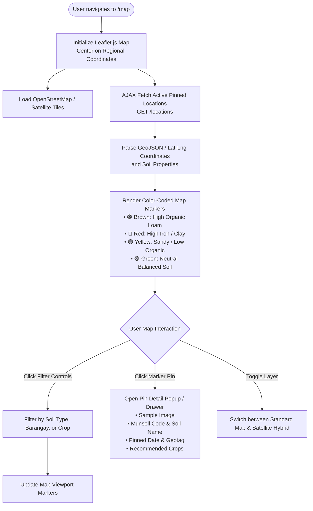
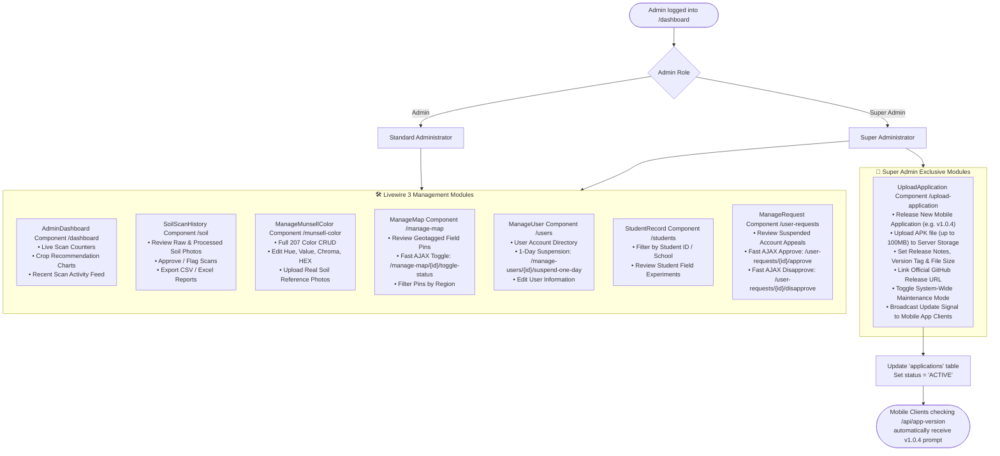

# 🌐 AgriCo Website Architecture & Flowcharts

This document provides a comprehensive, end-to-end flowchart guide for the **AgriCo Web Application** (Laravel 11 / Livewire 3 / Blade / Tailwind CSS / Leaflet GIS).

---

## 📑 Table of Contents
1. [Master Website System Flowchart](#1-master-website-system-flowchart)
2. [Public Navigation & Page Journey](#2-public-navigation--page-journey)
3. [Soil Scanning & 6-Stage ML Analysis Pipeline](#3-soil-scanning--6-stage-ml-analysis-pipeline)
4. [User Authentication & Account Lifecycle](#4-user-authentication--account-lifecycle)
5. [Interactive GIS Soil Map Flowchart](#5-interactive-gis-soil-map-flowchart)
6. [Admin & Super Admin Panel (Livewire 3)](#6-admin--super-admin-panel-livewire-3)
7. [Mobile App Download & Distribution Flow](#7-mobile-app-download--distribution-flow)

---

## 1. Master Website System Flowchart

This diagram illustrates the complete structure of the website, mapping visitors, registered users, and administrators to their respective routes, controllers, and services.

```mermaid
flowchart TB
    Visitor([🌐 Web Visitor / User]) --> URL{Requested Route}

    %% Public Routes
    URL -->|GET /| SplashView[Splash Screen\nresources/views/splash.blade.php]
    URL -->|GET /home| HomeController[WebsiteController::home\nresources/views/website/home.blade.php]
    URL -->|GET /scan| ScanController[WebsiteController::scan\nresources/views/website/scan.blade.php]
    URL -->|GET /map| MapController[WebsiteController::map\nresources/views/website/map.blade.php]
    URL -->|GET /munsell| MunsellController[WebsiteController::munsell\nresources/views/website/munsell.blade.php]
    URL -->|GET /training| TrainingController[TrainingController::index\nresources/views/website/training.blade.php]
    URL -->|GET /faq| FAQController[WebsiteController::faq\nresources/views/website/faq.blade.php]
    URL -->|GET /download| DownloadController[WebsiteController::downloadApp\nRedirect to Verified CDN]

    %% Authentication Routes
    URL -->|GET /login| LoginView[UserAuthController::showLoginForm\nresources/views/website/auth/login.blade.php]
    URL -->|GET /register| RegisterView[UserAuthController::showRegisterForm\nresources/views/website/auth/register.blade.php]
    URL -->|GET /forgot-password| ForgotPassView[PasswordResetCodeController\n6-Digit OTP Recovery]

    %% Authenticated User Routes
    URL -->|GET /profile| AuthUserCheck{Auth Guard: web/admin}
    AuthUserCheck -->|Authenticated| ProfileView[WebsiteController::profile\nresources/views/website/profile.blade.php]
    AuthUserCheck -->|Guest| RedirectLogin[Redirect to /login]

    %% Admin Routes
    URL -->|GET /dashboard| AdminGuard{Auth Guard: admin}
    AdminGuard -->|Authorized Admin| AdminSuite[Livewire 3 Admin Suite\nDashboard, Soil, Munsell, Map, Users, Releases]
    AdminGuard -->|Unauthorized| RedirectAdminLogin[Redirect to /login]

    subgraph DataLayer ["💾 Persistence & Storage"]
        MySQL[(MySQL Database\nusers, soil_scans, locations,\nmunsell_colors, applications)]
        DiskStorage[Public Disk Storage\n/storage/scans/, /storage/applications/]
    end

    ScanController <--> DataLayer
    MapController <--> DataLayer
    ProfileView <--> DataLayer
    AdminSuite <--> DataLayer
    DownloadController <--> DiskStorage
```



---

## 2. Public Navigation & Page Journey

User journey across public pages, browsing informational resources, and discovering features.

```mermaid
flowchart TD
    Start([User arrives on AgriCo]) --> Splash[/ Splash Page]
    
    Splash --> Action{Choose Action}
    
    Action -->|Get Started| Home[/home Home Portal]
    Action -->|Direct Scan| Scan[/scan Soil Scanner]
    Action -->|View Soil Map| Map[/map Interactive Map]
    Action -->|View Color Chart| Munsell[/munsell 207-Color Chart]
    Action -->|Get Mobile App| Download[/download Download APK]
    Action -->|Log In| Login[/login Sign In]

    Home --> FeatureCards{Explore Feature}
    FeatureCards -->|Launch Soil Analysis| Scan
    FeatureCards -->|Explore Soil Geotags| Map
    FeatureCards -->|Color Reference| Munsell
    FeatureCards -->|Dataset Training| Training[/training Soil Training Dataset]
    FeatureCards -->|Frequently Asked Questions| FAQ[/faq Knowledge Base]
    FeatureCards -->|Download Android App| Download

    Download --> CDNRedirect[WebsiteController::downloadApp\nStream from CDN] --> DownloadComplete([agrico-app-v1.0.4.apk Downloaded])
```

---

## 3. Soil Scanning & 6-Stage ML Analysis Pipeline

This is the core functional engine of `resources/views/website/scan.blade.php` and `WebsiteController.php`. It demonstrates the full lifecycle: image capture, canvas normalization, 6-stage ML classification, Before/After image rendering, crop matching, fertilizer dosage calculation, and GIS geotagging.

```mermaid
flowchart TD
    StartScan([User enters /scan]) --> SelectSource{Input Mode}

    %% Image Acquisition
    SelectSource -->|Webcam / Live Stream| InitCam[Initialize Camera Stream\nnavigator.mediaDevices.getUserMedia]
    SelectSource -->|Upload Photo| FileUpload[Select Local Soil Image\ninput type='file']

    InitCam --> Viewfinder[Render Live Video Feed\nwith Alignment Bounding Box Reticle]
    Viewfinder --> CaptureBtn[User taps 'Capture Soil']
    CaptureBtn --> ExtractFrame[Draw Frame to Hidden Canvas]
    FileUpload --> ExtractFrame

    %% Computer Vision & Normalization
    subgraph PreProcessing ["🔬 Phase 1: Computer Vision & Color Pre-Processing"]
        ExtractFrame --> CropROI[Crop Center 50% ROI Box\nIsolates sample from background]
        CropROI --> ColorNorm[Apply Lighting & White Balance Normalization\nGray-World Algorithm to D65 Standard]
        ColorNorm --> StitchedBeforeAfter[Generate Before / After Stitched Image\n• Raw Capture (Before)\n• Normalized ROI (After)]
        ColorNorm --> SamplePixels[Extract Dominant RGB, HSV, and Hex Values]
        SamplePixels --> ConvertLab[Convert RGB to CIELAB Color Space\nL*, a*, b* Coordinates]
    end

    %% 6-Stage ML Pipeline
    subgraph MLEngine ["🧠 Phase 2: 6-Stage Machine Learning Determination"]
        ConvertLab --> Stage1[Stage 1: Soil Organic Matter Index\nCalculated from Luminance L* and Chroma]
        Stage1 --> Stage2[Stage 2: Munsell Nearest-Neighbor Search\nEuclidean & CIE76 Delta-E Distance\nagainst 207 Pre-Calibrated Color Chips]
        Stage2 --> Stage3[Stage 3: Soil Texture & Type Classification\nClay, Loam, Sandy Loam, Silt Loam, Clay Loam]
        Stage3 --> Stage4[Stage 4: Nutrient Assessment\nEstimated Nitrogen, Phosphorus, Potassium & pH Range]
        Stage4 --> Stage5[Stage 5: Crop Suitability Matrix\nScore suitability for Corn, Rice, Vegetables, Fruit Trees]
        Stage5 --> Stage6[Stage 6: Fertilizer Formulation\nDosage calculation for Complete 14-14-14, Urea, Organic Compost]
    end

    %% Results Presentation
    subgraph ResultsView ["📊 Phase 3: Results & Analysis Modal"]
        Stage6 --> ShowResults[Render Interactive Result Card\n• Before/After Soil Comparison\n• Matched Munsell Chip & Code (e.g., 10YR 3/3)\n• Soil Texture & pH Level\n• Estimated NPK Gauges\n• Ranked Crops with Match %\n• Fertilizer Dosage Calculator]
    end

    %% Geotagging & Storage
    ShowResults --> GeotagPrompt{Pin Soil Sample to Map?}
    
    GeotagPrompt -->|Yes| RequestGPS[Call navigator.geolocation.getCurrentPosition\nFetch Latitude & Longitude]
    RequestGPS --> SubmitPin[POST /scan/pin\nStore in 'locations' table]
    SubmitPin --> PinSuccess[Pin Added to Interactive Soil Map]

    GeotagPrompt -->|No / Skip| StoreScan[POST /scan/store\nSave Scan Record in 'soil_scans' table]
    PinSuccess --> StoreScan

    StoreScan --> FinishScan([Scan Saved & Archived in User History])
```

---

## 4. User Authentication & Account Lifecycle

Full lifecycle of user authentication, real-time validation, status checks, suspended account appeals, and 6-digit OTP password resets.

```mermaid
flowchart TD
    User([User visits Authentication]) --> AuthRoute{Selected Action}

    %% ------------------- Registration Flow -------------------
    AuthRoute -->|Register| RegPage[/register Registration Page]
    RegPage --> InputEmail[User inputs Email]
    InputEmail --> AjaxCheck[AJAX GET /auth/check-email\nDebounced validation against MySQL]
    AjaxCheck --> EmailTaken{Email Exists?}
    EmailTaken -->|Yes| ShowTakenErr[Display: 'Email is already registered'] --> InputEmail
    EmailTaken -->|No| EnterUserData[Enter Full Name, Student/Farmer ID, Password]
    EnterUserData --> SubmitReg[POST /register]
    SubmitReg --> HashPassword[Bcrypt Password Hash]
    HashPassword --> CreateUserRecord[Create User in 'users' table\nstatus: 'ACTIVE']
    CreateUserRecord --> LoginUser[Establish Session & Redirect to /home]

    %% ------------------- Login Flow -------------------
    AuthRoute -->|Login| LoginPage[/login Login Page]
    LoginPage --> InputCreds[Enter Email & Password]
    InputCreds --> SubmitLogin[POST /login]
    SubmitLogin --> VerifyCreds{Valid Credentials?}
    VerifyCreds -->|No| ShowLoginErr[Display: 'Invalid email or password'] --> LoginPage
    VerifyCreds -->|Yes| AccountStatus{Check 'status' column}
    
    AccountStatus -->|SUSPENDED| SuspendedNotice[Show Account Suspended Modal\nReason: Policy violation or pending review]
    SuspendedNotice --> ReactivateAppeal[User clicks 'Request Reactivation'\nInputs appeal explanation]
    ReactivateAppeal --> SubmitReactivation[POST /account/request-reactivation]
    SubmitReactivation --> AppealQueued([Appeal sent to Admin Panel /user-requests])

    AccountStatus -->|ACTIVE| CheckRole{Role}
    CheckRole -->|Farmer / Student| UserDashboard[Redirect to /home]
    CheckRole -->|Admin / SuperAdmin| AdminDashboard[Redirect to /dashboard]

    %% ------------------- Password Reset Flow -------------------
    AuthRoute -->|Forgot Password| ForgotPage[/forgot-password Page]
    ForgotPage --> EnterResetEmail[Enter Account Email]
    EnterResetEmail --> SendResetCode[POST /forgot-password/send-code]
    SendResetCode --> GenerateOTP[Generate 6-Digit Secure OTP\nSave to 'password_reset_codes' table\nExpire in 15 minutes]
    GenerateOTP --> SendEmail[Email 6-Digit Code to User]
    SendEmail --> VerifyCodePage[/forgot-password/verify-code]
    VerifyCodePage --> InputCode[Enter 6-Digit Code]
    InputCode --> SubmitCode[POST /forgot-password/verify-code]
    SubmitCode --> CodeValid{Code Matches & Not Expired?}
    CodeValid -->|No| ShowCodeErr[Show: 'Invalid or expired code'] --> VerifyCodePage
    CodeValid -->|Yes| ResetForm[/forgot-password/reset Page]
    ResetForm --> EnterNewPass[Enter New Password & Confirmation]
    EnterNewPass --> SubmitNewPass[POST /forgot-password/reset]
    SubmitNewPass --> UpdatePassHash[Update Bcrypt Password in DB]
    UpdatePassHash --> PassSuccess[Redirect to /login with Success Message]
```

---

## 5. Interactive GIS Soil Map Flowchart

Operation of the Leaflet-powered GIS mapping interface at `/map`.



---

## 6. Admin & Super Admin Panel (Livewire 3)

The internal administration architecture built using Laravel Livewire 3 real-time components.



---

## 7. Mobile App Download & Distribution Flow

How the website distributes the Android APK without 404 errors, utilizing both server disk and verified CDN streaming.

```mermaid
flowchart TD
    DownloadClick([User clicks 'Download App' on Website /download]) --> Controller[WebsiteController::downloadApp]

    Controller --> LogDownload[Log Download in 'downloads' table\nUser ID, IP, User Agent, Timestamp]

    LogDownload --> CheckLocalDisk{Local APK exists in\nstorage/app/public/applications/agrico-app-v1.0.4.apk?}

    CheckLocalDisk -->|Yes (Local Server)| StreamLocal[Storage::disk('public')->download\nSet MIME: application/vnd.android.package-archive]
    StreamLocal --> LocalDownloadSuccess([Browser downloads agrico-app-v1.0.4.apk directly])

    CheckLocalDisk -->|No (Cloud / Railway)| ResolveCDN[Call AppVersionController::resolveDirectAssetUrl\nResolves verified GitHub release to Azure Blob CDN]
    ResolveCDN --> RedirectCDN[HTTP 302 Redirect to:\nhttps://release-assets.githubusercontent.com/...]
    RedirectCDN --> CDNDownloadSuccess([Browser downloads agrico-app-v1.0.4.apk with HTTP 200])
```

---

## 8. Summary Table of Website Endpoints & Modules

| Route | Method | Controller / Component | Function / Purpose |
| :--- | :--- | :--- | :--- |
| `/` | `GET` | `splash.blade.php` | Landing splash introduction |
| `/home` | `GET` | `WebsiteController@home` | Public home dashboard & feature highlights |
| `/scan` | `GET` | `WebsiteController@scan` | Soil scanning & 6-stage ML analysis tool |
| `/scan/analyze` | `POST` | `WebsiteController@analyzeScan` | Server-assisted computer vision & color matching |
| `/scan/store` | `POST` | `WebsiteController@storeScan` | Save soil scan to database |
| `/scan/pin` | `POST` | `WebsiteController@pinLocation` | Geotag & pin soil sample to map |
| `/map` | `GET` | `WebsiteController@map` | Interactive Leaflet GIS soil map |
| `/munsell` | `GET` | `WebsiteController@munsell` | 207-color Munsell Soil Color Chart explorer |
| `/training` | `GET` | `TrainingController@index` | Soil ML training dataset & calibration |
| `/faq` | `GET` | `WebsiteController@faq` | Frequently Asked Questions |
| `/download` | `GET` | `WebsiteController@downloadApp` | 1-Tap Android APK download stream |
| `/login` | `GET, POST` | `UserAuthController` | User authentication & role verification |
| `/register` | `GET, POST` | `UserAuthController` | User registration with real-time email check |
| `/auth/check-email` | `GET` | `UserAuthController@checkEmail` | AJAX live email availability verification |
| `/account/request-reactivation` | `POST` | `UserAuthController@requestReactivation` | Suspended account reactivation appeal |
| `/forgot-password/*` | `GET, POST` | `PasswordResetCodeController` | 6-digit OTP password reset workflow |
| `/profile` | `GET, POST` | `WebsiteController` | User profile, scan archive & password change |
| `/dashboard` | `GET` | `AdminDashboard` (Livewire) | Administrative overview & analytics charts |
| `/soil` | `GET` | `SoilScanHistory` (Livewire) | Soil scan moderation & before/after inspection |
| `/munsell-color` | `GET` | `ManageMunsellColor` (Livewire) | CRUD operations for Munsell color database |
| `/manage-map` | `GET` | `ManageMap` (Livewire) | Geotagged pin moderation & status toggles |
| `/users` | `GET` | `ManageUser` (Livewire) | User accounts & 1-day suspension controls |
| `/students` | `GET` | `StudentRecord` (Livewire) | Student directory & field records |
| `/user-requests` | `GET` | `ManageRequest` (Livewire) | Review & approve account reactivation requests |
| `/upload-application` | `GET` | `UploadApplication` (Livewire) | Super Admin mobile app APK release manager |
